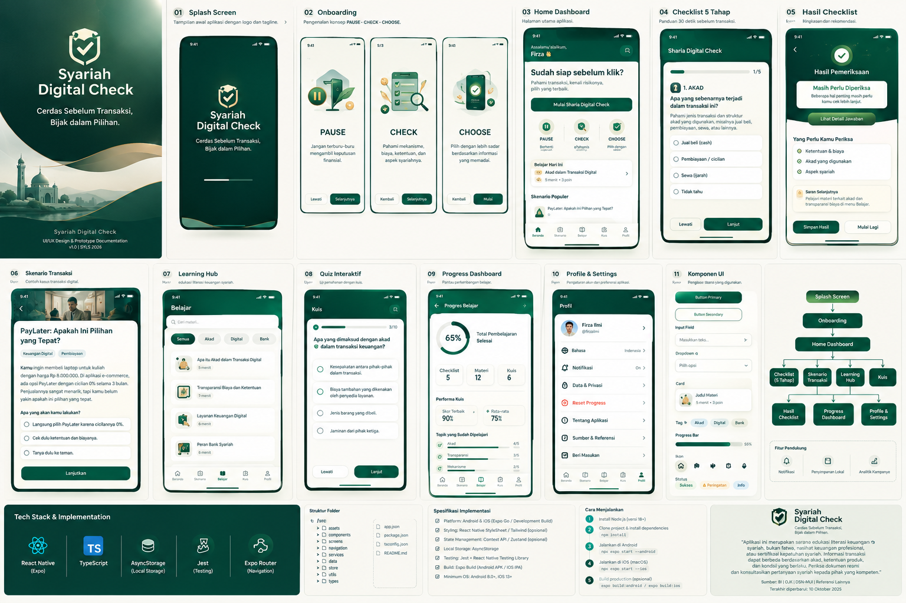

# Syariah Digital Check 🌿✨

<p align="center">
  
</p>

<p align="center">
  <strong>Aplikasi Edukasi & Evaluasi Mandiri Kepatuhan Syariah pada Transaksi Keuangan Digital Modern.</strong>
</p>

<p align="center">
  <a href="https://digitalchecksyariah.vercel.app"></a>
  
  
  
  
</p>

---

## 🌐 Live Web & Mobile Preview
Aplikasi ini sudah dideploy dan dapat diakses langsung secara publik via browser desktop maupun smartphone (iOS Safari / Android Chrome):
👉 **[https://digitalchecksyariah.vercel.app](https://digitalchecksyariah.vercel.app)**

---

## 🌟 Tentang Proyek

**Syariah Digital Check** dirancang untuk membantu masyarakat, praktisi, dan pengguna layanan fintech modern memahami serta mengevaluasi potensi risiko non-syariah (*riba*, *gharar*, *maysir*, dan keabsahan *akad*) dalam aktivitas finansial digital sehari-hari.

Aplikasi ini menggabungkan identitas visual bertema **Emerald & Ivory**, micro-animations interaktif, alur evaluasi komprehensif 5 tahap, studi kasus skenario fintech nyata, serta Learning Hub berbasis fatwa DSN-MUI dan kaidah fiqih muamalah.

---

## 🚀 Fitur Utama

### 1. 📋 5-Stage Syariah Checklist Evaluasi
Sistem checklist bertahap dengan feedback real-time dan indikator risiko:
- **Tahap 1: Akad & Kontrak** — Kejelasan status para pihak, keterbukaan hak dan kewajiban tanpa syarat batil.
- **Tahap 2: Objek Transaksi** — Kehalalan barang/jasa, ketiadaan komoditas terlarang atau fiktif.
- **Tahap 3: Skema Biaya & Denda** — Analisis denda keterlambatan (*ta'zir/ta'widh*), margin keuntungan vs bunga tersembunyi.
- **Tahap 4: Alur Transaksi & Serah Terima** — Validasi mekanisme serah terima (*qabdh* hakiki maupun hukmi).
- **Tahap 5: Dokumen & Bukti Transaksi** — Transparansi *invoice*, persetujuan klausul, dan legalitas.

### 2. 💡 Skenario Transaksi Nyata (Real-world Fintech Scenarios)
Simulasi evaluasi mandiri untuk berbagai skenario populer:
- 💳 **BNPL (Buy Now Pay Later)**
- 🤝 **Peer-to-Peer (P2P) Lending & Crowdfunding**
- 🎁 **E-Wallet Promo, Diskon, & Cashback**
- 🥇 **Investasi Emas & Reksadana Digital**
- 📦 **Model Bisnis Dropshipping & Marketplace**

### 3. 📚 Learning Hub & Ensiklopedia Muamalah
- Pembahasan mendalam: **Riba, Gharar, Maysir, Tadlis, Ikrah**.
- Kompilasi referensi Fatwa Dewan Syariah Nasional MUI (DSN-MUI) dan standar AAOIFI.
- Glosarium istilah akad (*Murabahah, Ijarah, Mudharabah, Musyarakah, Salam, Istishna'*).

### 4. 🧠 Kuis Interaktif & Scoring Dinamis
- Pertanyaan berbasis studi kasus situasional.
- Sistem penilaian skor kepatuhan syariah (*Syariah Compliance Index Score*).
- Penjelasan detail jawaban benar/salah beserta dalil dan argumentasi fiqih.

### 5. 📊 Progres Belajar & Penyimpanan Lokal
- Riwayat skor evaluasi dan kuis tersimpan secara otomatis di memori lokal perangkat (*AsyncStorage / localStorage*).
- Indikator kesiapan dan lencana pencapaian pemahaman literasi syariah.

---

## 🎨 Design System & Palette

| Token | Warna | Kode HEX | Peruntukan |
|---|---|---|---|
| **Emerald Primary** | 🟢 | `#0D9488` / `#065F46` | Brand Identity, Header, Action Buttons |
| **Ivory Background** | 🌾 | `#FDFBF7` / `#F8F6F0` | Canvas, Card Surface, Clean Reading |
| **Gold Accent** | ✨ | `#D97706` / `#F59E0B` | Badges, Skor Unggul, Highlight |
| **Slate Text** | 🖋️ | `#0F172A` / `#334155` | Tipografi Utama dan Keterbacaan |
| **Risk Warning** | ⚠️ | `#EF4444` / `#DC2626` | Indikasi Potensi Riba/Gharar |

---

## 📂 Struktur Repositori

```text
Syariah_Digital_Check_Design_and_Prototype/
├── a_wide_clean_presentation_board_ui_design_mocku.png  # Visual Presentation Board
├── Syariah_Digital_Check_UI_UX_Design_Guide.pdf         # UI/UX Specification & Guidelines
├── Syariah_Digital_Check_Interactive_Prototype.html     # Standalone Interactive Prototype
├── README.md                                            # Main Repository Documentation
└── Digital_Check/                                       # Cross-platform Expo React Native App
    ├── app/                                             # Expo Router Pages & Navigation
    │   ├── (tabs)/                                      # Bottom Tab Navigator (Home, Check, Learn, Quiz, Profile)
    │   ├── checklist.tsx                                # 5-Stage Checklist Evaluator
    │   ├── result.tsx                                   # Comprehensive Compliance Score & Report
    │   ├── scenarios/                                   # Real-world Fintech Case Studies
    │   └── ui-library.tsx                               # Living Component Library
    ├── src/
    │   ├── components/                                  # Modular UI Components (Screen, Cards, Badges, etc.)
    │   ├── data/                                        # Datasets (Checklist, Lessons, Scenarios, Quizzes)
    │   ├── store/                                       # React Context & Reducer State Management
    │   ├── theme/                                       # Typography, Colors, & Spacing Tokens
    │   └── utils/                                       # Scoring Engine, Validations, & Storage Helpers
    ├── assets/                                          # App Icons, Splash Screen, & Brand Assets
    └── package.json                                     # Project Dependencies & Scripts
```

---

## 🛠️ Instalasi & Menjalankan Aplikasi Lokal

Pastikan Anda telah menginstal [Node.js](https://nodejs.org/) (versi 18 ke atas) dan npm.

```bash
# 1. Masuk ke direktori Digital_Check
cd Digital_Check

# 2. Instal seluruh dependensi
npm install

# 3. Jalankan development server Expo
npx expo start
```

Pilihan testing:
- Tekan **`w`** untuk membuka di **Web Browser**.
- Scan QR code menggunakan aplikasi **Expo Go** di **Android** atau **iOS**.

---

## ⚖️ Catatan Disclaimer
Aplikasi ini berfungsi sebagai instrumen edukasi mandiri dan literasi keuangan syariah. Aplikasi ini tidak menggantikan fatwa resmi dari ulama berwenang, tidak menerbitkan sertifikasi halal/syariah formal, dan tidak ditujukan sebagai advis finansial perorangan yang mengikat.

---

<p align="center">
  Dibuat dengan dedikasi untuk kemajuan Literasi Finansial Syariah & Portofolio Digital Berkualitas Tinggi.
</p>
