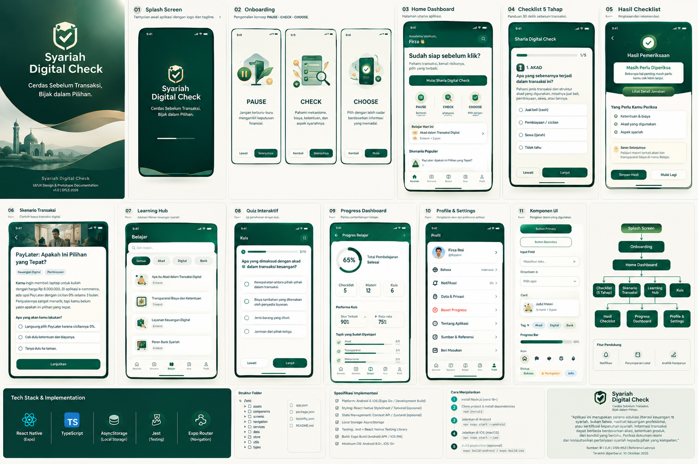

# Syariah Digital Check 🌿✨
> **Tagline:** *"Cerdas Sebelum Transaksi, Bijak dalam Pilihan."*

<p align="center">
  
</p>

<p align="center">
  <strong>Platform Edukasi & Evaluasi Mandiri Kepatuhan Syariah pada Transaksi Finansial Digital Modern Indonesia.</strong>
</p>

<p align="center">
  <a href="https://digitalchecksyariah.vercel.app"></a>
  <a href="SyariahDigitalCheck_iOS/"></a>
  <a href="docs/DESIGN.md"></a>
  <a href="docs/design-audit.md"></a>
  <a href="docs/design-qa-report.md"></a>
  
  
</p>

---

## 🌐 Live Web & Mobile Production
Aplikasi ini sudah live dan dapat diakses langsung secara publik via browser desktop maupun smartphone (iOS Safari / Android Chrome):  
👉 **[https://digitalchecksyariah.vercel.app](https://digitalchecksyariah.vercel.app)**

Dokumentasi lengkap sistem desain, audit, dan jaminan mutu dapat dibaca di:  
- 📄 **[`docs/DESIGN.md`](./docs/DESIGN.md)** (Spesifikasi Desain & Token)  
- 🔍 **[`docs/design-audit.md`](./docs/design-audit.md)** (Temuan Audit Desain & Aksesibilitas)  
- 📋 **[`docs/design-qa-report.md`](./docs/design-qa-report.md)** (Laporan QA & Verifikasi)  
- 📜 **[`docs/session-history.md`](./docs/session-history.md)** (Riwayat Sesi Kerja & Eksekusi)  

---

## 🌟 Filosofi Desain & Arah Visual

Produk ini dirancang dengan standar kualitas fintech peraih penghargaan yang memancarkan ketenangan, kepercayaan, dan keanggunan:
- **Deep Emerald Green (`#064E3B` / `#065F46`):** Warna utama yang merepresentasikan kemakmuran, integritas, dan stabilitas finansial syariah.
- **Warm Ivory (`#FAF8F5`) & Soft Off-White:** Latar kanvas hangat yang ramah bagi mata dan mendukung pembacaan jangka panjang.
- **Muted Sage (`#E7EDE9` / `#1F3529`):** Permukaan sekunder yang lembut untuk hierarki kartu.
- **Champagne Gold (`#C89D42`):** Aksen lencana dan sorotan indikator skor.
- **Forest Charcoal Text (`#0D281E`):** Kontras teks tinggi yang lulus uji aksesibilitas **WCAG AAA**.
- **8-Point Spacing Grid:** Sistem jarak presisi kelipatan 8px dengan sudut kartu 16–28px dan bayangan bertingkat.
- **Custom Crisp SVG Iconography:** Ikon garis bersih dan profesional tanpa emoji kekanak-kanakan atau grafik generik.

---

## 📱 Arsitektur 11 Layar Lengkap

Aplikasi mencakup perjalanan pengguna lengkap 11 layar interaktif:
1. **Welcome & Onboarding (`screenOnboarding`):** Alur 3 tahap **PAUSE → CHECK → CHOOSE** dengan indikator langkah dinamis.
2. **Home Dashboard (`screenHome`):** Sapaan pengguna, tombol aksi cepat, kartu jeda sadar, dan footer informasi publik.
3. **Jeda Sadar 30 Detik (`screenPause`):** Timer hitung mundur interaktif untuk meredam belanja impulsif dan menelaah T&C.
4. **Pilihan Kategori Transaksi (`screenCategorySelect`):** 9 kategori riil (PayLater, Pinjaman Digital, E-commerce, Langganan Otomatis, Emas Digital, Tabungan, Investasi, Donasi, Lainnya).
5. **Checklist Transaksi 5 Dimensi (`screenChecklist`):** Kuesioner spesifik kategori mencakup Akad, Biaya/Riba, Kepemilikan (Qabdh), Sanksi Keterlambatan, dan Kesiapan Keputusan.
6. **Hasil Evaluasi Edukatif 9 Bagian (`screenResult`):** Skor transparansi, status kesesuaian syariah, analisis alur dana vs hak milik, mitigasi risiko, pertanyaan kritis ke CS penyedia, dan rujukan fatwa.
7. **Studi Kasus Transaksi Interaktif (`screenCaseStudies`):** 4 simulasi dilema finansial modern (PayLater 0%, Emas Digital & Qabdh, Dropshipping, Langganan Otomatis) berlabel simulasi fiktif.
8. **Learning Hub & Rujukan Fatwa (`screenLearn`):** Pencarian instan, filter topik, estimasi waktu baca, dan lembar pembaca artikel interaktif (*modal reader*).
9. **Kuis Literasi Syariah (`screenQuiz`):** Bank soal terverifikasi acak dengan umpan balik ilmiah instan untuk tiap pilihan jawaban dan kutipan fatwa DSN-MUI.
10. **Dashboard Progres & Intelijen (`screenProgress`):** Kalkulasi riil Indeks Literasi (0-100), visualisasi 4 pilar kompetensi, dan ringkasan aktivitas.
11. **Profil, Privasi & Tata Kelola Publik (`screenProfile`):** Penyimpanan 100% lokal (*guest-first*), ekspor cadangan data JSON, tombol hapus total permanen, dan tautan dokumen legal.

---

## 💻 Desain Responsif Asli (Native Browser-Responsive Design)

Aplikasi ini 100% menggunakan arsitektur CSS Grid dan Flexbox modern yang merespons ukuran layar peramban secara alami (*native fluid responsive design*) tanpa simulasi frame perangkat atau viewport switcher tiruan:
- **Mobile (390px - 640px):** Navigasi bawah jempol (*thumb-friendly bottom navigation*), tumpukan kartu satu kolom teroptimasi sentuhan.
- **Tablet (641px - 1023px):** Tata letak 2-kolom berimbang dengan keterbacaan tipografi optimal.
- **Laptop & Desktop (1024px - 1440px+):** Navigasi atas lengkap, grid asimetris, dan batas visual lebar terpusat (max 1200px) mencegah kelelahan membaca.

---

## 📂 Struktur Repositori & Sumber Kebenaran (Source of Truth)

```text
Syariah_Digital_Check_Main/
├── index.html                                           # APLIKASI WEB PRODUKSI UTAMA (Single Source of Truth Web)
├── Syariah_Digital_Check_Interactive_Prototype.html     # Salinan berkas mandiri tersinkronisasi
├── _headers                                             # Konfigurasi keamanan CDN (CSP, HSTS Preload, XFO DENY)
├── vercel.json                                          # Konfigurasi perutean & header Vercel CDN
├── sw.js                                                # Service Worker PWA (Cache v2, Stale-While-Revalidate)
├── manifest.json                                        # Web App Manifest PWA (Standalone mobile app)
├── robots.txt & sitemap.xml                             # Optimasi perayapan mesin pencari (SEO)
├── DESIGN_SYSTEM_AND_UX_SPEC.md                         # Spesifikasi token warna WCAG AAA & sistem grid 8-pt
├── README.md                                            # Dokumentasi utama repositori
├── SyariahDigitalCheck_iOS/                             # Paket referensi kode Swift & SwiftUI iOS native
├── Digital_Check/                                       # Basis kode React Native / Expo & Mesin Pengujian Otomatis
│   ├── src/                                             # Modul data, logika skoring, store reducer, dan layanan
│   │   └── services/cloudSync.ts                        # Mesin Rekonsiliasi & Resolusi Konflik Sinkronisasi Cloud
│   └── src/tests/                                       # 12 Test Suites Otomatis (126/126 Tests Passing)
├── supabase/                                            # Infrastruktur Cloud & Skema PostgreSQL (Fase 13)
│   ├── migrations/                                      # Skrip Migrasi DDL Relasional & Kebijakan RLS
│   └── seed.sql                                         # Data Inisialisasi Lingkungan Pengembangan
├── docs/                                                # Dokumentasi Resmi, Audit, dan Tata Kelola
│   ├── PHASE_14_SECURITY_AUDIT.md                       # Audit Keamanan DevSecOps & Evaluasi OWASP Top 10 (Fase 14)
│   ├── PHASE_14_RELIABILITY_REPORT.md                   # Laporan Ketahanan, Degradasi Elegan & Penanganan Galat (Fase 14)
│   ├── PHASE_14_BACKUP_AND_RECOVERY.md                  # Prosedur Cadangan Multi-Lapis & Verifikasi Pemulihan (Fase 14)
│   ├── PHASE_14_INCIDENT_RESPONSE.md                    # Buku Panduan Tanggap Insiden Keamanan & Eskalasi (Fase 14)
│   ├── PHASE_13_BACKEND_ARCHITECTURE.md                 # Arsitektur Hybrid Privacy-First Cloud Infrastructure (Fase 13)
│   ├── PHASE_13_DATABASE_DESIGN.md                      # Desain Relasional Database PostgreSQL & Skema 3NF (Fase 13)
│   ├── PHASE_13_SECURITY_AND_RLS.md                     # Matriks Kebijakan Row Level Security & Minimisasi Data (Fase 13)
│   ├── PHASE_13_CLOUD_SYNC.md                           # Protokol Sinkronisasi & Algoritma Resolusi Konflik (Fase 13)
│   ├── PHASE_13_DEPLOYMENT_GUIDE.md                     # Panduan Provisioning Supabase & Migrasi Database (Fase 13)
│   ├── ENGINEERING_PRINCIPLES.md                        # 12 Prinsip Rekayasa Perangkat Lunak
│   ├── PRODUCTION_READINESS.md                          # Laporan Kesiapan Rilis Produksi
│   ├── PUBLIC_BETA_READINESS.md                         # Laporan Kesiapan Beta Publik (Fase 10)
│   ├── PHASE_10_USER_VALIDATION.md                      # Audit Kognitif & Heuristik Awal (Fase 10)
│   ├── PHASE_10_ACCESSIBILITY_AUDIT.md                  # Audit Aksesibilitas WCAG 2.2 AA (Fase 10)
│   ├── PHASE_11_USER_RESEARCH.md                        # Protokol Riset Pengguna Empiris 4 Kohort (Fase 11)
│   ├── PHASE_11_USABILITY_REPORT.md                     # Laporan Evaluasi Keterpakaian Lengkap (Fase 11)
│   ├── PHASE_11_IMPROVEMENT_BACKLOG.md                  # Backlog Prioritas P0, P1, P2 (Fase 11)
│   ├── PHASE_12_SHARIAH_AUDIT.md                        # Audit Komprehensif Konten Pengetahuan Syariah (Fase 12)
│   ├── PHASE_12_SOURCE_TRACEABILITY.md                  # Matriks Ketertelusuran Rujukan Primer 18 Dokumen (Fase 12)
│   ├── PHASE_12_CONTENT_CORRECTIONS.md                  # Log Koreksi Konten & Presisi Terminologi (Fase 12)
│   ├── PHASE_12_EXPERT_REVIEW_RESULTS.md                # Hasil Validasi Ahli Syariah & Alur Telaah Pakar (Fase 12)
│   ├── DEPLOYMENT_GUIDE.md                              # Panduan Penerapan Multi-Platform
│   ├── USER_GUIDE.md                                    # Panduan Navigasi Pengguna & Instalasi PWA
│   ├── KNOWN_LIMITATIONS.md                             # Transparansi Batasan Yuridis & Teknis
│   ├── RELEASE_NOTES.md                                 # Catatan Rilis Versi 2.5.0
│   ├── SOURCE_REGISTRY.md                               # Registri Rujukan Fatwa DSN-MUI & Regulasi OJK
│   ├── CONTENT_GOVERNANCE.md                            # Standar Redaksional & Kebijakan Verifikasi
│   ├── BACKEND_AND_SYNC_ARCHITECTURE.md                 # Spesifikasi Sinkronisasi Cloud Zero-Knowledge RLS
│   └── PHASE_7_QA_SECURITY_REPORT.md                    # Laporan Komprehensif QA & Keamanan
└── scripts/                                             # Skrip Otomasi Pengujian, Keandalan & Audit
    ├── qa_audit_runner.py                               # Runner Audit Responsivitas, DOM, & Aksesibilitas
    └── verify_backup_recovery.py                        # Verifikator Otomatis Integritas Cadangan & Pemulihan (Fase 14)
```

---

## ⚖️ Batasan Hukum & Edukasi
Aplikasi ini adalah media edukasi mandiri literasi keuangan syariah. Aplikasi ini tidak menggantikan fatwa resmi dari ulama berwenang, tidak menerbitkan sertifikasi kepatuhan syariah, dan bukan merupakan advis finansial atau investasi perorangan.

---

<p align="center">
  Dibuat dengan standar keunggulan Fintech UX & Komitmen Portofolio Bersih.
</p>
