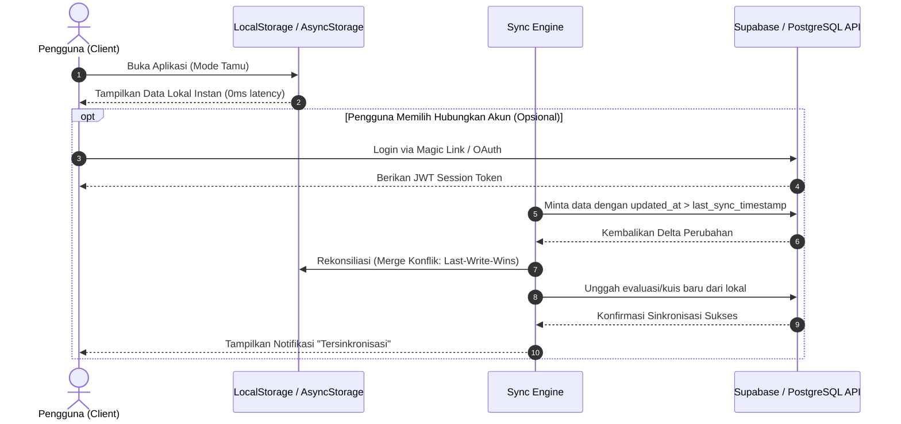

# ARSITEKTUR BACKEND, SINKRONISASI & KEAMANAN DATA
## Syariah Digital Check (Rekomendasi Implementasi & Spesifikasi RLS)

**Versi Dokumen:** 1.0.0  
**Status:** Dokumen Rekomendasi Resmi (Phase 6 Architecture)  
**Prinsip Desain:** *Local-First, Privacy-by-Design, Zero-Knowledge Storage, dan Guest-First Accessibility*

---

## 1. Filosofi Arsitektur: Guest-First & Privacy-Preserving

Syariah Digital Check dirancang dengan pendekatan **Guest-First** (Tamu Didahulukan):
1. **Akses Penuh Tanpa Registrasi**: Pengguna dapat membaca seluruh modul, meneliti studi kasus, mengerjakan kuis, dan memeriksa transaksi tanpa harus membuat akun atau mengisi formulir login.
2. **Penyimpanan Lokal Sebagai Single Source of Truth**: Semua data tersimpan di memori perangkat pengguna (`AsyncStorage` pada mobile, `localStorage` pada web).
3. **Autentikasi Bersifat Opsional**: Akun pengguna **hanya** dibutuhkan jika pengguna menginginkan sinkronisasi lintas perangkat (*cross-device backup & sync*).
4. **Minimisasi Data Mutlak**: Sistem tidak pernah meminta, menerima, maupun menyimpan:
   - Nomor PIN ATM/Mobile Banking
   - Kata Sandi Akun Perbankan / E-Wallet
   - Kode OTP (One-Time Password)
   - 16-Digit Nomor Kartu Debit/Kredit atau CVV
   - Dokumen Rekening Koran Sensitif

---

## 2. Arsitektur Backend yang Direkomendasikan: Supabase / PostgreSQL

Untuk mendukung sinkronisasi lintas perangkat bagi pengguna yang memilih mendaftar secara opsional, platform yang direkomendasikan adalah **Supabase (Managed PostgreSQL)** dengan pertimbangan:
- Native Row Level Security (RLS) pada kernel PostgreSQL.
- Dukungan autentikasi berbasis standar OAuth 2.0 / PKCE dan Magic Link (passwordless).
- SDK TypeScript resmi yang kompatibel dengan React Native / Expo dan Web browser.
- Kepatuhan terhadap prinsip data residency dan enkripsi *at-rest* (AES-256) serta *in-transit* (TLS 1.3).

---

## 3. Skema Basis Data Relasional (DDL)

```sql
-- ============================================================
-- SCHEMA: SYARIAH DIGITAL CHECK CLOUD SYNC ENGINE
-- ============================================================

-- Ekstensi UUID
CREATE EXTENSION IF NOT EXISTS "uuid-ossp";

-- 1. Tabel Profil Pengguna (Sinkronisasi Opsional)
CREATE TABLE public.user_profiles (
    id UUID PRIMARY KEY REFERENCES auth.users(id) ON DELETE CASCADE,
    display_name VARCHAR(50),
    preferred_theme VARCHAR(10) DEFAULT 'system' CHECK (preferred_theme IN ('system', 'light', 'dark')),
    privacy_mode VARCHAR(20) DEFAULT 'local_first' CHECK (privacy_mode IN ('local_first', 'cloud_synced')),
    created_at TIMESTAMPTZ NOT NULL DEFAULT timezone('utc'::text, now()),
    updated_at TIMESTAMPTZ NOT NULL DEFAULT timezone('utc'::text, now())
);

-- 2. Tabel Riwayat Evaluasi Transaksi (Hanya ringkasan kriteria non-sensitif)
CREATE TABLE public.assessment_records (
    id UUID PRIMARY KEY DEFAULT uuid_generate_v4(),
    user_id UUID NOT NULL REFERENCES public.user_profiles(id) ON DELETE CASCADE,
    client_local_id VARCHAR(64) NOT NULL,
    category VARCHAR(32) NOT NULL,
    result_state VARCHAR(20) NOT NULL CHECK (result_state IN ('understood', 'needs_checking', 'not_understood')),
    unresolved_count INT NOT NULL DEFAULT 0,
    answers_summary JSONB NOT NULL,
    clarity_score INT NOT NULL CHECK (clarity_score BETWEEN 0 AND 100),
    evaluated_at TIMESTAMPTZ NOT NULL,
    created_at TIMESTAMPTZ NOT NULL DEFAULT timezone('utc'::text, now()),
    CONSTRAINT uq_user_assessment UNIQUE (user_id, client_local_id)
);

-- 3. Tabel Progres Belajar Modul & Studi Kasus
CREATE TABLE public.learning_progress (
    user_id UUID NOT NULL REFERENCES public.user_profiles(id) ON DELETE CASCADE,
    item_type VARCHAR(16) NOT NULL CHECK (item_type IN ('lesson', 'scenario', 'bookmark')),
    item_id VARCHAR(64) NOT NULL,
    completed_at TIMESTAMPTZ NOT NULL DEFAULT timezone('utc'::text, now()),
    PRIMARY KEY (user_id, item_type, item_id)
);

-- 4. Tabel Riwayat Upaya Kuis
CREATE TABLE public.quiz_history (
    id UUID PRIMARY KEY DEFAULT uuid_generate_v4(),
    user_id UUID NOT NULL REFERENCES public.user_profiles(id) ON DELETE CASCADE,
    client_local_id VARCHAR(64) NOT NULL,
    topic VARCHAR(64) NOT NULL,
    score INT NOT NULL,
    total INT NOT NULL,
    accuracy_percent INT NOT NULL CHECK (accuracy_percent BETWEEN 0 AND 100),
    attempted_at TIMESTAMPTZ NOT NULL,
    created_at TIMESTAMPTZ NOT NULL DEFAULT timezone('utc'::text, now()),
    CONSTRAINT uq_user_quiz UNIQUE (user_id, client_local_id)
);

-- Index performa query per pengguna
CREATE INDEX idx_assessments_user ON public.assessment_records(user_id, evaluated_at DESC);
CREATE INDEX idx_progress_user ON public.learning_progress(user_id);
CREATE INDEX idx_quiz_user ON public.quiz_history(user_id, attempted_at DESC);
```

---

## 4. Kebijakan Row Level Security (RLS)

Untuk menjamin **isolasi data total antar pengguna**, Row Level Security (RLS) diaktifkan secara wajib di setiap tabel:

```sql
-- 1. Aktifkan RLS di seluruh tabel
ALTER TABLE public.user_profiles ENABLE ROW LEVEL SECURITY;
ALTER TABLE public.assessment_records ENABLE ROW LEVEL SECURITY;
ALTER TABLE public.learning_progress ENABLE ROW LEVEL SECURITY;
ALTER TABLE public.quiz_history ENABLE ROW LEVEL SECURITY;

-- 2. RLS user_profiles: Pengguna HANYA dapat membaca dan mengedit profil miliknya sendiri
CREATE POLICY "Users can view own profile" 
    ON public.user_profiles FOR SELECT 
    USING (auth.uid() = id);

CREATE POLICY "Users can update own profile" 
    ON public.user_profiles FOR UPDATE 
    USING (auth.uid() = id);

CREATE POLICY "Users can insert own profile" 
    ON public.user_profiles FOR INSERT 
    WITH CHECK (auth.uid() = id);

-- 3. RLS assessment_records: Isolasi data evaluasi transaksi
CREATE POLICY "Users can view own assessments" 
    ON public.assessment_records FOR SELECT 
    USING (auth.uid() = user_id);

CREATE POLICY "Users can insert own assessments" 
    ON public.assessment_records FOR INSERT 
    WITH CHECK (auth.uid() = user_id);

CREATE POLICY "Users can delete own assessments" 
    ON public.assessment_records FOR DELETE 
    USING (auth.uid() = user_id);

-- 4. RLS learning_progress: Isolasi data progres membaca
CREATE POLICY "Users can view own learning progress" 
    ON public.learning_progress FOR SELECT 
    USING (auth.uid() = user_id);

CREATE POLICY "Users can manage own learning progress" 
    ON public.learning_progress FOR ALL 
    USING (auth.uid() = user_id);

-- 5. RLS quiz_history: Isolasi skor kuis
CREATE POLICY "Users can view own quiz history" 
    ON public.quiz_history FOR SELECT 
    USING (auth.uid() = user_id);

CREATE POLICY "Users can insert own quiz history" 
    ON public.quiz_history FOR INSERT 
    WITH CHECK (auth.uid() = user_id);

CREATE POLICY "Users can delete own quiz history" 
    ON public.quiz_history FOR DELETE 
    USING (auth.uid() = user_id);
```

---

## 5. Protokol Sinkronisasi Lintas Perangkat (Delta Sync Protocol)



### Penanganan Konflik Data (Reconciliation):
- **Lessons & Scenarios**: Operasi himpunan (Union $A \cup B$). Jika suatu modul sudah ditandai selesai di salah satu perangkat, statusnya tetap selesai.
- **Kuis & Evaluasi**: Didasarkan pada `client_local_id` (UUIDv4 acak saat transaksi/kuis dibuat di perangkat lokal). Transaksi dengan ID lokal yang sama tidak akan terduplikasi.
- **Nama Profil**: *Last-Write-Wins* berdasarkan timestamp `updated_at`.

---

## 6. Standar Keamanan & Manajemen Kredensial

1. **Prinsip No Secrets in Frontend**:
   - Hanya kunci `anon_public_key` yang boleh ada pada build client web atau mobile.
   - `service_role_key` (kunci superuser yang melewati RLS) **DILARANG KERAS** disimpan di frontend, git commit, atau variabel lingkungan client.
2. **Penyimpanan Token di Mobile**:
   - Menggunakan `expo-secure-store` pada iOS Keychain dan Android KeyStore.
3. **Penyimpanan Token di Web**:
   - Menggunakan cookie HTTP-Only, Secure, SameSite=Strict bila disajikan via SSR/Proxy API, atau Session Storage dengan proteksi XSS.
4. **Opsi Enkripsi Sisi Klien (Zero-Knowledge Client-Side Encryption)**:
   - Jika pengguna menambahkan catatan pribadi pada riwayat transaksi, catatan tersebut dapat dienkripsi di browser menggunakan Web Crypto API (`AES-GCM-256`) dengan kunci turunan dari passphrase pengguna (`PBKDF2`) sebelum diunggah ke cloud. Server database hanya menyimpan *ciphertext*.

---

## 7. Kesimpulan & Status Kepatuhan

Arsitektur ini memastikan Syariah Digital Check tetap menjunjung tinggi prinsip fiqih muamalah dan perlindungan hak privasi:
- **Bebas Akses**: Tetap 100% fungsional tanpa backend.
- **Aman**: Terisolasi per pengguna saat backend diaktifkan di masa depan.
- **Etis**: Tanpa pengumpulan data finansial sensitif.
