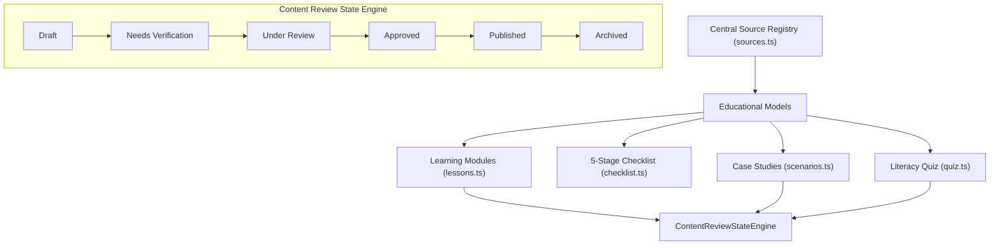

# CONTENT & KNOWLEDGE GOVERNANCE MANUAL
**Product:** Syariah Digital Check  
**Tagline:** *Cerdas Sebelum Transaksi, Bijak dalam Pilihan*  
**Document Version:** 1.0.0  
**Effective Date:** 20 November 2026  
**Target:** Islamic Financial Literacy Knowledge Management System (KMS)  

---

## 1. VISION & GOVERNANCE PRINCIPLES

Syariah Digital Check is built on the foundation of **Tabayyun** (meticulous verification), **Amanah** (trustworthiness), and **Hifzhul Maal** (protection of user wealth). 

Every educational module, interactive case study, checklist question, and quiz item must be strictly traceable to authoritative primary sources:
1. **Fatwa Dewan Syariah Nasional – Majelis Ulama Indonesia (DSN-MUI)**: The recognized authority on Islamic financial rulings in Indonesia.
2. **Peraturan Otoritas Jasa Keuangan (POJK & SEOJK)**: The statutory authority governing financial institutions and fintech lending (LPBBTI).
3. **Peraturan Bank Indonesia (PBI & PADG)**: The central bank authority on payment systems and digital currency.
4. **Peraturan Bappebti (Kementerian Perdagangan)**: The commodity futures regulatory authority governing digital gold trading.

---

## 2. CONTENT ARCHITECTURE & DOMAIN SCHEMAS

Critical educational content is centralized in structured data stores (`Digital_Check/src/data/` and unified with the web runtime) rather than scattered as arbitrary hardcoded UI strings.

### Content Lifecycle Statuses

| Status | Definition | Production Visibility |
|---|---|---|
| **`Draft`** | Newly created content under development by researchers. | Internal development only. |
| **`Needs Verification`** | Content completed but awaiting citation or primary legal document check. | Flagged with warning badge; hidden from standard public feeds. |
| **`Under Review`** | Under formal review by Sharia economics reviewers. | Staging / testing only. |
| **`Approved`** | Verified by reviewers as factually and legally sound. | Eligible for scheduled release. |
| **`Published`** | Live in production; fully verifiable against primary sources. | Publicly accessible across all client platforms. |
| **`Archived`** | Deprecated, superseded by newer fatwa/regulations, or historical only. | Read-only with prominent historical badge. |

> **CRITICAL RULE:** Unverified content (`Draft`, `Needs Verification`, `Under Review`, `Archived`) must **NEVER** be displayed to the public as "Approved" or "Authoritative". Automated unit tests enforce this rule.

---

## 3. STRICT LEGAL & FATWA AUDIT DISTINCTIONS

### A. Distinction: Ta'zir (Sanksi Sosial) vs Ta'widh (Ganti Rugi Riil)
Previous industry implementations frequently conflated Fatwa 43 with sanksi denda keterlambatan. This platform strictly enforces the legal distinction:
- **Fatwa DSN-MUI No. 17/DSN-MUI/IX/2000 (Ta'zir):**
  - Mengatur sanksi denda finansial bagi **nasabah mampu yang sengaja menunda kewajiban bayar**.
  - **Dana denda wajib disalurkan 100% untuk pos dana kebajikan sosial (Qardhul Hasan)**.
  - Lembaga Keuangan Syariah / Fintech dilarang keras mengakui dana sanksi ini sebagai pendapatan atau laba perusahaan.
- **Fatwa DSN-MUI No. 43/DSN-MUI/VIII/2004 (Ta'widh):**
  - Mengatur **ganti rugi riil** atas kerugian operasional yang pasti dialami kreditur akibat wanprestasi nasabah.
  - Nilai ta'widh hanya boleh sebesar *real loss* yang dapat dibuktikan secara akuntansi, **bukan bunga majemuk atau persentase spekulatif**.

### B. Distinction: Murabahah Pokok vs Teknis
- **Fatwa DSN-MUI No. 04/DSN-MUI/IV/2000:** Fatwa fondasi yang menetapkan rukun jual beli murabahah, kewajiban memiliki barang, dan transparansi margin keuntungan.
- **Fatwa DSN-MUI No. 111/DSN-MUI/IX/2017:** Fatwa komprehensif mutakhir yang mengatur pemisahan akad wakalah pendahuluan, uang muka (*urbun*), dan penyelesaian wanprestasi pada transaksi murabahah modern.

### C. Distinction: Emas Digital & Qabdh Hukmi
- **Fatwa DSN-MUI No. 77/DSN-MUI/V/2010:** Menetapkan keabsahan jual beli emas non-tunai selama emas diperlakukan sebagai komoditas (*sil'ah*), harga jual tidak bertambah selama cicilan, dan serah terima yuridis (**Qabdh Hukmi**) sah dengan jaminan 100% fisik emas ada di kustodian.
- **Peraturan Bappebti No. 4 Tahun 2019:** Menjadi dasar hukum regulasi bahwa Lembaga Kliring Berjangka dan Pengelola Tempat Penyimpanan (kustodian) wajib mengalokasikan emas fisik 1:1 terhadap saldo digital nasabah.

### D. Distinction: Regulasi Fintech LPBBTI (POJK 40/2024 vs POJK 10/2022)
- **POJK No. 40 Tahun 2024:** Regulasi LPBBTI terbaru yang **aktif berlaku**. Mengatur tata kelola, manajemen risiko, kewajiban memiliki Dewan Pengawas Syariah (DPS), dan perlindungan hak pengguna.
- **POJK No. 10/POJK.05/2022:** **STATUS: DICABUT dan dinyatakan tidak berlaku** oleh POJK No. 40 Tahun 2024. Dokumen ini hanya dicatat sebagai arsip transparansi historis.
- **SEOJK No. 19/SEOJK.06/2023:** Petunjuk teknis resmi pembatasan manfaat ekonomi (bunga/margin harian) dan pembatasan total biaya/denda maksimal 100% dari pokok pendanaan.

---

## 4. EDITORIAL STANDARDS FOR LEARNING MODULES

Setiap modul edukasi di Syariah Digital Check wajib memenuhi 8 kriteria struktural:
1. **Learning Objectives:** Minimal 2 capaian pembelajaran yang terukur.
2. **Concept Explanation:** Penjelasan konsep fiqih murni tanpa mencampuradukkan opini pribadi.
3. **Applicable Context:** Konteks penerapan pada transaksi digital konsumen (e-commerce, paylater, dompet digital, emas).
4. **Practical Example:** Contoh simulasi riil yang membedakan skema syariah vs skema ribawi.
5. **Relevant Principles:** Kaidah fiqih universal yang menaungi modul tersebut.
6. **Verified References:** Tautan ID sumber resmi yang terdaftar di `SOURCES_BY_ID`.
7. **Important Limitations:** Penegasan batasan bahwa modul ini bukan audit resmi atas produk perbankan tertentu.
8. **Further Reading:** Referensi naskah fatwa atau portal resmi regulator untuk riset mandiri pengguna.

---

## 5. ETHICAL GUARDRAILS

1. **Bukan Pengganti Ulama atau DSN-MUI:**  
   Syariah Digital Check adalah platform pendukung keputusan dan edukasi literasi, bukan lembaga pembuat fatwa. Platform tidak pernah menyatakan diri menggantikan fatwa resmi DSN-MUI.
2. **Larangan Vonis Mutlak Tanpa Dokumen:**  
   Sistem dilarang mengeluarkan vonis mutlak seperti *"Pasti Halal"*, *"Dijamin Halal"*, *"Pasti Haram"*, atau *"Resmi Halal DSN"* terhadap entitas atau produk spesifik tanpa adanya audit naskah akad riil oleh otoritas berwenang.
3. **Framing Kejelasan Informasi:**  
   Hasil evaluasi berfokus pada **Tingkat Transparansi dan Kejelasan Informasi Klausul Transaksi** (*Understood*, *Needs Checking*, *Not Understood*), memberdayakan konsumen untuk bersikap kritis sebelum mengikatkan diri dalam kontrak finansial.
