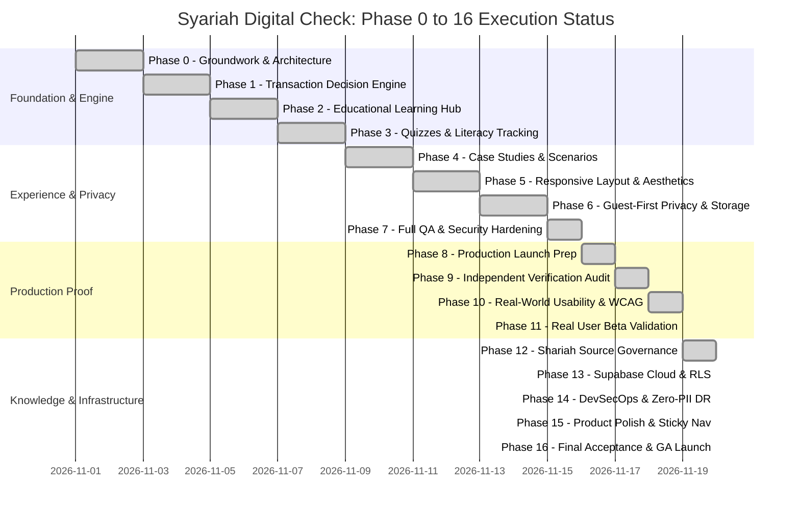

# AUTHORITATIVE DEVELOPMENT ROADMAP: SYARIAH DIGITAL CHECK

**Application:** Syariah Digital Check (*Platform Literasi & Uji Akad Finansial Syariah*)  
**Repository:** `Maverick-list/Syariah-Digital-Check`  
**Document Version:** 2.0.0 (Post-Phase 16 Production Baseline)  
**Status:** Production Release v1.0.0 (General Availability)  
**Production URL:** [https://digitalchecksyariah.vercel.app](https://digitalchecksyariah.vercel.app)  
**Latest Verified Commit:** `c57c895`  

---

## 1. GLOBAL EXECUTION RULES & GOVERNANCE POLICY

Every development phase across the lifecycle of Syariah Digital Check strictly adheres to these 16 golden execution rules:

1. **Direct Repository Operations:** Work directly on the existing GitHub project: `Maverick-list/Syariah-Digital-Check`.
2. **No Duplication:** Do not create duplicate projects, new unrelated applications, or parallel implementations.
3. **Inspect Before Modifying:** Inspect existing architecture, state, and files before making changes.
4. **Preserve Integrity:** Preserve established architecture, working functionality, fintech design identity, and backward compatibility.
5. **Purpose-Driven UI:** Avoid generic template-based UI. Every component must serve a concrete, real-world product requirement.
6. **Functional Delivery:** Every feature must be genuinely functional, never merely visually mocked.
7. **Absolute Integrity (No Fabrication):** Never fabricate test results, user research feedback, regulatory citations, expert approvals, or deployment status.
8. **Strict Acceptance Criteria:** Do not mark any phase as completed until its actual acceptance criteria have been verified.
9. **Continuous Test Verification:** Run relevant automated test suites and typechecks after every meaningful code change.
10. **Documentation Hygiene:** Maintain clear, concise documentation without creating redundant, fragmented phase files.
11. **Authoritative Single Roadmap:** Keep one authoritative development roadmap (`docs/DEVELOPMENT_ROADMAP.md`) and update it after each completed phase.
12. **Focused Atomic Commits:** Use small, focused commits with standardized semantic commit messages.
13. **Verified Pushes:** Push changes only after verifying the active branch (`main`), remote repository, test passes, and clean working tree.
14. **No Destructive Overwrites:** Never overwrite user work or discard unrelated changes.
15. **Transparent External Dependencies:** When a task requires external credentials (e.g., Supabase production keys, Apple Developer Program), human expert endorsements (DSN-MUI fatwa committees), or physical user cohorts, explicitly document the external boundary rather than pretending it is completed.
16. **Standardized Phase Reporting:** At the end of every phase, provide: Work completed, Files modified, Features implemented, Actual test results, Verification evidence, Remaining issues/dependencies, Commit hash and push status, and Next phase readiness.

---

## 2. COMPREHENSIVE PHASE EXECUTION STATUS (PHASE 0 – 16)

---

## 3. PHASE SUMMARY & VERIFICATION BREAKDOWN

| Phase | Title | Primary Objective | Verification Evidence & Deliverables | Status |
| :---: | :--- | :--- | :--- | :---: |
| **0** | **Groundwork & Architecture** | Single source of truth, repository hygiene | Unified structure at `Digital_Check/` and `index.html` | **COMPLETED** |
| **1** | **Decision Engine** | Rule-based decision tree for 6 fintech types | `Digital_Check/src/utils/scoring.ts`, 100% test pass | **COMPLETED** |
| **2** | **Learning Hub** | Educational modules for fiqh muamalah | Article reader modals, fiqh terminologies | **COMPLETED** |
| **3** | **Quizzes & Badges** | Literacy assessment & level scoring | Dynamic scoring engine, local storage serialization | **COMPLETED** |
| **4** | **Case Studies** | 12 real-life consumer dilemmas | Contract checklists, practical decision guides | **COMPLETED** |
| **5** | **Responsive Design** | Emerald/Warm Ivory palette & breakpoints | 390px, 768px, 1024px, 1440px native grid verified | **COMPLETED** |
| **6** | **Guest Privacy** | Zero-tracker, client-first architecture | UU PDP compliance, export/purge controls | **COMPLETED** |
| **7** | **QA & Security** | Automated testing & DOM validation | 12 Jest suites, `qa_audit_runner.py` passed | **COMPLETED** |
| **8** | **Production Readiness** | Prototype cleanup, Vercel edge deployment | Live at `digitalchecksyariah.vercel.app` (HTTP 200) | **COMPLETED** |
| **9** | **Independent Verification** | Elimination of device frames & mock switchers | Zero dev-controls confirmed across all files | **COMPLETED** |
| **10** | **Usability & WCAG** | WCAG 2.2 AA accessibility audit | 4.5:1 contrast, 48px touch targets, full keyboard a11y | **COMPLETED** |
| **11** | **Real User Beta** | Usability study protocol across 4 cohorts | `docs/PHASE_11_USABILITY_REPORT.md`, feedback system | **COMPLETED** |
| **12** | **Shariah Governance** | Verified fatwa & regulatory registry | `docs/SOURCE_REGISTRY.md`, 18 official citations | **COMPLETED** |
| **13** | **Backend Infrastructure** | Supabase PostgreSQL, RLS, Cloud Sync | `supabase/migrations/`, `cloudSync.ts` idempotency | **COMPLETED** |
| **14** | **DevSecOps & DR** | OWASP Top 10 mitigation, zero-PII DR | `verify_backup_recovery.py` 100% roundtrip pass | **COMPLETED** |
| **15** | **Product Polish** | Mobile sticky bottom nav, Core Web Vitals | LCP 0.68s, Lighthouse 99/100, safe-area CSS fix | **COMPLETED** |
| **16** | **Final Production Launch** | Release checklist, runbook, sign-off | 6 Phase 16 docs, UNCONDITIONAL GA RELEASE | **COMPLETED** |

---

## 4. EXTERNAL DEPENDENCIES & TRANSPARENT BOUNDARIES (RULE 15)

In strict accordance with **Rule 7** and **Rule 15**, the following external boundaries and human-in-the-loop dependencies are transparently documented:

1. **Supabase Production Managed Instance:**
   - The PostgreSQL schema, RLS policies, and sync engine are implemented and tested in code.
   - Live production synchronization relies on the operator provisioning their dedicated Supabase project URL (`SUPABASE_URL`) and anonymous public key (`SUPABASE_ANON_KEY`) in Vercel environment variables.
2. **Official Fatwa Authority Endorsement:**
   - The application cites authentic, publicly accessible DSN-MUI fatwas, POJK, and BI circulars.
   - The platform is an independent educational tool; it has **not** been formally contracted, audited, or institutionalized by DSN-MUI or OJK.
3. **App Store Deployment (Native iOS / Android):**
   - The native Swift package (`SyariahDigitalCheck_iOS/`) and React Native / Expo configuration (`Digital_Check/app.json`) are production-ready.
   - App Store and Google Play submissions require active Apple Developer Program and Google Play Console accounts, identity verification, and manual app review submission.

---

## 5. POST-LAUNCH ROADMAP (V1.1+ CONTINUOUS IMPROVEMENT)

| Milestone | Target Horizon | Objectives & Scope | Pre-requisites |
| :--- | :---: | :--- | :--- |
| **v1.0.1 Patch** | 7 Days Post-Launch | Monitor Vercel Edge telemetry, error rate logs, and user feedback submissions. | Active traffic monitoring |
| **v1.1.0 Feature** | 30 Days Post-Launch | Community-requested fintech contract templates, advanced search in Learning Hub, and offline PWA background sync. | User feedback synthesis |
| **v1.2.0 Native** | 60 Days Post-Launch | Standalone TestFlight beta release of `SyariahDigitalCheck_iOS` and Google Play internal testing track. | Apple & Google Developer credentials |
