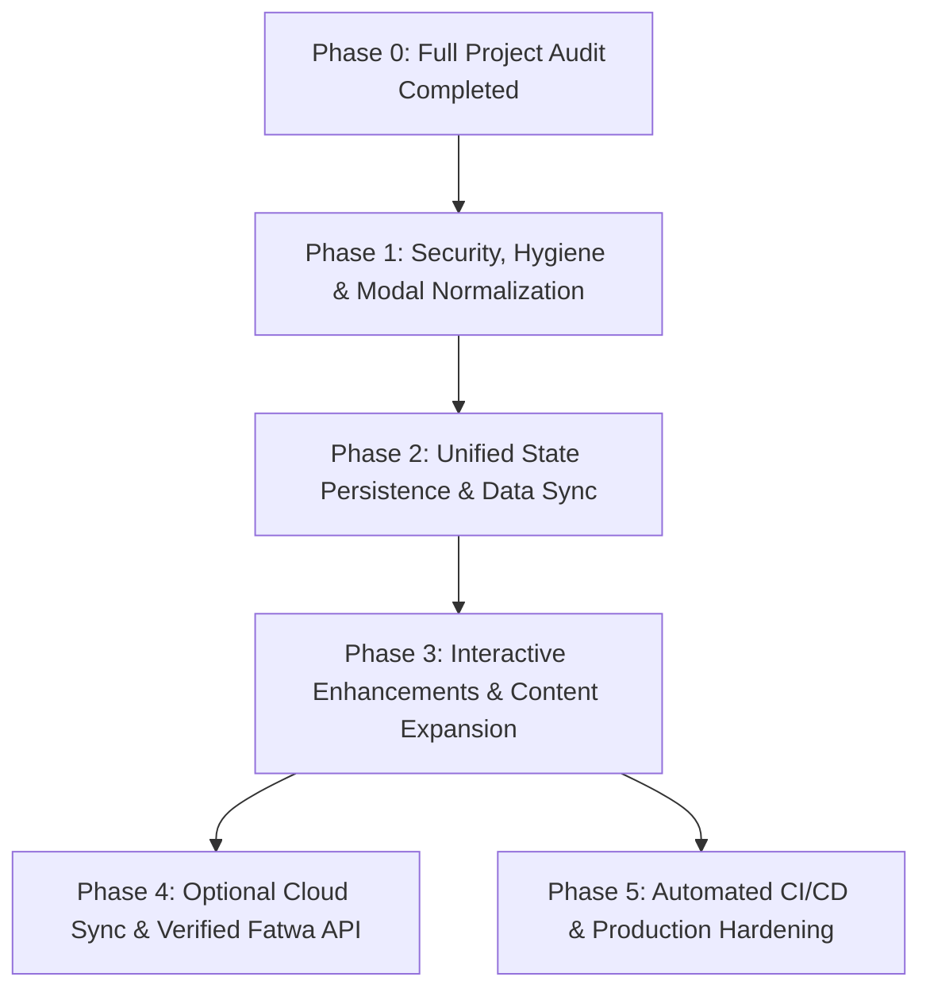

# DEVELOPMENT ROADMAP: SYARIAH DIGITAL CHECK
**Engineering Roadmap & Implementation Plan**  
**Document Version:** 1.0.0  
**Status:** Audit & Strategic Assessment Phase  

---

## 1. STRATEGIC OVERVIEW & DEPENDENCY GRAPH

---

## 2. PHASE-BY-PHASE IMPLEMENTATION PLAN

### PHASE 1 — SECURITY HYGIENE & MODAL NORMALIZATION (Immediate / P0 & P1)
**Goal:** Address dependency vulnerabilities in `Digital_Check/` and resolve modal routing gaps in `index.html`.

1. **Targeted Dependency Upgrades (`Digital_Check/`):**
   - Apply NPM overrides or upgrade packages to eliminate `node-forge` (high) and `zod` (high) vulnerabilities.
   - Run verification via `npm audit` and `npm test` to ensure zero regressions in Expo 58 compatibility.
2. **Dedicated Source References Modal (`modalSourceRef` in Web):**
   - Implement a dedicated modal in `index.html` rendering verified DSN-MUI fatwas, OJK regulations, and Bappebti reference links.
   - Update `openSourceRefModal()` to open `modalSourceRef` rather than redirecting to the Design System modal.
3. **Automated Linter & Code Formatter:**
   - Add ESLint (`eslint.config.js` or `.eslintrc.json`) and Prettier to `Digital_Check/`.
   - Add `"lint": "eslint ."` script to `Digital_Check/package.json`.

---

### PHASE 2 — UNIFIED STATE PERSISTENCE & DATA CONVERGENCE (P1)
**Goal:** Align the persistence capabilities of the Root Web application with the robust schema of `Digital_Check`.

1. **Full LocalStorage State Serialization in Web:**
   - Extend `loadPersistedState()` and `savePersistedState()` in `index.html` to serialize:
     - `checks`: Array of past evaluation records.
     - `lessonsRead`: Array of completed educational module IDs.
     - `quizScore`: Persisted quiz performance.
     - `activeDraft`: In-progress checklist state.
2. **Dynamic Literacy Index Calculation in Web:**
   - Replace static weights in the Web Progress screen with the mathematical formula from `Digital_Check/src/utils/progress.ts`.
3. **Data Normalization:**
   - Ensure lesson IDs, scenario structures, and quiz questions match identically between `index.html` and `Digital_Check/src/data/`.

---

### PHASE 3 — CONTENT EXPANSION & INTERACTIVE ENHANCEMENTS (P2)
**Goal:** Expand Fiqh Muamalah scenarios and enhance decision-support features.

1. **Additional Case Studies & Scenarios:**
   - Introduce scenarios for AI-driven trading bots, staking crypto, and peer-to-peer social crowdfunding.
2. **Dynamic Question Checklist Contextualization:**
   - Adapt checklist stage 3 based on the selected transaction category (e.g., specific Qabdh questions for digital gold vs dropshipping).
3. **Downloadable PDF / Summary Export:**
   - Allow users to export or print their transaction evaluation summary as an elegant, branded PDF report.

---

### PHASE 4 — OPTIONAL CLOUD SYNC & VERIFIED SCHOLARLY API (P3 / Future)
**Goal:** Enable opt-in cross-device synchronization and real-time fatwa database updates without compromising user privacy.

1. **Headless CMS / Fatwa API:**
   - Establish a lightweight, read-only API endpoint providing verified DSN-MUI fatwa metadata and regulatory warnings.
2. **Zero-Knowledge Cloud Backup:**
   - Offer an optional end-to-end encrypted backup of user evaluation history (using anonymous user keys or Passkeys).

---

### PHASE 5 — AUTOMATED CI/CD & PRODUCTION DEPLOYMENT (P2)
**Goal:** Guarantee continuous code quality and streamlined releases across web and app stores.

1. **GitHub Actions Workflow:**
   - Configure a CI pipeline running on every pull request:
     - Root Web: HTML/CSS validation and broken link checking.
     - Expo: `npm test` (Jest), `npm run typecheck` (`tsc --noEmit`), and `npx expo export --platform web`.
2. **Continuous Deployment:**
   - Automated deployment of the root web app to GitHub Pages, Cloudflare Pages, or Vercel on push to `main`.
3. **EAS Build Automation for Mobile:**
   - Configure Expo Application Services (EAS) for automated iOS IPA and Android AAB builds using `Digital_Check/eas.json`.

---

## 3. PRIORITY SUMMARY & ESTIMATED EFFORT

| Phase | Milestone | Priority | Risk Level | Prerequisites |
|---|---|---|---|---|
| **Phase 1** | Security audit fix & dedicated source reference modal | **P0 / P1** | Low | None |
| **Phase 2** | Full LocalStorage sync & unified progress calculation | **P1** | Low | Phase 1 |
| **Phase 3** | Content expansion & PDF evaluation export | **P2** | Low | Phase 2 |
| **Phase 4** | Optional cloud sync & fatwa database API | **P3** | Medium | User consent & backend setup |
| **Phase 5** | GitHub Actions CI/CD & automated web deployment | **P2** | Low | Phase 1 |

> **IMPORTANT NOTICE:**  
> This phase represents the complete Project Audit & Strategic Assessment. No files have been deleted, no application architectures have been dismantled, and no production code has been altered. Development and implementation will proceed upon instruction in the subsequent phase.
