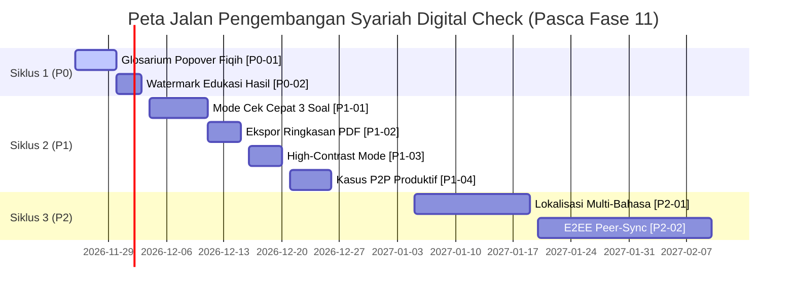

# Backlog Penyempurnaan Produk Berbasis Validasi Pengguna (Fase 11)
**Syariah Digital Check (v2.5.0 Public Beta)**
*Daftar Prioritas Peningkatan Produk (P0, P1, P2) Berdasarkan Temuan Empiris Keterpakaian*

---

## 1. Metodologi Penentuan Prioritas (Prioritization Framework)

Backlog ini disusun berdasarkan masukan langsung dari uji keterpakaian 4 kohort partisipan (Fase 11), dianalisis menggunakan matriks dampak pengguna (*User Impact*) berbanding kompleksitas teknis (*Engineering Effort*):

- **P0 (Kritis / Urgent)**: Hal-hal yang berdampak langsung pada kepercayaan publik, akurasi hukum syariah, atau potensi salah interpretasi fatal oleh pengguna awam.
- **P1 (Penting / High Polish)**: Peningkatan efisiensi navigasi, kemudahan kognitif, dan fitur pendukung yang mempercepat penyelesaian tugas pengguna aktif.
- **P2 (Diharapkan / Future Roadmap)**: Pengembangan fitur tingkat lanjut untuk fase pasca-beta (misal: sinkronisasi multi-perangkat terenkripsi, perluasan kurikulum edukasi).

```mermaid
quadrantChart
    title Matriks Prioritas Peningkatan Syariah Digital Check
    x-axis Kompleksitas Rendah --> Kompleksitas Tinggi
    y-axis Dampak Rendah --> Dampak Tinggi
    quadrant-1 Prioritas P1 (Tinggi / Kompleks)
    quadrant-2 Prioritas P0 (Tinggi / Cepat)
    quadrant-3 Prioritas P2 (Rendah / Cepat)
    quadrant-4 Prioritas P2 (Rendah / Kompleks)
    "Glosarium Fiqih Popover (P0-01)": [0.35, 0.90]
    "Watermark Edukasi Hasil (P0-02)": [0.20, 0.85]
    "Mode Cek Cepat 3 Soal (P1-01)": [0.45, 0.75]
    "Ekspor Ringkasan PDF (P1-02)": [0.40, 0.70]
    "Pilihan Kontras Tinggi (P1-03)": [0.25, 0.65]
    "Studi Kasus P2P Produktif (P1-04)": [0.30, 0.60]
    "Multi-Bahasa Arab-Inggris (P2-01)": [0.85, 0.45]
    "E2E Encrypted Multi-Sync (P2-02)": [0.90, 0.50]
    "Forum Diskusi Terkurasi (P2-03)": [0.80, 0.35]
```

---

## 2. Rincian Item Backlog Prioritas P0 (Kritis untuk Kepercayaan Publik)

### [P0-01] Glosarium Popover Interaktif untuk Istilah Fiqih Muamalah
- **Kohort Sasaran**: Konsumen Awam (K1, K4)
- **Kebutuhan Pengguna / Rasional**: Partisipan non-akademisi merasa terintimidasi oleh kosa kata Arab klasik seperti *Qabdh*, *Shafqatayn*, *Ta'zir*, *Ta'widh*, dan *Ba'i ma la yamlik*. Mereka memerlukan definisi instan satu-ketukan (*tap to view definition*) tanpa harus meninggalkan alur checklist transaksi.
- **Dampak yang Diharapkan**: Menurunkan angka keraguan (*hesitation rate*) pada pertanyaan checklist hingga > 40%.
- **Estimasi Kompleksitas**: Rendah - Sedang (HTML `<abbr>` / popover tooltip ringan tanpa dependensi eksternal).
- **Kriteria Keberterimaan (Acceptance Criteria)**:
  1. Setiap kata fiqih kunci memiliki garis bawah bertitik (*dotted underline*).
  2. Saat disentuh atau didekati kursor, muncul balon penjelasan bahasa Indonesia sehari-hari (maksimal 2 kalimat padat).
  3. Dapat diakses penuh menggunakan tombol keyboard (fokus visual dan atribut `aria-describedby`).

### [P0-02] Penegasan Watermark Edukasi pada Salinan Hasil & Tangkapan Layar
- **Kohort Sasaran**: Seluruh Kohort (K1, K2, K3, K4)
- **Kebutuhan Pengguna / Rasional**: Mencegah pihak tidak bertanggung jawab menggunakan tangkapan layar hasil evaluasi sebagai "bukti kehalalan" atau sertifikasi kepatuhan syariah resmi untuk memasarkan produk pinjaman/investasi.
- **Dampak yang Diharapkan**: Melindungi integritas platform dan mencegah tuntutan regulasi dari OJK / DSN-MUI atas pencatutan status legalitas.
- **Estimasi Kompleksitas**: Rendah (CSS background badge & disclaimer teks pada salinan clipboard).
- **Kriteria Keberterimaan**:
  1. Kartu hasil memuat watermark visual transparan bertuliskan *"HASIL EDUKASI LITERASI — BUKAN SERTIFIKASI RESMI"*.
  2. Fitur salin teks mencantumkan klausul sanggahan otomatis di baris terakhir pesan.

---

## 3. Rincian Item Backlog Prioritas P1 (Penyempurnaan Keterpakaian & Efisiensi)

### [P1-01] Mode Pemeriksaan Cepat (3 Pertanyaan Kunci) vs Mode Komprehensif (5 Dimensi)
- **Kohort Sasaran**: Pengguna Finansial Aktif (K3)
- **Kebutuhan Pengguna / Rasional**: Dalam kondisi terburu-buru (misalnya batas waktu checkout 15 menit promo flash sale), pengguna aktif memerlukan evaluasi kilat terhadap 3 aspek paling berbahaya (Riba bunga tersembunyi, Kejelasan barang, Denda akumulatif) tanpa harus menjawab seluruh 5 dimensi.
- **Dampak yang Diharapkan**: Meningkatkan frekuensi pemeriksaan rutin harian oleh pengguna fintech aktif.
- **Estimasi Kompleksitas**: Sedang (Penambahan opsi switcher mode di awal checklist).
- **Kriteria Keberterimaan**:
  1. Pengguna dapat memilih antara *"Mode Kilat (3 Menit)"* atau *"Mode Lengkap (5 Dimensi)"*.
  2. Hasil mode kilat secara jujur menginformasikan bahwa aspek legalitas sekunder belum dievaluasi.

### [P1-02] Ekspor Ringkasan Hasil Audit dalam Format PDF Ramah Cetak
- **Kohort Sasaran**: Mahasiswa (K2), Pengguna Finansial Aktif (K3)
- **Kebutuhan Pengguna / Rasional**: Pengguna memerlukan bukti rangkuman evaluasi untuk didiskusikan dengan pasangan/keluarga sebelum menyetujui kontrak kredit barang bernilai besar (misal: pembiayaan kendaraan atau modal usaha).
- **Dampak yang Diharapkan**: Memfasilitasi musyawarah keluarga yang sadar syariah.
- **Estimasi Kompleksitas**: Sedang (CSS print stylesheet `@media print` teroptimasi dokumen A4 tanpa tombol interaktif).
- **Kriteria Keberterimaan**:
  1. Tombol *"Cetak / Simpan PDF"* pada Layar Hasil.
  2. Hasil cetak bersih dari bilah navigasi dan tombol aksi, menyajikan dial skor, telaah klausul, dan pertanyaan kritis untuk merchant secara rapi.

### [P1-03] Pengaturan Kontras Visual Tinggi (High-Contrast Mode) untuk Aksesibilitas Rendah
- **Kohort Sasaran**: Konsumen Berliterasi Terbatas & Lansia (K4)
- **Kebutuhan Pengguna / Rasional**: Membantu pengguna dengan penurunan daya penglihatan atau saat membaca di bawah sinar matahari luar ruangan.
- **Dampak yang Diharapkan**: Meningkatkan kenyamanan membaca pada pengguna usia > 45 tahun.
- **Estimasi Kompleksitas**: Rendah (CSS variables override class `.high-contrast`).
- **Kriteria Keberterimaan**:
  1. Switcher kontras tinggi di layar Pengaturan / Profil.
  2. Rasio kontras teks meningkat menjadi minimum 10:1 dengan pembatas kartu lebih kontras.

### [P1-04] Perluasan Koleksi Studi Kasus P2P Lending Produktif vs Konsumtif
- **Kohort Sasaran**: Mahasiswa (K2), Pengguna Finansial Aktif (K3)
- **Kebutuhan Pengguna / Rasional**: Banyak pelaku UMKM muslim bingung membedakan antara pinjaman modal peer-to-peer berbasis bagi hasil (*Mudharabah/Musyarakah*) dengan pinjaman berbunga berkedok syariah.
- **Dampak yang Diharapkan**: Mendukung literasi pembiayaan usaha halal mikro.
- **Estimasi Kompleksitas**: Rendah - Sedang (Penambahan dataset skenario di `categoryCaseStudies`).
- **Kriteria Keberterimaan**:
  1. Tersedia skenario perbandingan P2P produktif vs pinjol konsumtif.
  2. Memuat kutipan Fatwa DSN-MUI No. 117/2018 tentang Layanan Pembiayaan Berbasis Teknologi Informasi.

---

## 4. Rincian Item Backlog Prioritas P2 (Rencana Jangka Panjang / Pasca-Beta)

### [P2-01] Lokalisasi Bahasa Ganda (Bahasa Indonesia & Bahasa Inggris)
- **Kohort Sasaran**: Mahasiswa Internasional, Ekspatriat Muslim di Indonesia
- **Kebutuhan Pengguna / Rasional**: Menyediakan sarana literasi muamalah bagi komunitas muslim asing yang bertransaksi menggunakan platform e-wallet atau fintech lokal Indonesia.
- **Estimasi Kompleksitas**: Tinggi (Pemisahan string kamus bahasa `i18n`).

### [P2-02] Sinkronisasi Multi-Perangkat Terenkripsi Tanpa Akun Sentral (E2EE Peer-Sync)
- **Kohort Sasaran**: Pengguna Multi-Perangkat (K1, K3)
- **Kebutuhan Pengguna / Rasional**: Memindahkan riwayat evaluasi dari ponsel ke laptop tanpa memerlukan database login tersentralisasi yang rentan kebocoran data.
- **Arsitektur Rujukan**: Mengacu pada dokumen `docs/BACKEND_AND_SYNC_ARCHITECTURE.md` (WebRTC P2P atau enkripsi ujung-ke-ujung berbasis Web Crypto API).
- **Estimasi Kompleksitas**: Sangat Tinggi.

### [P2-03] Papan Diskusi & Tanya Komunitas Muamalah Terkurasi
- **Kohort Sasaran**: Seluruh Pengguna
- **Kebutuhan Pengguna / Rasional**: Ruang interaksi publik untuk mendiskusikan aplikasi fintech baru yang belum terdaftar dalam 9 kategori utama.
- **Estimasi Kompleksitas**: Sangat Tinggi (Memerlukan dewan kurator syariah dan sistem moderasi ketat agar terbebas dari hoaks/fatwa liar).

---

## 5. Ringkasan Jadwal Eksekusi Pasca-Beta


