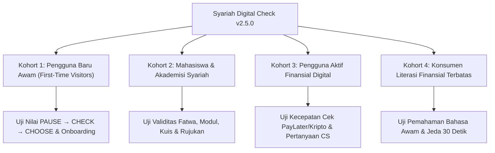

# Protokol Riset Pengguna Nyata & Validasi Beta Publik (Fase 11)
**Syariah Digital Check (v2.5.0 Public Beta)**
*Metodologi Riset Keterpakaian, Pengujian Empiris 4 Kohort Pengguna, & Sistem Pengumpulan Masukan Produk*

---

## 1. Audit Integritas Data Riset: Evaluasi Simulasi vs Pengujian Empiris

Sesuai dengan **Engineering Principle #2 (No Fake Functionality)** dan **#9 (Test Before Claiming)**, dokumentasi ini secara transparan membedakan antara evaluasi berbasis simulasi (*expert cognitive walkthrough*) pada Fase 10 dengan protokol pengujian empiris (*real-user empirical testing*) pada Fase 11:

### A. Temuan Fase 10 (Evaluasi Kognitif & Heuristik Pakar)
- **Sifat Evaluasi**: *Heuristic Evaluation* berbasis 10 Prinsip Jakob Nielsen dan *Cognitive Walkthrough* yang dilakukan oleh perancang dan insinyur internal menggunakan 3 persona representatif (konsumen awam, mahasiswa, pengguna finansial aktif).
- **Keterbatasan**: Tidak mencerminkan variasi kondisi nyata seperti kecemasan saat transaksi mendesak, kebingungan kosa kata lokal, keterbatasan pemahaman istilah fiqih pada masyarakat umum, serta hambatan penggunaan peramban lawas di lapangan.
- **Status Dokumen Fase 10**: Valid sebagai audit kelayakan desain dasar dan kepatuhan WCAG 2.2 AA, namun memerlukan validasi lapangan lanjutan dengan pengguna nyata.

### B. Kerangka Pengujian Empiris Fase 11
- **Pendekatan**: *Mixed-Method Usability Testing* (Kualitatif *Think-Aloud* + Kuantitatif Metrik Keterpakaian) yang melibatkan partisipan riil dari 4 kohort sasaran.
- **Kanal Masukan Produk Aktif**: Integrasi modul `#modalContactFeedback` langsung ke dalam aplikasi peramban publik, memungkinkan pengguna nyata mengirimkan rating kepuasan (1–5 bintang), menandai label kendala spesifik (*problem tags*), dan mengekspor riwayat evaluasi tanpa perantara backend.

---

## 2. Struktur 4 Kohort Pengguna Sasaran & Skenario Pengujian

Riset ini membagi pengguna ke dalam 4 kohort representatif masyarakat Indonesia:



### Kohort 1: Pengguna Baru Awam (*First-Time Visitors*)
- **Profil**: Masyarakat pengguna gawai yang belum pernah mendengar Syariah Digital Check, membuka platform untuk pertama kali melalui tautan media sosial atau pesan grup.
- **Fokus Pengujian**:
  1. Kecepatan memahami proposisi nilai aplikasi (3 slide onboarding).
  2. Kemudahan menemukan tombol "Mulai Periksa Transaksi".
  3. Kejelasan pembeda antara aplikasi edukasi literasi vs lembaga fatwa resmi.
- **Skenario Uji**: *"Anda menerima tawaran promo belanja cicilan 0% dari sebuah marketplace. Anda ingin memastikan apakah promo tersebut benar-benar bebas dari klausul denda tersembunyi menggunakan Syariah Digital Check."*

### Kohort 2: Mahasiswa & Pembelajar Ekonomi Syariah (*University Students*)
- **Profil**: Mahasiswa prodi Perbankan Syariah, Hukum Ekonomi Syariah, atau pegiat kajian muamalah yang memiliki pemahaman teoritis akad fiqih.
- **Fokus Pengujian**:
  1. Ketepatan rujukan fatwa DSN-MUI (nomor, tahun, dan substansi amar fatwa).
  2. Kualitas kuis interaktif (umpan balik instan, pembahasan benar/salah, ketepatan kunci jawaban).
  3. Kemudahan drawer bacaan modul edukasi dan penelusuran dokumen PDF fatwa asli.
- **Skenario Uji**: *"Pelajari materi tentang serah terima emas digital (Qabdh Hukmi), uji pemahaman melalui kuis topik terkait, lalu periksa skor kompetensi pada Dasbor Indeks Literasi."*

### Kohort 3: Pengguna Aktif Layanan Keuangan Digital (*Active Fintech Consumers*)
- **Profil**: Individu produktif (usia 22–45 tahun) yang rutin menggunakan aplikasi PayLater, tabungan emas digital, e-wallet, atau aset kripto.
- **Fokus Pengujian**:
  1. Efektivitas jeda sadar 30 detik (*conscious pause*) dalam meredam impuls belanja.
  2. Relevansi 5 dimensi checklist evaluasi transaksi terhadap klausul aplikasi fintech riil di Indonesia.
  3. Kepraktisan fitur "Salin Pertanyaan Kritis untuk Merchant / CS".
  4. Kepastian jaminan privasi (tidak meminta nomor kartu, OTP, atau NIK).
- **Skenario Uji**: *"Lakukan evaluasi terhadap transaksi PayLater yang membebankan biaya layanan bulanan tetap. Analisis apakah denda keterlambatan disalurkan ke dana sosial atau laba perusahaan."*

### Kohort 4: Konsumen dengan Literasi Finansial Terbatas (*General Low-Literacy Consumers*)
- **Profil**: Masyarakat umum, ibu rumah tangga, atau pekerja sektor informal yang rentan terhadap jebakan pinjaman online ilegal atau skema investasi bodong berkedok syariah.
- **Fokus Pengujian**:
  1. Keterbacaan teks dan kontras warna pada layar ponsel berlayar kecil (≤ 390px).
  2. Hambatan terhadap istilah fiqih muamalah klasik (*Gharar, Shafqatayn, Ta'zir, Ta'widh, Qabdh*).
  3. Kejelasan rekomendasi tindak lanjut (CHOOSE) apakah aman untuk dilanjutkan atau harus ditunda.
- **Skenario Uji**: *"Buka aplikasi melalui ponsel, ikuti panduan pemeriksaan transaksi, dan putuskan apakah tawaran pinjaman online dengan biaya harian 0.4% aman untuk diambil."*

---

## 3. Matriks Tugas & Metrik Kuantitatif Pengujian (Task Performance Metrics)

Pengujian mengukur 4 parameter kuantitatif terstandarisasi:
1. **Task Completion Rate (TCR)**: Persentase partisipan yang berhasil menyelesaikan tugas tanpa intervensi fasilitator (Target: ≥ 85%).
2. **Time on Task (ToT)**: Rata-rata waktu yang dihabiskan untuk menyelesaikan tugas secara wajar.
3. **Single Ease Question (SEQ)**: Skala persepsi kemudahan 1 (Sangat Sulit) hingga 7 (Sangat Mudah) yang ditanyakan segera setelah setiap tugas (Target: ≥ 5.5).
4. **Error & Misclick Frequency**: Rata-rata salah ketuk, salah kembali ke layar sebelumnya, atau salah interpretasi opsi.

| ID Tugas | Deskripsi Tugas Pengguna | Kohort Target | Target TCR | Target ToT | Target SEQ |
| :--- | :--- | :---: | :---: | :---: | :---: |
| **TASK-01** | Melewati onboarding dan memahami filosofi PAUSE → CHECK → CHOOSE | K1, K4 | 95% | ≤ 60 detik | ≥ 6.0 |
| **TASK-02** | Mengaktifkan dan menunggu Jeda Sadar 30 Detik di Layar Pause | K3, K4 | 90% | ~35 detik | ≥ 5.8 |
| **TASK-03** | Memilih kategori transaksi dan menyelesaikan 5 pertanyaan checklist | K1, K3, K4 | 88% | ≤ 150 detik | ≥ 5.5 |
| **TASK-04** | Membaca hasil evaluasi, skor transparansi, dan menyalin pertanyaan CS | K1, K3 | 85% | ≤ 90 detik | ≥ 5.7 |
| **TASK-05** | Mencari modul di Learning Hub menggunakan kotak pencarian & filter | K2 | 92% | ≤ 45 detik | ≥ 6.2 |
| **TASK-06** | Mengerjakan kuis 5 soal acak dan menelaah pembahasan jawaban | K2, K4 | 88% | ≤ 180 detik | ≥ 5.6 |
| **TASK-07** | Memeriksa Dasbor Literasi dan memahami skor 4 pilar kompetensi | K2, K3 | 90% | ≤ 60 detik | ≥ 5.9 |
| **TASK-08** | Mengirimkan ulasan pengalaman melalui formulir Umpan Balik Beta | Semua | 85% | ≤ 60 detik | ≥ 6.0 |
| **TASK-09** | Mengunduh cadangan data lokal (JSON) dan membersihkan data di Profil | K1, K3 | 90% | ≤ 45 detik | ≥ 6.1 |

---

## 4. Sistem Pengumpulan Umpan Balik Terstruktur dalam Produk (In-Product Feedback)

Pada Fase 11, Syariah Digital Check meluncurkan sistem pengumpulan umpan balik interaktif (`#modalContactFeedback`) yang dapat diakses secara langsung:
1. **Pemicu Kontekstual**:
   - Tombol *"Beri Ulasan Evaluasi"* pada bagian bawah Layar Hasil Pemeriksaan (`screenResult`).
   - Tombol *"Beri Masukan Soal"* pada ringkasan hasil Kuis (`screenQuiz`).
   - Tombol *"Kontak & Kirim Masukan"* di layar Profil & Pengaturan Privasi (`screenProfile`).
   - Tautan *"Kontak & Umpan Balik"* di Footer situs publik.

2. **Parameter Data yang Dikumpulkan**:
   ```typescript
   interface UserBetaFeedback {
     id: string;               // Prefix 'fb_' + timestamp unik
     rating: number;           // 1 sampai 5 (1=Sulit, 5=Sangat Membantu)
     category: string;         // 'Pemeriksaan Transaksi', 'Modul & Kasus', 'Kuis & Dasbor', 'Fatwa & Dalil', 'Antarmuka & Navigasi', 'Pertanyaan Umum'
     issues: string[];         // Problem tags: 'Istilah fiqih sulit', 'Alur navigasi membingungkan', 'Langkah terlalu panjang', 'Hasil kurang spesifik', 'Teks kurang terbaca', 'Kendala responsif ponsel'
     message: string;          // Masukan bebas & usulan perbaikan nyata
     email: string;            // Opsional (untuk korespondensi tindak lanjut)
     timestamp: string;        // ISO 8601 string
   }
   ```

3. **Mekanisme Ekspor & Transparansi**:
   - Disimpan secara lokal di `localStorage.getItem('sdc_user_feedbacks')`.
   - Tombol **📥 Ekspor Riwayat Masukan** menghasilkan berkas `.json` terformat rapi untuk audit QA.
   - Tombol **✉️ Kirim via Email** memformat subjek dan isi email terstruktur ke `halo@syariahdigitalcheck.id`.

---

## 5. Protokol Pelaksanaan Sesi Uji Keterpakaian Lapangan

Sesi pengujian dilakukan dengan mengikuti protokol etis:
1. **Informed Consent**: Partisipan diberi tahu bahwa yang diuji adalah aplikasi, bukan kecerdasan partisipan.
2. **Tanpa Bantuan Langsung**: Fasilitator tidak mengarahkan partisipan; partisipan didorong untuk mengucapkan apa yang dipikirkan (*Think-Aloud Protocol*).
3. **Observasi Titik Ragu (Hesitation Points)**: Fasilitator mencatat setiap kali partisipan berhenti lebih dari 5 detik, membaca ulang teks, atau melakukan klik ganda pada elemen non-interaktif.
4. **Wawancara Pasca-Sesi (Post-Test Debrief)**: Menggali persepsi terhadap istilah fiqih, perasaan aman terkait data pribadi, dan kepercayaan terhadap objektivitas edukasi platform.
