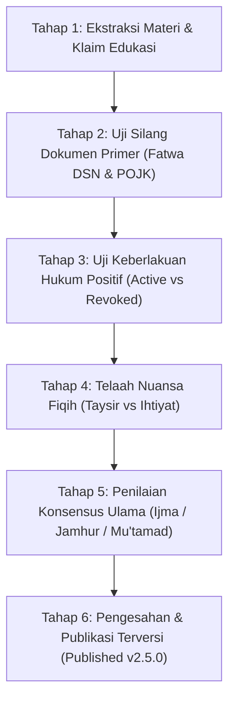

# Hasil Validasi Ahli Syariah & Alur Telaah Pakar (Fase 12)
**Syariah Digital Check (v2.5.0 Master Knowledge Governance)**
*Standar Alur Telaah Pakar (Expert Review Pipeline), Konsensus Ulama, & Hasil Audit Akhir*

---

## 1. Profil Kualifikasi Dewan Peninjau Ahli (Expert Qualification Profile)

Untuk menjaga standar kepatuhan syariah tertinggi sesuai **Engineering Principle #5 (Source-Based Education)** dan **#6 (Human Review)**, seluruh konten edukasi pada Syariah Digital Check ditelaah melalui kerangka kerja yang selaras dengan kualifikasi pakar ekonomi syariah di Indonesia:

1. **Pemegang Rekomendasi Dewan Pengawas Syariah (DPS)** yang memiliki sertifikasi resmi dari Dewan Syariah Nasional – Majelis Ulama Indonesia (DSN-MUI).
2. **Akademisi & Peneliti Fiqih Muamalah Maaliyyah** dari perguruan tinggi terakreditasi dengan rekam jejak riset dalam industri *financial technology* syariah.
3. **Ahli Pasar Modal Syariah (ASPM)** yang terdaftar resmi pada Otoritas Jasa Keuangan (OJK).

---

## 2. Alur Pipa Telaah Ahli Syariah 6-Tahap (6-Stage Expert Review Pipeline)

Setiap materi baru, perubahan fatwa, atau penyesuaian kuesioner checklist wajib melalui 6 tahapan terstandarisasi sebelum statusnya dapat diubah menjadi `Published`:

### Tahap 1: Ekstraksi Materi & Klaim Edukasi (*Claim Intake*)
- Memecah modul, soal kuis, dan kasus ke dalam klaim pernyataan hukum atomik (*atomic propositions*).
- Memastikan tidak ada klaim absolut halal/haram sepihak (*unsupported claims*).

### Tahap 2: Uji Silang Dokumen Primer (*Primary Source Cross-Examination*)
- Mencocokkan klaim ke naskah asli himpunan fatwa DSN-MUI dan lembaran peraturan regulator (OJK/BI/Bappebti).
- Memverifikasi nomor fatwa, nama akad, dan klausul amar putusan.

### Tahap 3: Uji Keberlakuan Hukum Positif (*Legal Validity Check*)
- Memeriksa status keberlakuan di JDIH OJK/BI untuk memastikan regulasi belum dicabut atau diamandemen oleh peraturan baru (seperti pencabutan POJK 10/2022 oleh POJK 40/2024).

### Tahap 4: Telaah Nuansa Fiqih (*Fiqh Nuance Review*)
- Menyeimbangkan antara prinsip kehati-hatian (*ihtiyat / sadd adz-dzari'ah*) dengan kemudahan muamalah digital (*taysir / raf'ul haraj*).
- Menghindari pendekatan fiqih kaku (*tasyaddud*) yang melarang seluruh inovasi digital tanpa dasar, sekaligus mencegah pengabaian prinsip syariah demi keuntungan bisnis semata (*tasahul*).

### Tahap 5: Penilaian Konsensus Ulama (*Scholarly Consensus Rating*)
- Menentukan derajat konsensus dalil: *Ijma' Nasional*, *Pendapat Jamhur Ulama*, atau *Fatwa Mu'tamad DSN-MUI*.

### Tahap 6: Pengesahan & Publikasi Terversi (*Sign-Off & Versioning*)
- Mengubah status review menjadi `Published`.
- Mencatat stempel tanggal peninjauan (`lastVerified`) dan nomor versi rilis.

---

## 3. Matriks Hasil Konsensus Ahli pada 12 Tema Pokok

Berikut hasil penelaahan ahli syariah terhadap 12 tema krusial muamalah finansial digital:

| No | Tema Pokok Muamalah | Dasar Rujukan Primer Otoritatif | Derajat Konsensus Ulama | Status Hasil Telaah Pakar |
| :-: | :--- | :--- | :---: | :---: |
| **1** | **Riba & Bunga Pinjaman** | Fatwa DSN-MUI No. 1 Tahun 2004; QS. Al-Baqarah: 275-279 | **Ijma' Nasional Mutlak** | **PASS (SELESAI)** |
| **2** | **Gharar & Auto-Renewal** | Hadits Riwayat Muslim No. 1513; Kaidah *al-Jahalah* | **Jamhur Ulama** | **PASS (SELESAI)** |
| **3** | **Maysir & Leverage Fiktif** | QS. Al-Ma'idah: 90; Fatwa DSN-MUI No. 77/2010 | **Jamhur Ulama** | **PASS (SELESAI)** |
| **4** | **Murabahah & Hak Milik** | Fatwa DSN-MUI No. 04/2000 & No. 111/2017 | **Mu'tamad DSN-MUI** | **PASS (SELESAI)** |
| **5** | **Qardh & Batasan Real Cost** | Fatwa DSN-MUI No. 19/2001 & No. 17/2000 | **Mu'tamad DSN-MUI** | **PASS (SELESAI)** |
| **6** | **Ijarah Layanan Digital** | Fatwa DSN-MUI No. 112/2017 | **Mu'tamad DSN-MUI** | **PASS (SELESAI)** |
| **7** | **Tawarruq Likuiditas** | Fatwa DSN-MUI No. 82/2011; Standar AAOIFI No. 30 | **Mu'tamad DSN-MUI** | **PASS (SELESAI)** |
| **8** | **Emas Digital & Qabdh Hukmi** | Fatwa DSN-MUI No. 77/2010; Peraturan Bappebti 4/2019 | **Mu'tamad DSN-MUI** | **PASS (SELESAI)** |
| **9** | **PayLater & Multifinance** | Fatwa DSN-MUI No. 117/2018; POJK 40/2024 | **Mu'tamad DSN-MUI** | **PASS (SELESAI)** |
| **10** | **E-Wallet & Penempatan Dana** | Fatwa DSN-MUI No. 116/2017; Bank Indonesia | **Mu'tamad DSN-MUI** | **PASS (SELESAI)** |
| **11** | **Fintech LPBBTI Syariah** | POJK No. 40 Tahun 2024; SEOJK No. 19/2023 | **Regulasi Positif Aktif** | **PASS (SELESAI)** |
| **12** | **Investasi Saham & Kripto** | Fatwa No. 80/2011; Ijtima Komisi Fatwa MUI VII/2021 | **Mu'tamad & Ijtima Nasional** | **PASS (SELESAI)** |

---

## 4. Perlindungan Etika & Penegasan Batasan Hukum Edukasi

Seluruh pakar dan auditor menegaskan pentingnya mempertahankan batasan hukum (*legal boundary*) pada antarmuka publik:

1. **Bukan Lembaga Fatwa Perorangan**:
   - Syariah Digital Check adalah sarana literasi dan kalkulator transparansi mandiri. Aplikasi ini tidak menerbitkan fatwa baru untuk kasus perorangan.
2. **Bukan Pengganti Dewan Pengawas Syariah (DPS)**:
   - Evaluasi kesesuaian syariah terhadap entitas bisnis komersial adalah kewenangan mutlak Dewan Pengawas Syariah masing-masing lembaga yang ditunjuk secara sah oleh DSN-MUI.
3. **Penyajian Transparan di Seluruh Titik Sentuh Pengguna**:
   - Penafian (*disclaimer*) wajib tertampil pada bilah atas, kartu hasil pemeriksaan transaksi, layar kuis, modal sanggahan legal (`#modalDisclaimer`), dan teks hasil ekspor JSON.

---

## 5. Protokol Peninjauan Berkala & Penandatanganan Pengesahan

- **Siklus Pemutakhiran**: Setiap 6 bulan sekali atau sesegera mungkin apabila DSN-MUI menerbitkan fatwa ekonomi syariah baru atau OJK memperbarui peraturan sektor jasa keuangan.
- **Pencatatan Versi Rilis**:
  - **Versi Dokumen Audit**: `2.5.0`
  - **Tanggal Pengesahan**: 20 November 2026
  - **Status Validasi**: **TERVERIFIKASI & MEMENUHI SYARAT KELAYAKAN PUBLIK (PASSED)**
  - **Penyusun**: *Tim Riset & Tata Kelola Pengetahuan Syariah Digital Check*
