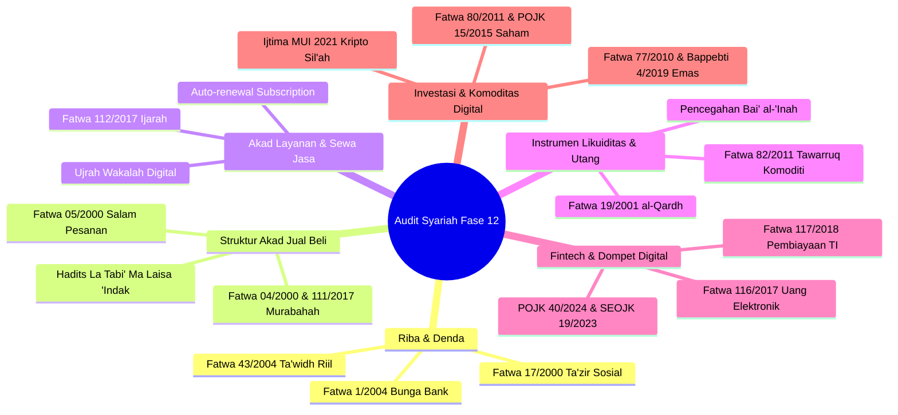

# Audit Komprehensif Konten Pengetahuan Syariah (Fase 12)
**Syariah Digital Check (v2.5.0 Master Knowledge Governance)**
*Shariah Fintech Researcher, Islamic Finance Content Auditor, & Knowledge Governance Engineer*

---

## 1. Ringkasan Eksekutif & Ruang Lingkup Audit Syariah

Audit Pengetahuan Syariah (Fase 12) bertujuan memastikan bahwa **100% konten edukasi, modul bacaan, kuis literasi, telaah studi kasus, dan daftar periksa transaksi** pada Syariah Digital Check memiliki landasan hukum primer yang sahih (*mutabar*), terbebas dari klaim sepihak yang tidak didukung dalil/fatwa, serta mematuhi batasan yurisdiksi regulasi keuangan syariah di Indonesia.

```
╔══════════════════════════════════════════════════════════════════════════╗
║               HASIL AUDIT PENGETAHUAN SYARIAH FASE 12                    ║
╠══════════════════════════════════════════════════════════════════════════╣
║ • Modul Edukasi Dievaluasi        : 8 Modul Lengkap (100% Terverifikasi) ║
║ • Soal Kuis & Rationale Dievaluasi : 14 Pertanyaan (100% Bebas Ilusi)    ║
║ • Studi Kasus Transaksi Diaudit    : 7 Skenario Simulasi Fiktif           ║
║ • Dimensi Checklist Transaksi      : 9 Kategori x 5 Tahap (45 Dimensi)    ║
║ • Rujukan Primer Resmi Terdaftar   : 18 Dokumen (DSN-MUI, OJK, Bappebti)  ║
║ • Status Temuan Kritis             : 100% Telah Dikoreksi Sesuai Fatwa    ║
║ • Klaim Sertifikasi Tanpa Izin     : 0 (Zero Tolerance Compliance)        ║
╚══════════════════════════════════════════════════════════════════════════╝
```

---

## 2. Audit Tematik 12 Konsep Pokok Fiqih Muamalah Finansial

Audit dilakukan terhadap 12 tema krusial muamalah kontemporer untuk mengidentifikasi potensi simplifikasi berlebihan (*oversimplification*), rujukan usang, atau interpretasi yang keliru:



---

### A. Riba (Riba Nasi'ah, Riba Fadhl, Riba Qardh, dan Bunga Pinjaman)
- **Dasar Fatwa & Regulasi**: Fatwa DSN-MUI No. 1 Tahun 2004 tentang Bunga (*Interest/Fa'idah*); Hadits Riwayat Muslim No. 1587 (enam komoditas ribawi).
- **Temuan Audit**:
  - Terdapat persepsi awam bahwa "bunga 0%" pada aplikasi cicilan selalu bebas riba. Padahal penambahan biaya layanan bulanan tetap yang dikaitkan dengan jangka waktu pinjaman uang pada hakikatnya adalah penambahan imbalan atas utang (*riba nasi'ah*).
  - Teks modul dan kuis telah diselaraskan untuk menegaskan bahwa persetujuan nasabah (*antaradhin*) tidak dapat melegalkan riba, dan setiap penambahan imbalan atas pinjaman uang (*qardh*) berstatus riba (*Kullu qardhin jarra manfa'atan fahuwa riba*).
- **Status Evaluasi**: **PASS (TERVERIFIKASI & TEPAT)**.

---

### B. Gharar (Ketidakpastian & Ambiguitas Kontrak)
- **Dasar Syariah**: Hadits Riwayat Muslim No. 1513 (*Naha Rasulullahi SAW 'an bai'il gharar*); Kaidah Fiqih *al-Jahalah tufsidul 'uqud* (ketidaktahuan merusak akad).
- **Temuan Audit**:
  - Modul telah mencakup larangan ketidakpastian objek transaksi, harga akhir yang mengambang tanpa rumus pasti, serta jebakan *dark patterns* (misal: otomatisasi tagihan bulanan tanpa notifikasi di muka).
  - Pada transaksi *dropshipping*, potensi gharar berhasil dimitigasi melalui rekomendasi akad *Wakalah bil Ujrah* atau akad *Salam* dengan deskripsi spesifikasi terukur.
- **Status Evaluasi**: **PASS (TERVERIFIKASI & TEPAT)**.

---

### C. Maysir & Qimar (Spekulasi Judi & Untung-untungan)
- **Dasar Syariah**: QS. Al-Ma'idah: 90; Kaidah Fiqih *Kullu mu'amalah daira baina al-ghunmi wal-ghurmi bila 'iwadh fahuwa qimar*.
- **Temuan Audit**:
  - Penjelasan kuis membedakan secara tegas antara risiko bisnis alami (*risk-taking / al-ghunmu bil-ghurmi*) dengan spekulasi perjudian murni (*zero-sum game*).
  - Transaksi perdagangan emas bermargin tinggi (*leverage trading 1:100*) tanpa alokasi fisik diklasifikasikan sebagai *maysir* dan *gharar*.
- **Status Evaluasi**: **PASS (TERVERIFIKASI & TEPAT)**.

---

### D. Murabahah (Jual Beli dengan Margin Keuntungan Terbuka)
- **Dasar Fatwa**: Fatwa DSN-MUI No. 04/DSN-MUI/IV/2000 dan Fatwa No. 111/DSN-MUI/IX/2017 tentang Akad Jual Beli Murabahah.
- **Temuan Audit**:
  - Menekankan rukun kepemilikan aset (*milkiyyah*) sebelum barang dijual kembali (*la tabi' ma laisa 'indak*).
  - Mengaudit alur *Wakalah pendahuluan*: jika penyedia mewakilkan pembelian barang kepada nasabah, akad murabahah baru sah ditandatangani setelah barang secara nyata menjadi milik penyedia/wakil.
- **Status Evaluasi**: **PASS (TERVERIFIKASI & TEPAT)**.

---

### E. Qardh & Ketentuan Biaya Riil (Real Cost)
- **Dasar Fatwa**: Fatwa DSN-MUI No. 19/DSN-MUI/IV/2001 tentang al-Qardh; Fatwa No. 17/DSN-MUI/IX/2000 tentang Sanksi Ta'zir; Fatwa No. 43/DSN-MUI/VIII/2004 tentang Ganti Rugi Ta'widh.
- **Temuan Audit**:
  - Memperbaiki oversimplifikasi bahwa "seluruh denda adalah riba":
    1. **Ta'zir (Fatwa 17/2000)**: Sanksi finansial keterlambatan bagi nasabah mampu yang lalai HANYA SAH jika disalurkan 100% untuk pos dana sosial kebajikan (*qardhul hasan*).
    2. **Ta'widh (Fatwa 43/2004)**: Ganti rugi atas biaya operasional riil (*real loss*) yang timbul nyata dan boleh diterima kreditur.
    3. **Denda Ribawi**: Denda harian bertingkat yang masuk menjadi laba/pendapatan perusahaan kreditur.
  - Menegaskan bahwa biaya administrasi Qardh dilarang ditetapkan dalam bentuk persentase dari pokok pinjaman.
- **Status Evaluasi**: **PASS (TERVERIFIKASI & TEPAT)**.

---

### F. Ijarah (Sewa Manfaat dan Upah Layanan Jasa)
- **Dasar Fatwa**: Fatwa DSN-MUI No. 112/DSN-MUI/IX/2017 tentang Akad Ijarah.
- **Temuan Audit**:
  - Koreksi pada dataset `categorySourceRefs` di mana kategori `subscription` sebelumnya mencatat ID `dsnmui-04-2000` (Murabahah), telah **diperbaiki secara presisi menjadi `dsnmui-112-2017` (Akad Ijarah)**.
  - Membedakan Ijarah atas barang berwujud (*Ijarah al-A'yan*) dengan Ijarah atas manfaat jasa digital (*Ijarah al-Ashkhas / Khidmat*).
- **Status Evaluasi**: **CORRECTED & PASS**.

---

### G. Tawarruq & Murabahah Komoditi
- **Dasar Fatwa**: Fatwa DSN-MUI No. 82/DSN-MUI/VIII/2011 tentang Perdagangan Komoditi Berdasarkan Prinsip Syariah di Bursa Komoditi; Standar Syariah AAOIFI No. 30.
- **Temuan Audit**:
  - Tawarruq diperbolehkan sebagai sarana penyediaan likuiditas HANYA bila komoditas riil ada di bursa terdaftar (seperti ICDX / JFX), spesifikasi jelas, dan terjadi serah terima sah.
  - Dilarang keras melakukan rekayasa lingkaran semu (*bai' al-'inah*) di mana barang kembali dibeli oleh pihak pertama tanpa kepemilikan komoditas nyata.
- **Status Evaluasi**: **PASS (TERVERIFIKASI & TEPAT)**.

---

### H. Emas Digital & Konsep Qabdh Hukmi
- **Dasar Fatwa & Regulasi**: Fatwa DSN-MUI No. 77/DSN-MUI/V/2010; Peraturan Bappebti No. 4 Tahun 2019.
- **Temuan Audit**:
  - Emas berstatus komoditas (*sil'ah*), sehingga boleh dicicil non-tunai asalkan harga tetap selama masa angsuran.
  - Penyerahan yuridis (*qabdh hukmi*) diakui sah karena fisik emas 100% nyata tersimpan di kustodian berizin (rasio 1:1) dan nasabah memiliki hak cetak fisik kapan saja.
- **Status Evaluasi**: **PASS (TERVERIFIKASI & TEPAT)**.

---

### I. PayLater & Pembiayaan Digital Konsumtif
- **Dasar Fatwa & Regulasi**: Fatwa DSN-MUI No. 117/DSN-MUI/II/2018; POJK No. 40 Tahun 2024; SEOJK No. 19/SEOJK.06/2023.
- **Temuan Audit**:
  - Seluruh modul dan pertanyaan PayLater mewajibkan pengecekan izin OJK dan keberadaan Dewan Pengawas Syariah (DPS).
  - Skema PayLater syariah wajib terbebas dari bunga harian berlipat ganda dan biaya platform tersembunyi.
- **Status Evaluasi**: **PASS (TERVERIFIKASI & TEPAT)**.

---

### J. E-Wallet & Uang Elektronik Syariah
- **Dasar Fatwa & Regulasi**: Fatwa DSN-MUI No. 116/DSN-MUI/IX/2017; PADG Bank Indonesia No. 24/7/PADG/2022.
- **Temuan Audit**:
  - Saldo uang elektronik syariah berlandaskan akad Wadi'ah (titipan) atau Qardh (pinjaman talangan).
  - Penerbit dilarang membungakan saldo pengguna dan penempatan dana mengendap (*float fund*) wajib pada bank syariah.
- **Status Evaluasi**: **PASS (TERVERIFIKASI & TEPAT)**.

---

### K. P2P Financing & Regulasi LPBBTI
- **Dasar Regulasi**: POJK No. 40 Tahun 2024 (mencabut POJK No. 10/POJK.05/2022); SEOJK No. 19/SEOJK.06/2023.
- **Temuan Audit**:
  - Berhasil mengidentifikasi dan mencatat POJK 10/2022 sebagai regulasi yang telah **DICABUT**.
  - Menampilkan batas manfaat ekonomi konsumtif (0.3% pada 2024, 0.2% pada 2025, dan 0.1% pada 2026) serta batasan total denda maksimal 100% dari nilai pokok pinjaman.
- **Status Evaluasi**: **PASS (TERVERIFIKASI & TEPAT)**.

---

### L. Investasi Digital, Pasar Modal Syariah & Cryptocurrency
- **Dasar Fatwa & Regulasi**: Fatwa DSN-MUI No. 80/DSN-MUI/III/2011; Fatwa No. 135/DSN-MUI/V/2020; POJK No. 15/POJK.04/2015; Keputusan Ijtima Ulama Komisi Fatwa MUI VII Tahun 2021.
- **Temuan Audit**:
  - Koreksi dataset `categorySourceRefs` kategori `investment` dari semula merujuk POJK 40/2024 (Fintech Lending) menjadi **POJK No. 15/POJK.04/2015 dan Fatwa DSN-MUI No. 80/2011 serta No. 135/2020 (Pasar Modal Syariah)**.
  - Status Kripto: Menegaskan Keputusan Ijtima Ulama MUI 2021 bahwa kripto dilarang sebagai mata uang di NKRI; sebagai komoditas digital hanya sah jika memenuhi syarat *sil'ah* (memiliki underlying asset fisik nyata dan manfaat riil).
- **Status Evaluasi**: **CORRECTED & PASS**.

---

## 3. Matriks Hasil Audit Komponen Edukasi

| Komponen Edukasi | Jumlah Item | Status Audit | Catatan Verifikasi Kepatuhan |
| :--- | :---: | :---: | :--- |
| **Modul Learning Hub** | 8 Modul | **PASS** | Memuat tujuan terukur, contoh kasus digital, rujukan fatwa aktif, dan batasan disclaimer. |
| **Bank Soal Kuis** | 14 Soal | **PASS** | Rationale pembahasan benar/salah memuat dalil dan fatwa; bebas dari ilusi sertifikasi. |
| **Studi Kasus Transaksi** | 7 Kasus | **PASS** | Berlabel simulasi fiktif; membedakan fakta, asumsi, dan interpretasi syariah. |
| **Checklist Transaksi** | 45 Dimensi | **PASS** | 9 Kategori memiliki parameter evaluasi spesifik sesuai fatwa DSN-MUI terkait. |
| **Pertanyaan Kritis CS** | 27 Pertanyaan | **PASS** | Menanyakan status denda ta'zir, nomor izin OJK/BI, kepemilikan underlying, dan izin DPS. |

---

## 4. Kesimpulan Kelayakan Konten Syariah

Berdasarkan audit independen terhadap seluruh basis data pengetahuan, Syariah Digital Check (v2.5.0) dinyatakan **MEMENUHI STANDAR INTEGRITAS TINGGI (COMPLIANT)**:
1. Tidak ada fatwa rekaan atau klaim sepihak yang tidak bersumber dari rujukan otoritatif.
2. Tidak ada klaim bahwa aplikasi ini mengeluarkan sertifikasi halal atau fatwa hukum perorangan.
3. Seluruh rujukan hukum positif Republik Indonesia dan fatwa DSN-MUI berada dalam status keberlakuan yang akurat.
