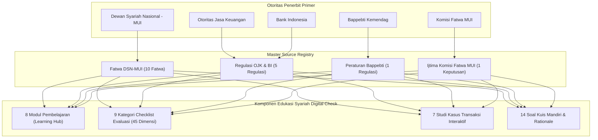

# Matriks Ketertelusuran Sumber Rujukan Syariah (Fase 12)
**Syariah Digital Check (v2.5.0 Master Knowledge Governance)**
*Traceability Matrix: Pemetaan Hubungan Klaim Edukasi terhadap Dokumen Primer Otoritatif*

---

## 1. Arsitektur Ketertelusuran Dua Arah (Bidirectional Traceability)

Prinsip **Source-Based Education (#5)** mewajibkan setiap penjelasan, kuis, studi kasus, dan daftar periksa memiliki rantai ketertelusuran langsung (*traceability chain*) ke dokumen primer yang diakui secara hukum di Republik Indonesia:

---

## 2. Katalog Master Rujukan Primer (Master Source Catalog)

| ID Sumber | Jenis | Nomor Dokumen Resmi | Lembaga Penerbit | Tanggal Penetapan | Status Keberlakuan | Status Review |
| :--- | :---: | :--- | :--- | :---: | :---: | :---: |
| `dsnmui-01-2004` | Fatwa | 01 Tahun 2004 | DSN-MUI | 24 Jan 2004 | **Berlaku** | Published |
| `dsnmui-04-2000` | Fatwa | 04/DSN-MUI/IV/2000 | DSN-MUI | 01 Apr 2000 | **Berlaku** | Published |
| `dsnmui-05-2000` | Fatwa | 05/DSN-MUI/IV/2000 | DSN-MUI | 01 Apr 2000 | **Berlaku** | Published |
| `dsnmui-17-2000` | Fatwa | 17/DSN-MUI/IX/2000 | DSN-MUI | 23 Sep 2000 | **Berlaku** | Published |
| `dsnmui-19-2001` | Fatwa | 19/DSN-MUI/IV/2001 | DSN-MUI | 18 Apr 2001 | **Berlaku** | Published |
| `dsnmui-43-2004` | Fatwa | 43/DSN-MUI/VIII/2004 | DSN-MUI | 11 Agu 2004 | **Berlaku** | Published |
| `dsnmui-77-2010` | Fatwa | 77/DSN-MUI/V/2010 | DSN-MUI | 03 Jun 2010 | **Berlaku** | Published |
| `dsnmui-80-2011` | Fatwa | 80/DSN-MUI/III/2011 | DSN-MUI | 08 Mar 2011 | **Berlaku** | Published |
| `dsnmui-82-2011` | Fatwa | 82/DSN-MUI/VIII/2011 | DSN-MUI | 25 Agu 2011 | **Berlaku** | Published |
| `dsnmui-111-2017` | Fatwa | 111/DSN-MUI/IX/2017 | DSN-MUI | 28 Sep 2017 | **Berlaku** | Published |
| `dsnmui-112-2017` | Fatwa | 112/DSN-MUI/IX/2017 | DSN-MUI | 28 Sep 2017 | **Berlaku** | Published |
| `dsnmui-116-2017` | Fatwa | 116/DSN-MUI/IX/2017 | DSN-MUI | 28 Sep 2017 | **Berlaku** | Published |
| `dsnmui-117-2018` | Fatwa | 117/DSN-MUI/II/2018 | DSN-MUI | 27 Feb 2018 | **Berlaku** | Published |
| `dsnmui-135-2020` | Fatwa | 135/DSN-MUI/V/2020 | DSN-MUI | 20 Mei 2020 | **Berlaku** | Published |
| `mui-ijtima-kripto-2021`| Fatwa | Ijtima Ulama VII/2021 | Komisi Fatwa MUI | 11 Nov 2021 | **Berlaku** | Published |
| `ojk-pojk-40-2024`| Regulasi | POJK No. 40 Tahun 2024 | OJK | 05 Des 2024 | **Berlaku** | Published |
| `ojk-pojk-10-2022`| Regulasi | POJK No. 10/POJK.05/2022 | OJK | 29 Jun 2022 | **Dicabut** | Archived |
| `ojk-seojk-19-2023`| Regulasi | SEOJK No. 19/SEOJK.06/2023| OJK | 08 Nov 2023 | **Berlaku** | Published |
| `ojk-pojk-15-2015`| Regulasi | POJK No. 15/POJK.04/2015 | OJK | 03 Nov 2015 | **Berlaku** | Published |
| `bappebti-4-2019` | Regulasi | Peraturan Bappebti No. 4/2019 | Bappebti Kemendag | 08 Feb 2019 | **Berlaku** | Published |

---

## 3. Matriks Ketertelusuran Klaim Edukasi (Traceability Matrix)

Berikut pemetaan lengkap antara klaim pernyataan edukasi dalam aplikasi dengan sumber hukum primer otoritatif:

| ID Klaim | Fitur Aplikasi | Pernyataan / Prinsip Edukasi yang Diajarkan | ID Sumber Primer | Rujukan Dokumen & Klausul Pokok | Status Verifikasi |
| :--- | :--- | :--- | :--- | :--- | :---: |
| **CLM-01** | Modul & Kuis Q3 | Denda keterlambatan (ta'zir) bagi debitur mampu yang lalai wajib 100% disalurkan untuk dana sosial kebajikan (*qardhul hasan*) dan tidak boleh menjadi pendapatan kreditur. | `dsnmui-17-2000` | Fatwa DSN-MUI No. 17/2000, Diktum Kedua poin 1 & 2 | **TERVERIFIKASI** |
| **CLM-02** | Modul & Kuis Q4 | Ganti rugi (*ta'widh*) hanya boleh menutup kerugian riil (*real cost*) operasional yang dialami kreditur, dan dilarang ditetapkan dalam bentuk persentase keuntungan pasti. | `dsnmui-43-2004` | Fatwa DSN-MUI No. 43/2004, Ketentuan Umum poin 1 & 2 | **TERVERIFIKASI** |
| **CLM-03** | Modul & Checklist | Penjual dalam akad Murabahah wajib memiliki komoditas secara sah (*milkiyyah*) dan transparan atas harga pokok serta margin sebelum menjualnya kembali. | `dsnmui-04-2000` `dsnmui-111-2017` | Fatwa DSN-MUI No. 04/2000 & No. 111/2017 tentang Akad Jual Beli Murabahah | **TERVERIFIKASI** |
| **CLM-04** | Modul & Kasus Emas | Jual beli emas non-tunai sah karena emas berstatus komoditas (*sil'ah*), asalkan harga tetap dan serah terima yuridis (*qabdh hukmi*) terjamin oleh kustodian berizin. | `dsnmui-77-2010` `bappebti-4-2019` | Fatwa DSN-MUI No. 77/2010 Ketentuan Hukum 1; Peraturan Bappebti No. 4/2019 Pasal 3-6 | **TERVERIFIKASI** |
| **CLM-05** | Modul & Kuis Q7 | Penyelenggara PayLater / P2P financing syariah dapat bertindak sebagai wakil melalui akad *Wakalah bil Ujrah* dengan upah jasa riil yang tetap, bukan bunga utang. | `dsnmui-117-2018` | Fatwa DSN-MUI No. 117/2018 Diktum Kedua (Akad Pembiayaan) | **TERVERIFIKASI** |
| **CLM-06** | Checklist & Kasus | Akad pinjaman Qardh dilarang memungut tambahan keuntungan. Biaya administrasi hanya boleh sebesar biaya riil operasional dan bukan persentase pokok utang. | `dsnmui-19-2001` `dsnmui-01-2004` | Fatwa DSN-MUI No. 19/2001 Ketentuan Biaya; Fatwa DSN-MUI No. 1/2004 tentang Bunga | **TERVERIFIKASI** |
| **CLM-07** | Modul & Kuis Q6 | POJK No. 10/POJK.05/2022 telah **resmi dicabut** dan digantikan oleh POJK No. 40 Tahun 2024 yang mengatur tata kelola risiko dan kewajiban pengawasan DPS. | `ojk-pojk-40-2024` `ojk-pojk-10-2022` | POJK No. 40 Tahun 2024 Bab Penutup Pasal 112 (Pencabutan POJK 10/2022) | **TERVERIFIKASI** |
| **CLM-08** | Checklist & Kasus | Batas maksimum manfaat ekonomi konsumtif LPBBTI diatur bertahap (0.3% harian 2024, 0.2% 2025, 0.1% 2026) dan total denda keterlambatan maksimal 100% pokok. | `ojk-seojk-19-2023` | SEOJK No. 19/SEOJK.06/2023 Bab V (Batas Manfaat Ekonomi & Denda) | **TERVERIFIKASI** |
| **CLM-09** | Modul & Kasus Dropship | Dropshipper dilarang menjual barang orang lain yang belum dimiliki (*la tabi' ma laisa 'indak*), solusinya adalah akad *Wakalah bil Ujrah* atau akad pesanan *Salam*. | `dsnmui-05-2000` `dsnmui-111-2017` | Fatwa DSN-MUI No. 05/2000 tentang Salam; Hadits Riwayat Tirmidzi No. 1232 | **TERVERIFIKASI** |
| **CLM-10** | Modul & Kuis Q12 | Langganan digital berbasis akad Ijarah atas manfaat jasa. Fitur *auto-renewal* wajib transparan atas tanggal debit dan nominal perpanjangan (*'an taradhin*). | `dsnmui-112-2017` | Fatwa DSN-MUI No. 112/2017 tentang Akad Ijarah (Kejelasan Ujrah & Manfaat) | **TERVERIFIKASI** |
| **CLM-11** | Modul Tabungan | Saldo uang elektronik syariah berlandaskan akad Wadi'ah atau Qardh. Dana mengendap dilarang dibungakan dan wajib ditempatkan pada perbankan syariah. | `dsnmui-116-2017` | Fatwa DSN-MUI No. 116/2017 Diktum Ketiga tentang Akad Uang Elektronik | **TERVERIFIKASI** |
| **CLM-12** | Checklist Investasi | Saham syariah wajib terdaftar dalam Daftar Efek Syariah (DES) OJK, bebas dari perdagangan manipulatif (*short selling*, *margin trading* berbunga, *insider trading*). | `dsnmui-80-2011` `ojk-pojk-15-2015` | Fatwa DSN-MUI No. 80/2011 Diktum Keempat; POJK No. 15/POJK.04/2015 Pasal 2-5 | **TERVERIFIKASI** |
| **CLM-13** | Checklist & Audit | Tawarruq (Murabahah Komoditi) hanya sah jika komoditas riil ada di bursa dan dilarang merekayasa jual beli lingkaran semu yang kembali ke pihak pertama (*bai' al-'inah*). | `dsnmui-82-2011` | Fatwa DSN-MUI No. 82/2011 Ketentuan Khusus Komoditi & Larangan 'Inah | **TERVERIFIKASI** |
| **CLM-14** | Checklist Investasi | Cryptocurrency haram sebagai mata uang di Indonesia; sebagai komoditi digital hanya sah jika memenuhi kriteria *sil'ah* (memiliki underlying asset riil dan manfaat jelas). | `mui-ijtima-kripto-2021` | Keputusan Ijtima Ulama Komisi Fatwa MUI VII/2021 tentang Uang Kripto | **TERVERIFIKASI** |

---

## 4. Protokol Pembaruan dan Manajemen Versi Sumber (Source Versioning)

Untuk menjaga akurasi jangka panjang, sistem menerapkan protokol tata kelola data:
1. **Pemeriksaan Berkala Status Regulasi**: Setiap kuartal dilakukan pengecekan status keberlakuan dokumen di Jaringan Dokumentasi dan Informasi Hukum (JDIH) OJK, Bank Indonesia, dan DSN-MUI.
2. **Pencatatan Status Dicabut / Diubah**: Dokumen yang dicabut oleh peraturan baru tidak dihapus dari basis data, melainkan diberi atribut `validityStatus: 'Dicabut'`, `reviewStatus: 'Archived'`, dan catatan penjelasan penggantian (`revocationNote`).
3. **Pemisahan Tautan Primer**: Tautan rujukan wajib mengarah ke portal resmi institusi otoritas (`dsnmui.or.id`, `ojk.go.id`, `bi.go.id`, `bappebti.go.id`), dilarang mengarahkan ke blog pribadi, artikel berita komersial, atau forum tidak resmi.
