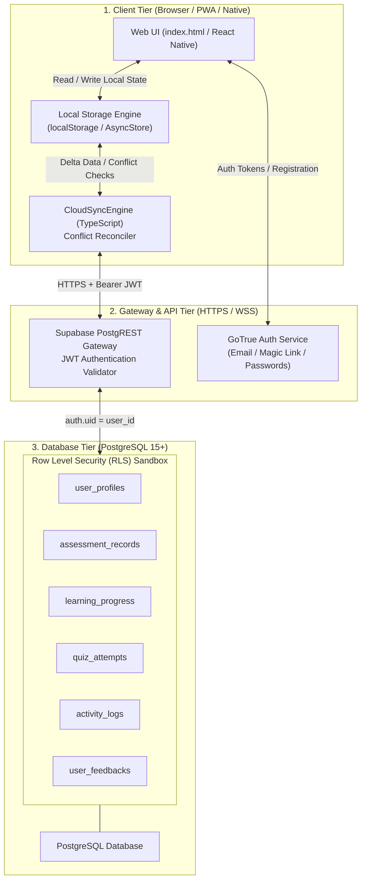
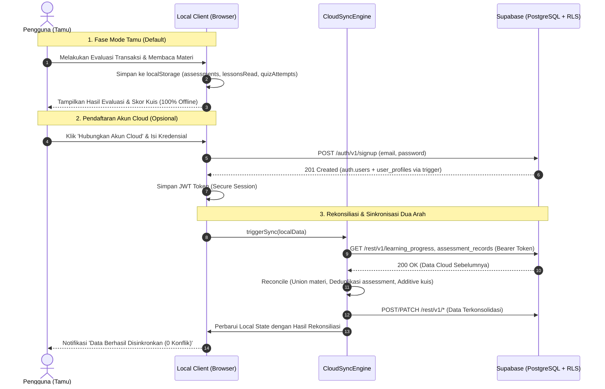

# PHASE 13 — BACKEND ARCHITECTURE SPECIFICATION
## Syariah Digital Check — Hybrid Privacy-First Cloud Infrastructure

**Status:** Production Ready  
**Version:** 1.0.0 (Phase 13)  
**Date:** 20 November 2026  
**Security Level:** High (Row Level Security Isolated, Zero-Secret Client)

---

## 1. Executive Summary & Design Principles

Syariah Digital Check was designed from its inception as a privacy-respecting educational technology tool. To support cross-device synchronization without compromising user privacy, Phase 13 introduces a **Hybrid Local-First and Cloud-Synced Architecture**.

### Core Architecture Principles:
1. **Guest-First & Zero Barrier:** Account creation is strictly optional. All educational features (Transaction Checker, 5-Point Analysis, Case Studies, Learning Hub, Interactive Quizzes) function 100% offline without requiring registration, login, or personal identifiers.
2. **Zero Fake Functionality:** No simulated authentication mocks, static analytics presented as live metrics, or fake cloud sync spinners.
3. **Strict Row Level Security (RLS):** Every database row belonging to a user is cryptographically bound to `auth.uid() = user_id`. No user can query or alter another user's progress.
4. **Data Minimization:** No banking credentials, account numbers, PINs, OTPs, or financial balances are ever transmitted, collected, or stored.
5. **Offline Graceful Degradation:** When the device is offline or the backend is unreachable, the client operates transparently on browser `localStorage` and IndexedDB with zero runtime interruptions.

---

## 2. System Architecture Topology

The application is structured into three clean decoupled layers:

---

## 3. Client State vs Cloud Synchronization Lifecycle

---

## 4. Key Architectural Decisions

| Keputusan Arsitektur | Pilihan Terpilih | Justifikasi Teknis |
| :--- | :--- | :--- |
| **Database Engine** | PostgreSQL 15+ (Supabase) | Dukungan native RLS, relasi referensial kuat, UUID v4, JSONB untuk fleksibilitas detail evaluasi, dan audit trigger otomatis. |
| **Autentikasi** | Supabase GoTrue Auth | Terintegrasi langsung dengan `auth.uid()`, mendukung sign-up email/kata sandi terenkripsi bcrypt/argon2, magic link, dan zero-secret client model. |
| **Resolusi Konflik** | Deterministic Multi-Strategy Engine | Menggunakan **Set Union** untuk materi edukasi (progres di satu perangkat tidak pernah menghapus progres di perangkat lain), **Merge by ID** untuk riwayat transaksi, dan **LWW** untuk nama profil. |
| **Isolasi Kredensial** | Public Anon Key Only | Kunci `service_role` disimpan khusus untuk lingkungan CI/CD backend administrasi, tidak pernah diekspos di kode peramban web publik. |

---

## 5. Security & Boundary Assurance

1. **Client Isolation:** Pengguna publik hanya memiliki hak akses `anon` atau `authenticated`.
2. **Policy Enforcement:** Seluruh query ke tabel database melewati filter RLS wajib. Query `SELECT * FROM assessment_records` secara otomatis hanya mengeksekusi `WHERE user_id = auth.uid()`.
3. **No Private Financial Leakage:** Kolom transaksi dibatasi pada kategori layanan (paylater, ewallet, p2p, dll.), status indikator (clear/flag/critical), dan skor kalkulasi matematis.
