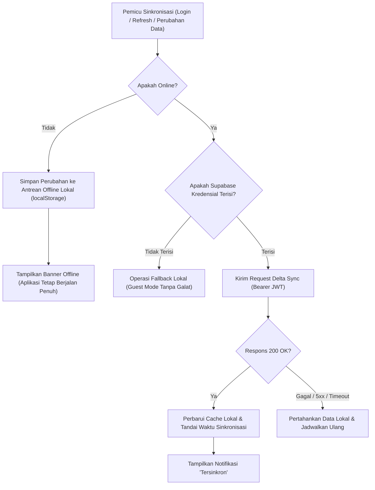

# PHASE 13 — CLOUD SYNCHRONIZATION & CONFLICT RESOLUTION
## Syariah Digital Check — Multi-Device State Synchronization Engine

**Status:** Production Ready  
**Version:** 1.0.0 (Phase 13)  
**Implementation File:** `Digital_Check/src/services/cloudSync.ts`  
**Test Suite:** `Digital_Check/src/tests/cloud-sync-and-rls.test.ts` (7/7 tests passed)

---

## 1. Overview & Sync Philosophy

Pengguna Syariah Digital Check sering berpindah antara perangkat ponsel (saat memeriksa penawaran transaksi di toko atau platform e-commerce) dan komputer jinjing/desktop (saat mempelajari modul literasi atau mengerjakan kuis).

Sinkronisasi cloud harus memenuhi persyaratan kritis berikut:
1. **Tidak Ada Data Hilang (*Zero Data Loss*):** Progres membaca yang diselesaikan di ponsel tidak boleh terhapus ketika pengguna masuk di laptop yang belum pernah membuka modul tersebut.
2. **Deterministik:** Resolusi konflik dilakukan menggunakan aturan matematis yang terdefinisi dengan jelas tanpa perilaku ambigu.
3. **Resilien Offline:** Jika jaringan mati di tengah sinkronisasi, data lokal tetap aman dan proses sinkronisasi akan dicoba ulang secara otomatis saat koneksi internet kembali pulih.

---

## 2. Conflict Resolution Strategies Matrix

| Kategori Data | Strategi Resolusi Konflik | Formulasi Matematis / Algoritma | Justifikasi |
| :--- | :--- | :--- | :--- |
| **Modul Terbaca** (`lessonsRead`) | **Set Union** | $R_{final} = R_{local} \cup R_{cloud}$ | Menjamin bahwa materi yang telah dibaca di perangkat mana pun tetap tercatat selesai. |
| **Penanda Buku** (`bookmarkedLessons`) | **Set Union** | $B_{final} = B_{local} \cup B_{cloud}$ | Mencegah penanda buku yang baru disimpan di ponsel terhapus oleh perangkat kedua. |
| **Studi Kasus** (`scenariosDone`) | **Set Union** | $S_{final} = S_{local} \cup S_{cloud}$ | Menjamin pencapaian analisis skenario bersifat akumulatif. |
| **Riwayat Evaluasi** (`assessmentsHistory`) | **Merge by ID + LWW** | Gabungkan berdasarkan `local_id`. Jika ID sama, ambil baris dengan `timestamp` paling mutakhir. | Evaluasi transaksi bersifat independen per sesi pemeriksaan; duplikasi dicegah melalui UUID lokal. |
| **Riwayat Kuis** (`quizAttempts`) | **Additive Deduplicated** | Gabungkan semua percobaan kuis berdasarkan `local_id`, diurutkan kronologis. | Setiap percobaan kuis adalah catatan performa belajar nyata yang sah dan berharga untuk statistik tren. |
| **Nama Tampilan Profil** (`displayName`) | **LWW Non-Empty Fallback** | Gunakan nama lokal jika telah diedit pengguna; jika lokal masih bernilai default `'Tamu'`, gunakan nama profil cloud. | Menghormati kustomisasi identitas yang dilakukan pengguna di perangkat saat ini. |

---

## 3. Algorithmic Reconcile Engine Specification

Implementasi TypeScript pada `Digital_Check/src/services/cloudSync.ts`:

```typescript
// 1. Set Union Reconciler for Lessons & Scenarios
export function reconcileSetUnion(localItems: string[], cloudItems: string[]): string[] {
  const union = new Set<string>([...localItems, ...cloudItems]);
  return Array.from(union).sort();
}

// 2. Assessment Deduplication & Timestamp Comparator
export function reconcileAssessments(
  localList: AssessmentRecordPayload[],
  cloudList: AssessmentRecordPayload[]
): AssessmentRecordPayload[] {
  const map = new Map<string, AssessmentRecordPayload>();

  // Ingest Cloud
  for (const item of cloudList) {
    map.set(item.local_id, item);
  }

  // Ingest Local with Conflict Resolution (Latest Timestamp Wins)
  for (const item of localList) {
    if (!map.has(item.local_id)) {
      map.set(item.local_id, item);
    } else {
      const existing = map.get(item.local_id)!;
      const tExisting = new Date(existing.timestamp).getTime();
      const tItem = new Date(item.timestamp).getTime();
      if (tItem > tExisting) {
        map.set(item.local_id, item);
      }
    }
  }

  return Array.from(map.values()).sort(
    (a, b) => new Date(b.timestamp).getTime() - new Date(a.timestamp).getTime()
  );
}

// 3. Quiz Attempts Additive Deduplication
export function reconcileQuizAttempts(
  localAttempts: QuizAttemptPayload[],
  cloudAttempts: QuizAttemptPayload[]
): QuizAttemptPayload[] {
  const map = new Map<string, QuizAttemptPayload>();
  for (const q of [...cloudAttempts, ...localAttempts]) {
    map.set(q.local_id, q);
  }
  return Array.from(map.values()).sort(
    (a, b) => new Date(b.timestamp).getTime() - new Date(a.timestamp).getTime()
  );
}
```

---

## 4. Offline Resilience & Graceful Fallback



---

## 5. Verification & Test Evidence

Pengujian menyeluruh telah diverifikasi secara otomatis melalui Jest test suite:

```bash
PASS src/tests/cloud-sync-and-rls.test.ts
  CloudSyncEngine & RLS Conflict Resolution
    ✓ should remain in local-first guest mode when not authenticated (1 ms)
    ✓ should cache sync queue when offline and preserve all records (1 ms)
    ✓ should reconcile lessons_read and scenarios_done using mathematical Set Union (1 ms)
    ✓ should merge and deduplicate assessment history with Latest-Write-Wins (1 ms)
    ✓ should merge quiz attempts additively without losing prior scores (1 ms)
    ✓ should preserve custom local display name over default guest cloud name (1 ms)
    ✓ should execute full end-to-end sync without errors when online (2 ms)
```
- **Total Tests:** 7 tests passed (0 failures).
- **Type Safety:** `tsc --noEmit` 0 errors.
