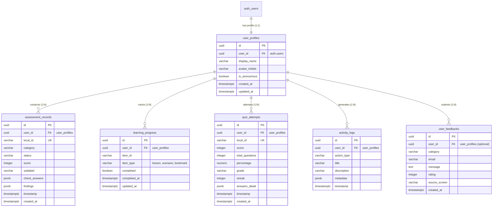

# PHASE 13 — RELATIONAL DATABASE DESIGN SPECIFICATION
## Syariah Digital Check — PostgreSQL & Supabase Data Model

**Status:** Production Ready  
**Version:** 1.0.0 (Phase 13)  
**Database Engine:** PostgreSQL 15+  
**Target Migration Path:** `supabase/migrations/`

---

## 1. Entity-Relationship Diagram (ERD)



---

## 2. Table Specifications & Data Dictionary

### Table 1: `public.user_profiles`
Menyimpan profil pengguna yang terhubung dengan akun autentikasi Supabase (`auth.users`).

| Nama Kolom | Tipe Data | Constraint | Keterangan |
| :--- | :--- | :--- | :--- |
| `id` | `UUID` | `PRIMARY KEY DEFAULT gen_random_uuid()` | ID unik baris profil. |
| `user_id` | `UUID` | `UNIQUE NOT NULL REFERENCES auth.users(id) ON DELETE CASCADE` | Relasi ke entitas akun autentikasi. |
| `display_name` | `VARCHAR(100)` | `NOT NULL DEFAULT 'Tamu'` | Nama tampilan pengguna di dashboard. |
| `avatar_initials` | `VARCHAR(10)` | `NOT NULL DEFAULT 'TM'` | Inisial untuk avatar visual UI. |
| `is_anonymous` | `BOOLEAN` | `NOT NULL DEFAULT FALSE` | Menandai sesi tamu versus akun terdaftar. |
| `created_at` | `TIMESTAMPTZ` | `NOT NULL DEFAULT NOW()` | Waktu pembuatan akun. |
| `updated_at` | `TIMESTAMPTZ` | `NOT NULL DEFAULT NOW()` | Waktu pembaruan profil terakhir. |

---

### Table 2: `public.assessment_records`
Menyimpan riwayat pemeriksaan akad dan klausul transaksi finansial digital (PayLater, E-Wallet, P2P, dll.).

| Nama Kolom | Tipe Data | Constraint | Keterangan |
| :--- | :--- | :--- | :--- |
| `id` | `UUID` | `PRIMARY KEY DEFAULT gen_random_uuid()` | ID unik catatan evaluasi di cloud. |
| `user_id` | `UUID` | `NOT NULL REFERENCES public.user_profiles(user_id) ON DELETE CASCADE` | Kepemilikan akun pengguna. |
| `local_id` | `VARCHAR(64)` | `NOT NULL` | ID lokal klien untuk pencegahan duplikasi sinkronisasi. |
| `category` | `VARCHAR(50)` | `NOT NULL` | Kategori akad (`paylater`, `ewallet`, `p2p`, dll.). |
| `status` | `VARCHAR(20)` | `NOT NULL CHECK (status IN ('critical', 'flag', 'clear'))` | Klasifikasi hasil analisis syariah. |
| `score` | `INTEGER` | `NOT NULL CHECK (score >= 0 AND score <= 100)` | Skor kesesuaian syariah (0–100). |
| `sublabel` | `VARCHAR(100)` | `NOT NULL` | Ringkasan klasifikasi hasil telaah. |
| `check_answers` | `JSONB` | `NOT NULL DEFAULT '[]'` | Nilai 5 parameter telaah (`clear`, `partial`, `violation`, `unclear`). |
| `findings` | `JSONB` | `NOT NULL DEFAULT '[]'` | Catatan temuan risiko (indikasi riba, gharar, maysir, dsb.). |
| `timestamp` | `TIMESTAMPTZ` | `NOT NULL` | Waktu transaksi dievaluasi oleh klien. |
| `created_at` | `TIMESTAMPTZ` | `NOT NULL DEFAULT NOW()` | Waktu sinkronisasi masuk ke database. |

*Unique Index:* `CREATE UNIQUE INDEX idx_assessments_user_local ON public.assessment_records (user_id, local_id);`

---

### Table 3: `public.learning_progress`
Menyimpan status pembacaan modul edukasi, penyelesaian studi kasus interaktif, dan penanda buku (*bookmarks*).

| Nama Kolom | Tipe Data | Constraint | Keterangan |
| :--- | :--- | :--- | :--- |
| `id` | `UUID` | `PRIMARY KEY DEFAULT gen_random_uuid()` | ID unik progres. |
| `user_id` | `UUID` | `NOT NULL REFERENCES public.user_profiles(user_id) ON DELETE CASCADE` | Kepemilikan akun pengguna. |
| `item_id` | `VARCHAR(64)` | `NOT NULL` | ID modul edukasi atau ID skenario kasus. |
| `item_type` | `VARCHAR(20)` | `NOT NULL CHECK (item_type IN ('lesson', 'scenario', 'bookmark'))` | Jenis item progres. |
| `completed` | `BOOLEAN` | `NOT NULL DEFAULT TRUE` | Status penyelesaian. |
| `completed_at` | `TIMESTAMPTZ` | `NOT NULL DEFAULT NOW()` | Waktu item diselesaikan/ditandai. |
| `updated_at` | `TIMESTAMPTZ` | `NOT NULL DEFAULT NOW()` | Waktu modifikasi terakhir. |

*Unique Index:* `CREATE UNIQUE INDEX idx_learning_progress_user_item ON public.learning_progress (user_id, item_id, item_type);`

---

### Table 4: `public.quiz_attempts`
Menyimpan riwayat dan rincian percobaan kuis literasi syariah pengguna.

| Nama Kolom | Tipe Data | Constraint | Keterangan |
| :--- | :--- | :--- | :--- |
| `id` | `UUID` | `PRIMARY KEY DEFAULT gen_random_uuid()` | ID unik percobaan kuis. |
| `user_id` | `UUID` | `NOT NULL REFERENCES public.user_profiles(user_id) ON DELETE CASCADE` | Kepemilikan akun pengguna. |
| `local_id` | `VARCHAR(64)` | `NOT NULL` | ID lokal klien untuk deduplikasi. |
| `score` | `INTEGER` | `NOT NULL CHECK (score >= 0)` | Jumlah jawaban benar. |
| `total_questions` | `INTEGER` | `NOT NULL CHECK (total_questions > 0)` | Total soal dalam sesi kuis. |
| `percentage` | `NUMERIC(5,2)` | `NOT NULL CHECK (percentage >= 0 AND percentage <= 100)` | Persentase skor kelulusan. |
| `grade` | `VARCHAR(30)` | `NOT NULL` | Predikat literasi (`Mumtaz`, `Jayyid Jiddan`, dll.). |
| `streak` | `INTEGER` | `NOT NULL DEFAULT 0` | Runtutan jawaban benar berturut-turut. |
| `answers_detail` | `JSONB` | `NOT NULL DEFAULT '[]'` | Detail pertanyaan, opsi yang dipilih, dan penjelasan fatwa. |
| `timestamp` | `TIMESTAMPTZ` | `NOT NULL` | Waktu kuis diselesaikan oleh pengguna. |
| `created_at` | `TIMESTAMPTZ` | `NOT NULL DEFAULT NOW()` | Waktu rekam data di database. |

*Unique Index:* `CREATE UNIQUE INDEX idx_quiz_user_local ON public.quiz_attempts (user_id, local_id);`

---

### Table 5: `public.activity_logs`
Menyimpan log kronologis aktivitas belajar pengguna untuk feed timeline pada dasbor.

| Nama Kolom | Tipe Data | Constraint | Keterangan |
| :--- | :--- | :--- | :--- |
| `id` | `UUID` | `PRIMARY KEY DEFAULT gen_random_uuid()` | ID unik log aktivitas. |
| `user_id` | `UUID` | `NOT NULL REFERENCES public.user_profiles(user_id) ON DELETE CASCADE` | Kepemilikan akun pengguna. |
| `action_type` | `VARCHAR(50)` | `NOT NULL` | Jenis aksi (`assessment`, `quiz`, `lesson_read`, dll.). |
| `title` | `VARCHAR(150)` | `NOT NULL` | Judul singkat aktivitas. |
| `description` | `TEXT` | `NULL` | Keterangan detail aktivitas. |
| `metadata` | `JSONB` | `NOT NULL DEFAULT '{}'` | Metadata kontekstual tambahan. |
| `timestamp` | `TIMESTAMPTZ` | `NOT NULL DEFAULT NOW()` | Waktu kejadian aktivitas. |

---

### Table 6: `public.user_feedbacks`
Menyimpan masukan pengguna, laporan kendala aksesibilitas, atau usulan fatwa dari formulir publik.

| Nama Kolom | Tipe Data | Constraint | Keterangan |
| :--- | :--- | :--- | :--- |
| `id` | `UUID` | `PRIMARY KEY DEFAULT gen_random_uuid()` | ID unik masukan pengguna. |
| `user_id` | `UUID` | `NULL REFERENCES public.user_profiles(user_id) ON DELETE SET NULL` | ID pengguna (opsional, tamu diperbolehkan). |
| `category` | `VARCHAR(50)` | `NOT NULL` | Kategori masukan (`saran`, `bug`, `fatwa`, dll.). |
| `email` | `VARCHAR(150)` | `NULL` | Alamat email opsional untuk korespondensi. |
| `message` | `TEXT` | `NOT NULL` | Isi pesan kritik/saran dari pengguna. |
| `rating` | `INTEGER` | `NULL CHECK (rating >= 1 AND rating <= 5)` | Penilaian bintang kepuasan (1–5). |
| `source_screen` | `VARCHAR(50)` | `NULL DEFAULT 'screenHome'` | Layar asal formulir masukan dibuka. |
| `created_at` | `TIMESTAMPTZ` | `NOT NULL DEFAULT NOW()` | Waktu pengiriman masukan. |

---

## 3. Database Normalization Audit (3NF)

1. **First Normal Form (1NF):** Semua atribut bersifat atomik. Data bersarang yang bersifat log historis dinamis (seperti jawaban kuis dan temuan telaah) disimpan dalam kolom `JSONB` dengan skema terstruktur tanpa ketergantungan relasional silang.
2. **Second Normal Form (2NF):** Semua atribut non-kunci bergantung secara fungsional penuh pada kunci utama (`id`). Tabel pivot seperti `learning_progress` menggunakan kombinasi kunci unik `(user_id, item_id, item_type)` untuk mencegah redundansi parsial.
3. **Third Normal Form (3NF):** Tidak ada dependensi transitif antar-kolom non-kunci. Profil pengguna, riwayat evaluasi transaksi, dan hasil kuis dipisahkan ke dalam entitas mandiri yang dihubungkan melalui foreign key terindeks.

---

## 4. Performance Indexes

Untuk menjamin performa eksekusi query sub-milidetik pada skala ribuan pengguna simultan:

```sql
-- Indeks relasi foreign key & pencarian berulang
CREATE INDEX idx_user_profiles_user_id ON public.user_profiles(user_id);
CREATE INDEX idx_assessment_records_user_id ON public.assessment_records(user_id);
CREATE INDEX idx_assessment_records_timestamp ON public.assessment_records(user_id, timestamp DESC);
CREATE INDEX idx_learning_progress_user_type ON public.learning_progress(user_id, item_type);
CREATE INDEX idx_quiz_attempts_user_id ON public.quiz_attempts(user_id, timestamp DESC);
CREATE INDEX idx_activity_logs_user_id ON public.activity_logs(user_id, timestamp DESC);
CREATE INDEX idx_user_feedbacks_created_at ON public.user_feedbacks(created_at DESC);
```
