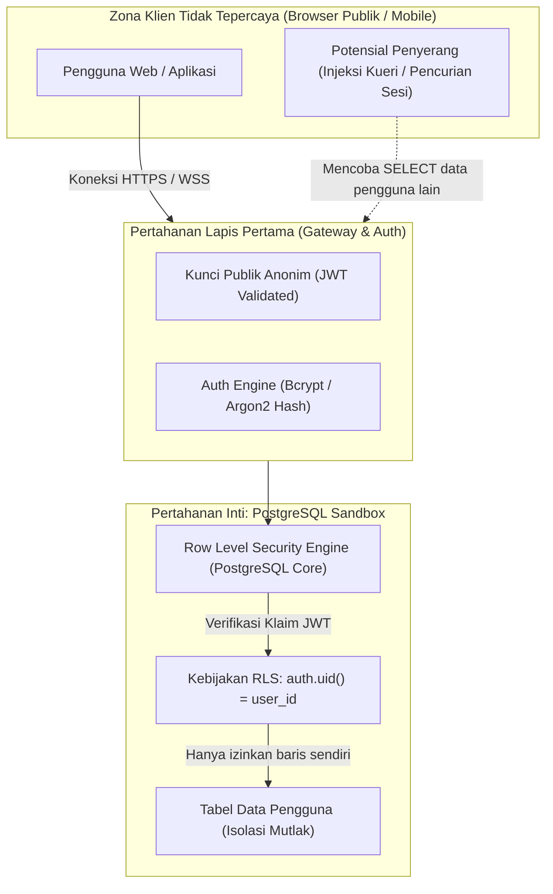

# PHASE 13 — SECURITY & ROW LEVEL SECURITY (RLS) AUDIT SPECIFICATION
## Syariah Digital Check — Privacy Protection & Cryptographic Identity Boundary

**Status:** Production Ready  
**Version:** 1.0.0 (Phase 13)  
**Security Level:** High / Zero-Trust Database  
**Compliance Standard:** ISO/IEC 27701 (Privacy Information Management) & OWASP Top 10 API Security

---

## 1. Threat Model & Security Architecture

Syariah Digital Check menangani edukasi finansial syariah dengan model ancaman berfokus pada privasi konsumen dan integritas data edukasi:



---

## 2. Row Level Security (RLS) Policy Matrix

Setiap tabel di dalam skema `public` telah diaktifkan RLS (`ALTER TABLE ... ENABLE ROW LEVEL SECURITY;`). Secara *default*, seluruh akses `SELECT`, `INSERT`, `UPDATE`, dan `DELETE` ditolak kecuali secara eksplisit diizinkan oleh kebijakan di bawah ini:

| Tabel | Operasi | Nama Kebijakan | Klausa Pemeriksaan (`USING` / `WITH CHECK`) | Peran Diizinkan |
| :--- | :--- | :--- | :--- | :--- |
| `user_profiles` | SELECT | `profiles_select_own` | `auth.uid() = user_id` | `authenticated` |
| `user_profiles` | INSERT | `profiles_insert_own` | `auth.uid() = user_id` | `authenticated` |
| `user_profiles` | UPDATE | `profiles_update_own` | `auth.uid() = user_id` | `authenticated` |
| `assessment_records` | SELECT | `assessments_select_own`| `auth.uid() = user_id` | `authenticated` |
| `assessment_records` | INSERT | `assessments_insert_own`| `auth.uid() = user_id` | `authenticated` |
| `assessment_records` | UPDATE | `assessments_update_own`| `auth.uid() = user_id` | `authenticated` |
| `assessment_records` | DELETE | `assessments_delete_own`| `auth.uid() = user_id` | `authenticated` |
| `learning_progress` | ALL | `learning_progress_own` | `auth.uid() = user_id` | `authenticated` |
| `quiz_attempts` | SELECT | `quiz_select_own` | `auth.uid() = user_id` | `authenticated` |
| `quiz_attempts` | INSERT | `quiz_insert_own` | `auth.uid() = user_id` | `authenticated` |
| `quiz_attempts` | DELETE | `quiz_delete_own` | `auth.uid() = user_id` | `authenticated` |
| `activity_logs` | SELECT | `activity_select_own` | `auth.uid() = user_id` | `authenticated` |
| `activity_logs` | INSERT | `activity_insert_own` | `auth.uid() = user_id` | `authenticated` |
| `user_feedbacks` | INSERT | `feedbacks_insert_public`| `TRUE` (Bisa dikirim oleh tamu anonim) | `anon`, `authenticated` |
| `user_feedbacks` | SELECT | `feedbacks_select_own` | `auth.uid() = user_id` (Staf admin via service role) | `authenticated` |

---

## 3. Data Minimization & Privacy Audit

Sesuai prinsip Undang-Undang Perlindungan Data Pribadi (UU PDP No. 27/2022) dan ISO/IEC 27701:

| Klasifikasi Data | Kebijakan Penyimpanan di Syariah Digital Check |
| :--- | :--- |
| **Nomor Rekening / Kartu Debit/Kredit** | **DILARANG KERAS (Zero Collection):** Aplikasi tidak memiliki kolom atau formulir nomor kartu atau rekening. |
| **PIN, Kata Sandi Bank, OTP** | **DILARANG KERAS (Zero Collection):** Tidak ada penangkapan atau transmisi kredensial autentikasi finansial perbankan. |
| **Saldo / Nilai Finansial Riil** | **DILARANG KERAS:** Transaksi dievaluasi berdasarkan persentase dan parameter klausul akad, bukan nominal rupiah rekening pribadi. |
| **Identitas Pengguna** | **Minim & Opsional:** Diperbolehkan menggunakan nama samaran (*display name*) atau beroperasi penuh sebagai *Tamu (Guest)*. |
| **Hak untuk Dihapus (*Right to be Forgotten*)** | **Didukung Penuh:** Pengguna dapat menghapus seluruh data lokal melalui tombol "Wipe Total Bersih" di halaman profil, dan data cloud terhapus otomatis melalui `ON DELETE CASCADE` saat akun dihapus. |

---

## 4. Automatic Profile Creation via PostgreSQL Trigger

Untuk mencegah celah di mana akun dibuat di sistem autentikasi tanpa profil database yang terikat:

```sql
CREATE OR REPLACE FUNCTION public.handle_new_user()
RETURNS TRIGGER
LANGUAGE plpgsql
SECURITY DEFINER
SET search_path = public
AS $$
BEGIN
  INSERT INTO public.user_profiles (user_id, display_name, avatar_initials, is_anonymous)
  VALUES (
    NEW.id,
    COALESCE(NEW.raw_user_meta_data->>'full_name', NEW.raw_user_meta_data->>'name', 'Pengguna Syariah'),
    UPPER(SUBSTRING(COALESCE(NEW.raw_user_meta_data->>'full_name', NEW.raw_user_meta_data->>'name', 'PS'), 1, 2)),
    COALESCE((NEW.raw_user_meta_data->>'is_anonymous')::boolean, FALSE)
  )
  ON CONFLICT (user_id) DO NOTHING;
  RETURN NEW;
END;
$$;

CREATE TRIGGER on_auth_user_created
  AFTER INSERT ON auth.users
  FOR EACH ROW EXECUTE FUNCTION public.handle_new_user();
```

---

## 5. Client-Side Secrets Isolation

Kunci akses Supabase dibagi menjadi dua kategori dengan batasan ketat:

1. **`VITE_SUPABASE_ANON_KEY` / `ENV_SUPABASE_ANON_KEY` (Publik):**
   - Aman diekspos di peramban web atau aplikasi seluler.
   - Hak istimewa dibatasi secara absolut oleh kebijakan RLS PostgreSQL.
2. **`SUPABASE_SERVICE_ROLE_KEY` (Rahasia Backend / CI/CD):**
   - Mengabaikan RLS (*bypass RLS*).
   - **TIDAK PERNAH** dimasukkan ke dalam bundel kode klien (`index.html`, `Digital_Check/src`, dsb.).
   - Hanya digunakan pada pipeline audit administratif atau migrasi skema terjadwal di lingkungan server terisolasi.
