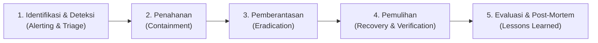
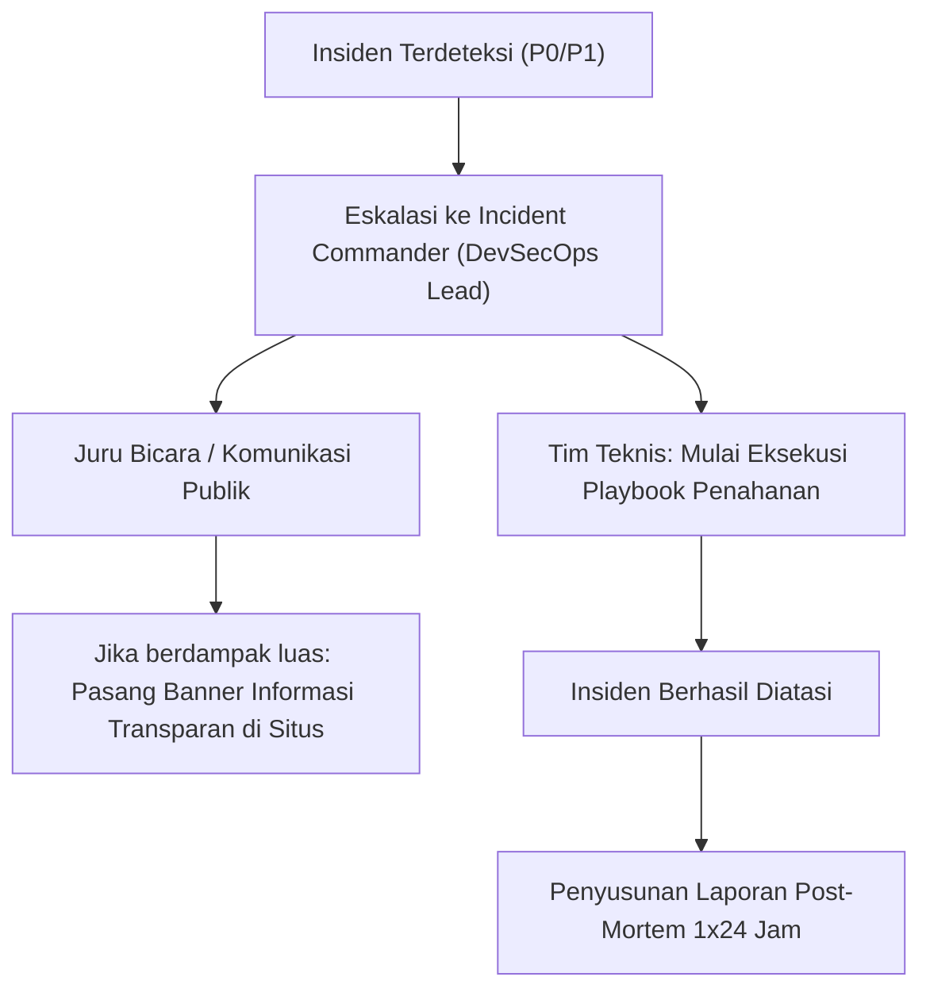

# PHASE 14 — SECURITY INCIDENT RESPONSE PLAYBOOK
## Syariah Digital Check — Production Incident Response & Threat Containment Plan

**Status:** Production Ready  
**Version:** 1.0.0 (Phase 14)  
**Date:** 20 November 2026  
**Auditor:** Principal DevSecOps Engineer & Security Operations Lead  
**Standard:** NIST SP 800-61 Rev. 2 (Computer Security Incident Handling Guide)

---

## 1. Incident Response Lifecycle

Syariah Digital Check mengadopsi standar siklus tanggap insiden 5 tahap:

---

## 2. Severity Classification Matrix

| Tingkat Keparahan | Kriteria Insiden | Target Waktu Tanggap (MTTA) | Target Waktu Penyelesaian (MTTR) | Contoh Kasus |
| :--- | :--- | :---: | :---: | :--- |
| **P0 — Kritis** | Gangguan layanan total, kebocoran data terkonfirmasi, atau kompromi kunci administratif. | < 15 Menit | < 2 Jam | Kebocoran token `service_role`, serangan bypass RLS yang berhasil, outage CDN global. |
| **P1 — Tinggi** | Gangguan parsial pada fitur utama atau terdeteksi upaya eksploitasi aktif. | < 30 Menit | < 6 Jam | Upaya brute-force login abnormal, kegagalan sinkronisasi cloud untuk banyak pengguna. |
| **P2 — Sedang** | Anomali non-kritis yang tidak mengganggu privasi atau integritas data inti. | < 2 Jam | < 24 Jam | Lonjakan galat validasi formulir masukan, degradasi performa latensi sesaat. |
| **P3 — Rendah** | Masalah kosmetik, false positive alert, atau pertanyaan klarifikasi keamanan. | < 1 Hari Kerja | < 3 Hari Kerja | Laporan bug tipografi pada modal kebijakan privasi, perbaikan warning dependensi dev. |

---

## 3. Incident Playbooks

### Playbook 1: Kompromi Token / Kebocoran Kunci Akses (P0/P1)
**Pemicu:** Terdeteksi token akses atau JWT terekspos di log publik atau repositori pihak ketiga.
1. **Penahanan (Containment):**
   - Segera lakukan rotasi JWT Secret di dasbor Supabase (*Project Settings > API > JWT Secret > Generate new secret*).
   - Tindakan ini akan membatalkan seluruh sesi aktif yang beredar secara instan.
2. **Pemberantasan (Eradication):**
   - Cabut sesi pengguna terdampak melalui GoTrue Admin API.
   - Periksa audit log database untuk mengidentifikasi apakah terdapat pembacaan baris yang tidak wajar selama jendela paparan.
3. **Pemulihan (Recovery):**
   - Deploy konfigurasi lingkungan baru ke Vercel CDN dengan nilai anon key yang telah disegarkan.
   - Minta pengguna untuk login ulang secara opsional.

### Playbook 2: Terdeteksi Upaya Eksploitasi RLS (P0)
**Pemicu:** Kueri PostgREST mencoba menyuntikkan klausa `user_id` yang berbeda dari klaim token `auth.uid()`.
1. **Penahanan:**
   - PostgreSQL RLS secara native menolak kueri tersebut (menghasilkan 0 baris atau galat 403 Forbidden).
   - Jika terdapat anomali pada definisi policy, terapkan darurat: `ALTER TABLE <table_name> FORCE ROW LEVEL SECURITY;`.
2. **Pemberantasan:**
   - Review file migrasi SQL `supabase/migrations/20261120000002_enable_rls_policies.sql`.
   - Pastikan klausa `USING (auth.uid() = user_id)` tidak memiliki klausa `OR TRUE` yang tidak disengaja.
3. **Pemulihan:**
   - Jalankan regression test suite `Digital_Check/src/tests/cloud-sync-and-rls.test.ts` untuk memverifikasi isolasi multi-tenant.

### Playbook 3: Serangan DDoS / Flooding API (P1)
**Pemicu:** Lonjakan lalu lintas kueri HTTP abnormal (>100x baseline) yang menargetkan endpoint `user_feedbacks` atau file aset statis.
1. **Penahanan:**
   - Aktifkan fitur *Attack Mode / DDoS Protection* di panel Vercel WAF atau Cloudflare.
   - Terapkan rate limiting pada level CDN: maksimal 60 request per IP per menit.
2. **Pemberantasan:**
   - Blokir subnet IP agresif yang teridentifikasi sebagai bot scraper komersial.
3. **Pemulihan:**
   - Verifikasi latensi respons peramban kembali ke rentang normal (<150 ms).

### Playbook 4: Gangguan Cloud Database / Downtime Supabase (P1)
**Pemicu:** Health check probe mendeteksi Supabase API tidak merespons (HTTP 503 / Timeout).
1. **Penahanan & Mitigasi Otomatis:**
   - Pengguna Syariah Digital Check **tidak terganggu sama sekali** karena aplikasi beroperasi dalam arsitektur **Local-First / Guest-First**.
   - `CloudSyncEngine` secara otomatis beralih ke penahanan lokal (*offline local caching*).
2. **Pemantauan:**
   - Pantau status resmi penyedia cloud di [status.supabase.com](https://status.supabase.com).
3. **Pemulihan:**
   - Saat status pulih, klien peramban secara otomatis menyinkronkan antrean data yang tertunda saat pemicu online aktif.

---

## 4. Communication & Escalation Protocol

---

## 5. Post-Incident Review (PIR) Template

Setiap insiden berderajat P0 atau P1 wajib mendokumentasikan laporan tinjauan pasca-insiden dalam kurun waktu 24 jam dengan struktur berikut:

1. **Ringkasan Eksekutif:** Tanggal, durasi insiden, dan tingkat keparahan.
2. **Kronologi Kejadian (Timeline):** Jam dan menit dari deteksi awal hingga pemulihan penuh.
3. **Akar Masalah (Root Cause):** Analisis 5-Whys mengapa insiden dapat terjadi.
4. **Dampak Pengguna:** Estimasi jumlah pengguna terdampak (jika ada).
5. **Tindakan Perbaikan (Action Items):** Daftar perbaikan pencegahan permanen dengan pemilik tugas dan tenggat waktu tegas.
