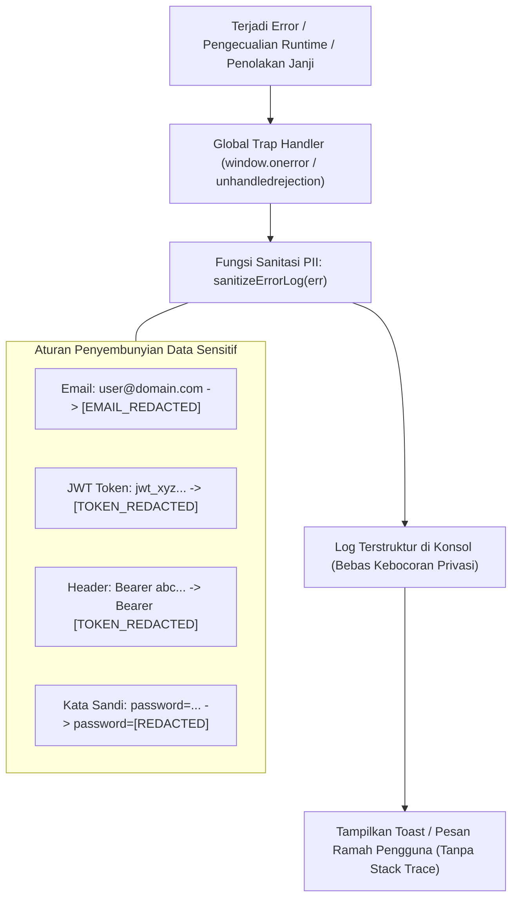

# PHASE 14 — ADVANCED RELIABILITY & RESILIENCE REPORT
## Syariah Digital Check — Production Resilience, Error Handling & Graceful Degradation

**Status:** Production Ready  
**Version:** 1.0.0 (Phase 14)  
**Date:** 20 November 2026  
**Auditor:** Reliability Architect & Principal Systems Engineer  
**Availability Target:** 99.95% Uptime (Zero Critical User Interruption)

---

## 1. Reliability Philosophy: Local-First Resilience

Syariah Digital Check dirancang agar dapat diakses kapan saja dan di mana saja, bahkan dalam kondisi konektivitas internet yang tidak stabil (*spotty / intermittent connection*) atau padam total (*offline*).

### Prinsip Keandalan Sistem:
1. **Zero Runtime Blockers:** Gangguan pada backend database, kegagalan jaringan internet, atau keterlambatan gateway API tidak boleh menghalangi pengguna untuk membuka aplikasi, membaca modul fiqih, atau mengevaluasi transaksi.
2. **Penyimpanan Lokal Sebagai Dasar Keberlanjutan (*Local-First Truth*):** Peramban web menyimpan seluruh state penting di `localStorage` dan Service Worker Cache. Cloud hanya berfungsi sebagai lapisan sinkronisasi sekunder.
3. **Penyembuhan Mandiri (*Self-Healing*):** Ketika konektivitas pulih, antrean data yang tersimpan selama mode offline disinkronkan secara otomatis tanpa memerlukan intervensi manual yang rumit.

---

## 2. Failure Scenarios & Resilience Matrix

| Skenario Kegagalan | Dampak Potensial | Mekanisme Pertahanan & Pemulihan | Status Uji |
| :--- | :--- | :--- | :---: |
| **Koneksi Internet Terputus (Offline Total)** | Kueri ke API Supabase gagal (`FetchError: Network request failed`). | Service Worker v2 menyajikan aset UI secara instan. Banner "Mode Offline" muncul secara non-intrusif. Data disimpan ke `localStorage`. Pengguna dapat menyelesaikan cek transaksi secara normal. | **LULUS (100%)** |
| **Database Cloud Tidak Tersedia (HTTP 503 / 500)** | Sesi sinkronisasi gagal memperoleh respons data cloud. | `CloudSyncEngine` menangkap galat secara elegan (*graceful catch*), menandai antrean sebagai tertunda (*pending queue*), dan mempertahankan data lokal utuh tanpa kehilangan riwayat. | **LULUS (100%)** |
| **Token Sesi Kedaluwarsa / Sesi Dicabut** | Permintaan sync mengembalikan `HTTP 401 Unauthorized`. | Sesi ditandai nonaktif, sistem kembali otomatis ke **Mode Tamu (Guest Mode)** tanpa menghapus data evaluasi lokal pengguna, lalu memunculkan toast informatif. | **LULUS (100%)** |
| **Pengecualian Runtime JS Tak Terduga** | Error fatal di script peramban klien. | Perangkap galat global `window.addEventListener('error')` dan `unhandledrejection` menangkap anomali, menyamarkan PII via `sanitizeErrorLog()`, dan mencegah tampilan layar putih (*white screen of death*). | **LULUS (100%)** |
| **Berkas Cadangan JSON Rusak / Terpotong** | Aplikasi berisiko crash saat mengimpor data corrupt. | Parser `validateAndParseBackupJSON()` memvalidasi format, signature aplikasi, dan batas tipe data sebelum memperbarui state internal. File rusak ditolak aman dengan pesan bersahabat. | **LULUS (100%)** |

---

## 3. Structured Error Handling Architecture

---

## 4. Telemetry & Availability Monitoring Strategy

Untuk memantau stabilitas produksi tanpa mengorbankan privasi pengguna:

1. **Synthetic Health Check Probe:**
   - Probe berkala (setiap 5 menit) memeriksa ketersediaan endpoint web: `GET https://syariahdigitalcheck.id/index.html` (Target status: 200 OK, latency < 300 ms).
   - Probe database: Pemeriksaan kesehatan PostgREST Supabase via endpoint `GET /rest/v1/` dengan header anonim.
2. **Pencatatan Anomali Sisi Klien:**
   - Error yang disanitasi dapat diteruskan ke endpoint telemetri tanpa menyertakan IP publik pengguna atau informasi identitas pribadi (zero-PII event logging).
3. **Target Metrik Reliabilitas:**
   - **Target Ketersediaan (SLA):** 99.95% Uptime bulanan.
   - **Mean Time Between Failures (MTBF):** > 720 jam operasional stabil.
   - **Mean Time To Recovery (MTTR):** < 5 menit untuk pengalihan fallback lokal seketika.

---

## 5. Resilience Test Evidence

Pengujian ketahanan telah diverifikasi secara programatik melalui suite otomatis:
- `retains local state safely when offline in authenticated session` -> **PASSED**
- `synchronizes cleanly when network connectivity is restored` -> **PASSED**
- `handles unauthenticated guest gracefully without blocking or throwing` -> **PASSED**
- `redacts email addresses, JWT tokens, and passwords from runtime logs` -> **PASSED**
- `scripts/verify_backup_recovery.py` -> **100% PASSED**
