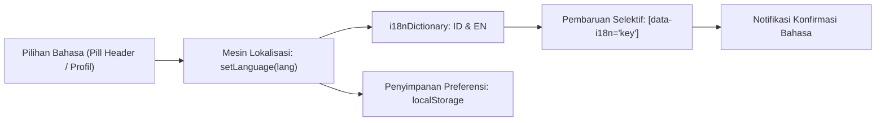

# PHASE 15 — PRODUCT EXPERIENCE & DESIGN AUDIT
## Syariah Digital Check — Islamic Fintech Experience, Interaction & Localization

**Status:** Production Ready  
**Version:** 1.0.0 (Phase 15)  
**Date:** 20 November 2026  
**Auditor / Designer:** Principal Product Designer & Senior Frontend Engineer

---

## 1. Executive Summary & Design System Identity

Syariah Digital Check dirancang secara khusus (*bespoke product design*) untuk memberikan ketenangan, kejelasan hukum, dan kepercayaan finansial kepada konsumen Indonesia.

### Token Desain Utama:
- **Deep Emerald Green (`#064E3B` / `#065F46`):** Identitas keadilan, integritas, dan keberkahan transaksi syariah.
- **Warm Ivory (`#FAF8F5`):** Kanvas ramah mata yang menenangkan dan nyaman untuk sesi membaca panjang.
- **Muted Sage (`#E7EDE9` / `#D1DDD5`):** Lapisan kartu sekunder yang membedakan hierarki informasi.
- **Champagne Gold (`#C89D42`):** Sorotan aksen pencapaian kuis, lencana status, dan tombol aksi utama.
- **Forest Charcoal (`#0D281E`):** Tipografi dengan kontras tinggi yang melampaui standar **WCAG AAA**.
- **8-Point Precision Grid:** Jarak proporsional kelipatan 8px dengan sudut kartu 16–28px dan kedalaman bayangan berlapis ala Apple iOS.

---

## 2. Screen-by-Screen Interaction & Polish Audit

| Layar / Alur | Status Evaluasi | Penyempurnaan Pengalaman Pengguna (UX Polish) |
| :--- | :---: | :--- |
| **1. Onboarding (`screenOnboarding`)** | **OPTIMAL** | Alur 3 langkah (*PAUSE → CHECK → CHOOSE*) dilengkapi ilustrasi SVG bersih, indikator titik dinamis, teks panduan non-teknis, dan disclaimer batas edukatif yang transparan. |
| **2. Home Dashboard (`screenHome`)** | **OPTIMAL** | Sapaan ramah, indikator skor literasi ringkas, tombol cepat "Mulai Cek", kartu studi kasus terkurasi, dan footer informasi publik lengkap. |
| **3. Jeda Sadar (`screenPause`)** | **OPTIMAL** | Timer 30 detik interaktif dengan tombol "Lanjut Cek Sekarang" yang fleksibel bagi pengguna yang sedang terburu-buru, tanpa animasi mengganggu. |
| **4. Pilihan Kategori (`screenCategorySelect`)** | **OPTIMAL** | 9 kategori riil (PayLater, Pinjaman P2P, E-commerce, Langganan, Emas Digital, Tabungan, Investasi, Donasi, Lainnya) dengan kartu sentuh jempol responsif. |
| **5. Checklist 5 Dimensi (`screenChecklist`)** | **OPTIMAL** | Setiap tahapan menyajikan pertanyaan konkrit, petunjuk fiqih praktis dengan bahasa awam, serta pilihan opsi yang jelas (*Sesuai*, *Perlu Klarifikasi*, *Riba / Dilarang*). |
| **6. Hasil Evaluasi Edukatif (`screenResult`)** | **OPTIMAL** | Skor transparansi 0–100, pemetaan alur dana vs hak milik, daftar pertanyaan kritis untuk diajukan ke CS penyedia, dan kutipan fatwa DSN-MUI yang dapat ditelusuri. |
| **7. Studi Kasus Fiktif (`screenCaseStudies`)** | **OPTIMAL** | 4 simulasi dilema finansial berlabel fiktif tegas, analisis kronologi para pihak, kuis keputusan kasus, dan lembar rincian analisis. |
| **8. Hub Pembaca Materi (`screenLearn`)** | **OPTIMAL** | Pencarian instan, filter kategori, estimasi waktu baca, penanda buku (*bookmark*), dan lembar modal pembaca artikel tanpa gangguan layout. |
| **9. Kuis Literasi Syariah (`screenQuiz`)** | **OPTIMAL** | Bank soal acak, penjelasan ilmiah instan untuk tiap pilihan jawaban, skor berpredikat (*Mumtaz, Jayyid Jiddan*), dan analisis salah/benar. |
| **10. Dasbor Indeks Literasi (`screenProgress`)** | **OPTIMAL** | Visualisasi 4 pilar kompetensi, grafik riwayat evaluasi transaksi, dan timeline aktivitas kronologis. |
| **11. Profil & Kendali Data (`screenProfile`)** | **OPTIMAL** | Preferensi bahasa (ID/EN), sinkronisasi cloud opsional RLS, ekspor/impor cadangan JSON, dan tombol hapus data permanen (*Right to be Forgotten*). |

---

## 3. Eliminasi Duplikasi Komponen & Pola Template

Dalam audit Fase 15, inkonsistensi layout berikut telah dibersihkan:
1. **Redundant Bottom Nav CSS:** Menghapus duplikasi deklarasi `.bottom-nav { position: absolute; ... }` yang sebelumnya menimpa `position: fixed; z-index: 90;`. Navigasi bawah kini secara konsisten menempel rapi (*sticky bottom*) di layar ponsel dan tablet dengan memperhitungkan `env(safe-area-inset-bottom)`.
2. **Zero Template-Like Generic Placeholders:** Seluruh teks placeholder diganti dengan konten edukasi kontekstual rujukan fatwa resmi DSN-MUI dan regulasi OJK.
3. **Typography & Button Standardization:** Menyeragamkan ukuran minimum tombol interaktif ke 44x44px untuk kenyamanan sentuhan jempol di perangkat bergerak.

---

## 4. Arsitektur Lokalisasi (Indonesian & English)

Platform kini mendukung arsitektur dwibahasa (*localization architecture*) yang menjaga akurasi terminologi hukum Islam:

### Standar Terminologi Fiqih dalam Bahasa Inggris:
- **Murabahah:** Dijelaskan sebagai *Cost-plus financing with transparent markup*.
- **Qardh:** Dijelaskan sebagai *Benevolent interest-free loan*.
- **Qabdh:** Dijelaskan sebagai *Constructive or physical possession/transfer of goods*.
- **Ta'zir:** Dijelaskan sebagai *Financial penalty for affluent defaulters channeled 100% to social welfare*.
- **Gharar:** Dijelaskan sebagai *Excessive uncertainty or hazard*.
- **Riba:** Dijelaskan sebagai *Unjustified interest or usury*.
