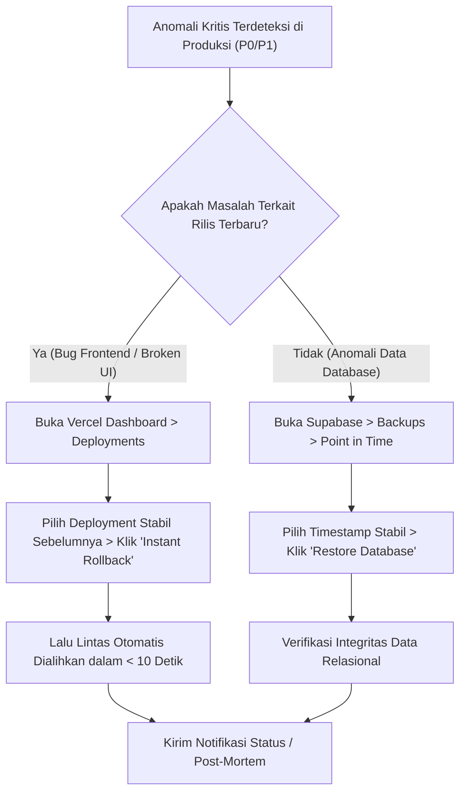

# PHASE 16 — PRODUCTION OPERATIONAL RUNBOOK
## Syariah Digital Check — Maintenance, Incident Response & Runbook Prosedur

**Status:** Production Ready  
**Version:** 3.0.0 (Public Release)  
**Date:** 20 November 2026  
**Target Audience:** DevOps Engineers, System Administrators & On-Call Architects

---

## 1. System Dependencies & Architecture Matrix

Syariah Digital Check beroperasi dengan dependensi minimal untuk memaksimalkan ketersediaan sistem:

| Komponen | Penyedia / Layanan | Peran Sistem | Titik Kegagalan Kritis (SPOF) |
| :--- | :--- | :--- | :---: |
| **Static Hosting & CDN** | Vercel Edge Network | Distribusi aset web dan perutean HTTPS | Tidak (Multi-POP Anycast Failover) |
| **Database & Auth (Opsional)**| Supabase (PostgreSQL 15+) | Sinkronisasi cloud lintas perangkat & RLS | Tidak (Fallback otomatis ke Guest Mode lokal) |
| **PWA Cache Engine** | Browser Service Worker v2 | Operasional offline penuh dan loading instan | Tidak (Tersimpan di memori perangkat klien) |
| **DNS Management** | Vercel DNS / Registrar | Resolusi domain `digitalchecksyariah.vercel.app` | Tidak (Anycast DNS berkecepatan tinggi) |

---

## 2. Standard Operating Procedures (SOP)

### SOP-01: Penerapan Pembaruan Aplikasi (Routine Deployment)
1. Lakukan pengembangan dan pengujian lokal pada branch fitur.
2. Jalankan seluruh suite pengujian otomatis:
   ```bash
   cd Digital_Check && npm test && npm run typecheck
   cd .. && python3 scripts/verify_backup_recovery.py
   python3 scripts/qa_audit_runner.py
   ```
3. Jika seluruh pengujian lolos 100%, buat commit dengan format semantik dan push ke remote:
   ```bash
   git push origin main
   ```
4. Pantau dashboard Vercel untuk memastikan status *Deployment Completed* tanpa peringatan build.

### SOP-02: Pembaruan Skema Database (Database Migrations)
1. Siapkan skrip SQL baru di `supabase/migrations/` dengan penamaan kronologis `YYYYMMDDHHMMSS_<nama_migrasi>.sql`.
2. Selalu sertakan klausul `IF NOT EXISTS` dan pastikan kebijakan RLS tetap diaktifkan.
3. Eksekusi skrip melalui Supabase CLI atau SQL Editor di lingkungan staging sebelum diterapkan ke produksi.

### SOP-03: Pembersihan Cache CDN (Cache Invalidation)
Jika terdapat perubahan darurat pada dokumen legal atau koreksi fatwa:
1. Buka Vercel Dashboard > *Deployments*.
2. Klik tombol *Redeploy* pada commit aktif dengan mencentang opsi *"Clear build cache"*.
3. Periksa header `Age` pada respons HTTP peramban untuk memastikan aset telah diperbarui.

---

## 3. Prosedur Darurat & Rollback (Emergency Rollback)



---

## 4. Pemantauan & Peringatan Dini (Monitoring & Alerts)

| Komponen | Alat Pemantauan | Ambang Batas Peringatan | Tindakan Eskalasi |
| :--- | :--- | :--- | :--- |
| **Uptime Web** | UptimeRobot / BetterStack | Uptime < 99.9% atau respons non-200 | Periksa status Vercel Edge Network. |
| **API Latency (p95)** | Vercel Analytics | Latensi > 500 ms selama 5 menit berturut-turut | Periksa ukuran aset dan konfigurasi cache. |
| **Database Queries** | Supabase Dashboard | CPU Postgres > 80% atau connection pool habis | Tinjau efektivitas indeks kueri; optimalkan slow queries. |
| **Client-Side Errors** | Browser Console Trap | Lonjakan anomali runtime > 10 event/menit | Tinjau log ter-sanitasi via `sanitizeErrorLog()`. |

---

## 5. Prosedur Bantuan Pengguna (User Support Escalation)

1. **Kendala Pemulihan Data Cadangan:**
   - Minta pengguna memastikan berkas memiliki ekstensi `.json` resmi dengan tanda tangan `"Syariah Digital Check"`.
   - Sarankan pengguna memeriksa apakah berkas tidak diedit secara manual di text editor.
2. **Kendala Mode Offline:**
   - Minta pengguna memuat ulang halaman utama satu kali saat terhubung internet agar Service Worker dapat memperbarui cache shell.
3. **Pertanyaan Fiqih & Rujukan Fatwa:**
   - Arahkan pengguna ke menu **Informasi Publik & Rujukan Fatwa Resmi (`#modalSourceRef`)** untuk membaca salinan dokumen asli DSN-MUI dan regulasi OJK.
