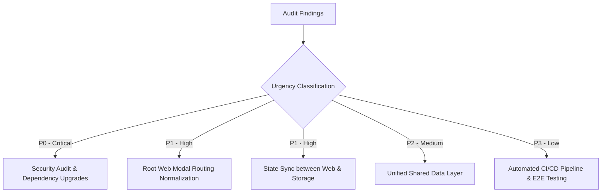

# PROJECT AUDIT: SYARIAH DIGITAL CHECK
**Document Version:** 1.0.0  
**Audit Date:** 20 November 2026  
**Auditor Roles:** Senior Full-Stack Engineer, Software Architect, Product Reviewer  
**Repository:** `Maverick-list/Syariah-Digital-Check`  
**Execution Environment:** Linux x86_64, Node.js v20.x, Python 3.14.4  

---

## EXECUTIVE SUMMARY

Syariah Digital Check is an educational digital fintech decision-support platform designed for the Indonesian market. Its mission is captured in the tagline: **"Cerdas Sebelum Transaksi, Bijak dalam Pilihan"** (*Smart Before Transacting, Wise in Choices*).

The platform serves as a critical pre-transaction checkpoint utilizing the **PAUSE → CHECK → CHOOSE** framework to prevent Muslims and the broader public from falling into digital financial traps including Riba (usury/interest loans), Gharar (excessive uncertainty/obscurity), and Maysir (gambling/speculative schemes).

### Key Architectural Finding: Tri-Platform Ecosystem
The repository currently maintains three distinct architectural tiers:
1. **Root Native Responsive Web Application (`index.html` & `Syariah_Digital_Check_Interactive_Prototype.html`)**: A zero-dependency, ultra-fast single-page web app + PWA running natively across Mobile, Tablet, and Desktop viewports.
2. **Expo React Native Application (`Digital_Check/`)**: A cross-platform mobile/web codebase built with Expo Router 58, React Native 0.88, React 19, TypeScript, and Jest.
3. **Pure Native iOS Application (`SyariahDigitalCheck_iOS/`)**: A Swift 5.9 / SwiftUI package targeting iOS 16+ using MVVM architecture.

---

## 1. PROJECT ARCHITECTURE & DIRECTORY STRUCTURE

```
Syariah-Digital-Check-main/
├── index.html                                 # Primary Native Responsive Web Application (159 KB)
├── Syariah_Digital_Check_Interactive_Prototype.html # Mirror standalone web prototype
├── manifest.json                              # Web App Manifest (PWA)
├── sw.js                                      # Service Worker for offline asset caching
├── assets/                                    # PWA and web brand icons (192, 512, apple-touch)
├── DESIGN_SYSTEM_AND_UX_SPEC.md              # Canonical design tokens & UX specifications
├── Syariah_Digital_Check_UI_UX_Design_Guide.pdf # Official design & screen inventory manual
├── a_wide_clean_presentation_board_ui_design_mocku.png # Design board visual reference
├── docs/                                      # Engineering, QA, and architectural documentation
│   ├── DESIGN.md                              # Living design system specification
│   ├── design-audit.md                        # Historical UI/UX audit report
│   ├── design-qa-report.md                    # Visual regression & accessibility verification
│   ├── session-history.md                     # Engineering changelog & sync status
│   ├── PROJECT_AUDIT.md                       # This comprehensive audit document
│   ├── TECHNICAL_ARCHITECTURE.md              # Complete system architecture breakdown
│   ├── FEATURE_INVENTORY.md                   # Granular functional inventory matrix
│   └── DEVELOPMENT_ROADMAP.md                 # Prioritized engineering implementation plan
├── Digital_Check/                             # Expo React Native & TypeScript cross-platform app
│   ├── app/                                   # Expo Router file-based routes
│   │   ├── (tabs)/                            # Main navigation tab screens
│   │   │   ├── index.tsx                      # Dashboard / Home
│   │   │   ├── check.tsx                      # Category selection & check launcher
│   │   │   ├── learn.tsx                      # Learning Center
│   │   │   ├── quiz.tsx                       # Sharia literacy quiz
│   │   │   └── profile.tsx                    # Profile, history, settings
│   │   ├── _layout.tsx                        # Root stack router layout & providers
│   │   ├── checklist.tsx                      # 5-stage interactive transaction checker
│   │   ├── result.tsx                         # Evaluation results & missing items breakdown
│   │   ├── onboarding.tsx                     # Welcome walkthrough (PAUSE → CHECK → CHOOSE)
│   │   ├── progress.tsx                       # Literacy index & activity history
│   │   ├── sources.tsx                        # Fatwa & regulatory bibliography
│   │   ├── splash.tsx                         # Animated splash screen
│   │   └── ui-library.tsx                     # Component design system gallery
│   ├── src/                                   # Domain logic, state, and UI components
│   │   ├── components/                        # Atomic & composite React Native components
│   │   ├── data/                              # Immutable domain datasets (fatwa, lessons, quiz)
│   │   ├── services/                          # Storage abstraction (AsyncStorage)
│   │   ├── store/                             # State store & reducer
│   │   ├── tests/                             # Unit test suite (Jest)
│   │   ├── theme/                             # Color palette and typography tokens
│   │   ├── types/                             # Strong TypeScript type definitions
│   │   └── utils/                             # Scoring, validation, and checklist algorithms
│   ├── package.json                           # NPM dependencies & scripts
│   ├── tsconfig.json                          # TypeScript configuration
│   └── app.json                               # Expo configuration
└── SyariahDigitalCheck_iOS/                   # Pure Swift / SwiftUI iOS implementation
    ├── Package.swift                          # SPM configuration (Swift 5.9, iOS 16+)
    └── Sources/SyariahDigitalCheck/
        ├── Models/                            # Category, ChecklistStep, Lesson, Quiz models
        ├── Theme/                             # ColorTokens.swift
        ├── ViewModels/                        # AppState.swift (ObservableObject)
        └── Views/                             # Native SwiftUI screens
```

---

## 2. FRONTEND FRAMEWORK, DEPENDENCIES & BUILD TOOLS

### A. Root Web Application (`index.html`)
- **Technology Stack:** HTML5 Semantic Structure, Vanilla JavaScript (ES6+), Modern Responsive CSS3 (Grid + Flexbox).
- **Dependencies:** Zero external runtime NPM dependencies. Embedded Google Fonts (*Playfair Display* and *Plus Jakarta Sans*) via Google Fonts CDN.
- **Build System:** Zero-build. Runs directly via any standard HTTP server (`python3 -m http.server`, NGINX, Cloudflare Pages, Vercel, or GitHub Pages).
- **PWA Capabilities:** Service Worker (`sw.js`) with cache-first strategy for core assets (`/`, `/index.html`, `/manifest.json`, and `/assets/*`).

### B. Mobile Codebase (`Digital_Check/`)
- **Framework:** Expo 58 (`expo@~58.0.14`) with Expo Router (`expo-router@~58.0.23`).
- **Core Libraries:** React 19.3.0, React Native 0.88.0, React Native Web 0.21.4, `@react-native-async-storage/async-storage` 2.2.0.
- **TypeScript:** TypeScript `~6.0.3` running in strict mode.
- **Bundler:** Metro Bundler for Native & Web (`npx expo export --platform web`).

---

## 3. BACKEND, DATABASE, APIS & EXTERNAL INTEGRATIONS

### Current State: Client-Side Offline Architecture
1. **No Centralized Cloud Backend:** There is currently no Node.js/Python/Go backend server, no REST API endpoints, and no GraphQL layer.
2. **No Remote Database:** Neither PostgreSQL, MySQL, MongoDB, Firebase, nor Supabase is integrated.
3. **Data Storage Mechanism:**
   - **Root Web App:** Browser `localStorage` (key: `syariah_digital_check_profile`). Stores user display name, initials, and completed checks counter.
   - **Expo App:** Device `@react-native-async-storage/async-storage` (key: `syariah_digital_check_state_v1`). Stores complete state including checks history, active draft, completed lessons, completed scenarios, quiz attempts, and activity logs.
4. **Third-Party Integrations:**
   - No external analytical trackers (zero invasive telemetry, privacy-first).
   - Official fatwa links point to official root domains (`https://dsnmui.or.id`, `https://ojk.go.id`, `https://bappebti.go.id`). No deep scraping or external API dependencies exist.

---

## 4. AUTHENTICATION & USER DATA PERSISTENCE

1. **Authentication Mode:** Pseudo-authentication / Local Identity.
   - Users are not required to create passwords, connect OAuth (Google/Apple), or enter email addresses.
   - Users can optionally provide a display name (validated by regex: maximum 30 characters, letters, numbers, spaces, dots, apostrophes, and hyphens).
2. **Privacy Assessment:** Highly privacy-preserving. No personal financial data, bank statements, or national identity numbers (NIK) are ever collected or transmitted over the network.
3. **Reset & Purge Mechanism:**
   - Both Web and Expo apps provide a one-click local data wipe feature (`confirmResetData()` / `clearState`), completely sanitizing the storage and resetting metrics to zero.

---

## 5. BUSINESS LOGIC & TRANSACTION CHECKER ENGINE

The core of the application is the **5-Stage Checklist**, evaluating the following critical Sharia dimensions:
1. **Akad / Struktur (Structure):** Clarifies the underlying contract (Murabahah, Qardh, Ijarah, Wakalah, or Unknown).
2. **Transparansi (Transparency):** Scrutinizes pricing clarity, hidden administration fees, and late fee consequences.
3. **Mekanisme & Qabdh (Mechanism & Possession):** Verifies physical/constructive delivery of commodities, ensuring transactions avoid selling what one does not own (*la tabi' ma laisa 'indak*).
4. **Kesesuaian Prinsip Syariah (Sharia Principles):** Screens for the primary prohibitions: Riba, Gharar, and Maysir.
5. **Kesiapan Finansial (Financial Readiness):** Assesses user self-awareness and financial affordability, reinforcing *Hifzhul Maal* (protection of wealth).

### Scoring Algorithm Evaluation
The engine calculates an educational compliance ratio:
$$\text{Score} = \text{round}\left(\frac{\text{clearCount} \times 1.0 + \text{partialCount} \times 0.5}{\text{totalQuestions}} \times 100\right)$$
- **Score $\ge 80\%$:** *Tingkat Kejelasan Tinggi* (High Clarity).
- **Score $50\% - 79\%$:** *Perlu Verifikasi Lanjutan* (Needs Further Verification).
- **Score $< 50\%$:** *Potensi Risiko Tinggi* (High Potential Risk).

### Legal & Religious Integrity
> **CRITICAL VERIFICATION:** The application strictly avoids issuing definitive Halal/Haram fatwas or claiming formal sharia certification. It frames every outcome as an educational indicator of transaction clarity, prompting users to verify contracts with certified scholars (DSN-MUI / DPS).

---

## 6. VISUAL AUDIT ACROSS VIEWPORTS

| Viewport Breakpoint | Status | Observations & Layout Quality |
|---|---|---|
| **Mobile (390px)** | **PASSED** | Clean single-column layout. Header switches to brand mark + profile avatar. Bottom navigation bar active with safe-area spacing. Touch targets $\ge 44\text{px}$. Zero horizontal overflow (`overflow-x: hidden`). |
| **Tablet (768px)** | **PASSED** | Adaptive 2-column grids for case studies and learning modules. Top header displays navigation links. Spacing expands gracefully without awkward white-space gaps. |
| **Laptop (1024px)** | **PASSED** | Header displays full desktop navigation with active indicators, "Design Spec" trigger, and "Mulai Cek" CTA. Bottom navigation bar hidden (`display: none`). Home switches to `1.18fr : 0.82fr` split layout. |
| **Desktop (1440px)** | **PASSED** | Full-width container capped at `1280px` max-width. Checklist features sticky left sidebar for stage indicators and right-side question cards. Results page displays gauge dial on the left and actionable items on the right. |

---

## 7. TECHNICAL AUDIT & AUTOMATED CHECKS

### A. Unit Test Suite (`Digital_Check/`)
- **Runner:** Jest 30.5.2 / Jest-Expo 58.0.11
- **Status:** **PASS** (3 test suites, 37 total tests passed)
  - `checklist.test.ts`: 15 tests passed.
  - `store.test.ts`: 11 tests passed.
  - `scoring.test.ts`: 11 tests passed.
- **Execution Time:** ~1.63 seconds.

### B. TypeScript Validation (`Digital_Check/`)
- **Command:** `npm run typecheck` (`tsc --noEmit`)
- **Status:** **PASS** (0 errors detected across all files in `src/` and `app/`).

### C. Production Web Export (`Digital_Check/`)
- **Command:** `npx expo export --platform web`
- **Status:** **PASS** (Bundled 21 static web scripts and assets to `dist/`).

### D. Security Vulnerability Scan (`npm audit`)
- **Result:** 29 vulnerabilities identified in `Digital_Check/node_modules`:
  - **3 High Severity:**
    - `node-forge <=1.4.2`: Multiple vulnerabilities including RSA PKCS#1 v1.5 verification bypass and prototype pollution.
    - `zod <4.6.6`: Memory exhaustion via oversized collections.
  - **26 Moderate Severity:**
    - `glob 9.0.0 - 14.0.1` & `minimatch 7.0.0 - 11.0.0`: Globparts amplification DoS.
    - `uuid <11.1.1`: Missing buffer bounds check in v3/v5/v6.
- **Remediation Note:** Vulnerabilities stem from transitive Expo build dependencies rather than runtime application code.

### E. Code Quality & Linting
- **Status:** No `.eslintrc` or ESLint script configured in `package.json`. Code formatting is currently maintained via manual conventions.

---

## 8. PRIORITIZED ISSUES & RECOMMENDATIONS



### P0 (Critical)
1. **NPM Vulnerability Upgrades:** Upgrade vulnerable transitive dependencies in `Digital_Check` using targeted package overrides (`resolutions` / `overrides` in `package.json`) to mitigate `node-forge` and `zod` security alerts without breaking Expo 58 compatibility.

### P1 (High)
2. **Dedicated Bibliography Modal in Root Web:** In `index.html`, `openSourceRefModal()` currently triggers `modalDesignSystem`. A dedicated `modalSourceRef` should be implemented to display the full list of DSN-MUI fatwas and regulatory references (similar to `sources.tsx` in Expo).
3. **Comprehensive LocalStorage Persistence in Root Web:** Expand `savePersistedState()` in `index.html` to persist not just the profile name and checks count, but also completed lessons (`lessonsRead`), quiz scores (`quizScore`), and checklist history, mirroring the robust AsyncStorage schema of `Digital_Check`.

### P2 (Medium)
4. **Data Normalization & Shared Dataset:** Unify `checklistStages`, `lessonsData`, and `caseStudiesData` between `index.html` and `Digital_Check/src/data/` to eliminate duplicate content maintenance across platforms.

### P3 (Low)
5. **Linting & CI/CD Pipeline:** Add ESLint and Prettier configurations to `Digital_Check`, and establish a GitHub Actions workflow to run `npm test`, `npm run typecheck`, and HTML validation automatically on every push.
