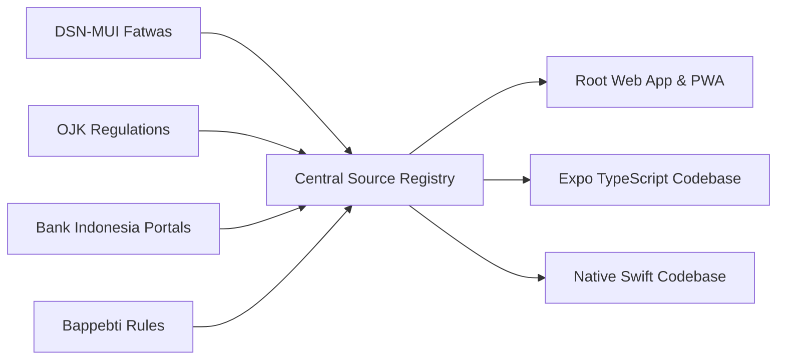

# CANONICAL SOURCE REGISTRY: SYARIAH DIGITAL CHECK
**Knowledge Management System (KMS) — Master Reference Database**  
**Document Version:** 1.0.0  
**Audit Date:** 20 November 2026  
**Verification Policy:** Verified Against Official Government & Scholarly Portals  

---

## 1. REGISTRY OVERVIEW

Registry ini berfungsi sebagai basis data tunggal (*single source of truth*) untuk seluruh rujukan hukum, fatwa syariah, dan regulasi finansial yang digunakan oleh Syariah Digital Check.

---

## 2. DETAILED REFERENCE CATALOG

### A. Fatwa Dewan Syariah Nasional – Majelis Ulama Indonesia (DSN-MUI)

#### 1. `dsnmui-17-2000`
- **Judul Dokumen:** Fatwa DSN-MUI No. 17/DSN-MUI/IX/2000 tentang Sanksi Atas Nasabah Mampu yang Menunda-nunda Pembayaran
- **Nomor Dokumen:** `17/DSN-MUI/IX/2000`
- **Lembaga Penerbit:** Dewan Syariah Nasional – Majelis Ulama Indonesia
- **Tanggal Penetapan:** 23 September 2000 (24 Jumadil Akhir 1421 H)
- **Status Keberlakuan:** `Berlaku`
- **Status Review:** `Published` (Terverifikasi Otoritatif)
- **URL Resmi:** `https://dsnmui.or.id`
- **Klausul Pokok:**
  1. Nasabah mampu yang menunda-nunda pembayaran dan/atau tidak mempunyai kemauan dan iktikad baik untuk membayar hutangnya boleh dikenakan sanksi (*ta'zir*).
  2. Sanksi berupa denda finansial **wajib dialokasikan dan disalurkan 100% untuk dana sosial/kebajikan (Qardhul Hasan)** dan tidak boleh diakui sebagai pos pendapatan atau keuntungan perusahaan kreditur.
- **Konteks Edukasi:** `pembiayaan-digital`, `transparansi-biaya`, Tahap 2 Checklist Transparansi Denda.

---

#### 2. `dsnmui-43-2004`
- **Judul Dokumen:** Fatwa DSN-MUI No. 43/DSN-MUI/VIII/2004 tentang Ganti Rugi (Ta'widh)
- **Nomor Dokumen:** `43/DSN-MUI/VIII/2004`
- **Lembaga Penerbit:** Dewan Syariah Nasional – Majelis Ulama Indonesia
- **Tanggal Penetapan:** 11 Agustus 2004 (25 Jumadil Akhir 1425 H)
- **Status Keberlakuan:** `Berlaku`
- **Status Review:** `Published` (Terverifikasi Otoritatif)
- **URL Resmi:** `https://dsnmui.or.id`
- **Klausul Pokok:**
  1. Ganti rugi (*ta'widh*) hanya boleh dikenakan atas kerugian riil (*real loss*) operasional yang pasti dialami oleh LKS akibat wanprestasi debitur.
  2. Besar ganti rugi tidak boleh melebihi nilai kerugian riil yang dapat dibuktikan, dan dilarang ditetapkan dalam bentuk persentase bunga keuntungan pasti di muka.
- **Pembeda Kritis:** Berbeda dari Ta'zir (Fatwa 17/2000) yang merupakan denda sosial, Ta'widh adalah penggantian biaya riil yang boleh menutupi ongkos penagihan LKS.
- **Konteks Edukasi:** `transparansi-biaya`, `pembiayaan-digital`.

---

#### 3. `dsnmui-04-2000`
- **Judul Dokumen:** Fatwa DSN-MUI No. 04/DSN-MUI/IV/2000 tentang Murabahah
- **Nomor Dokumen:** `04/DSN-MUI/IV/2000`
- **Lembaga Penerbit:** Dewan Syariah Nasional – Majelis Ulama Indonesia
- **Tanggal Penetapan:** 1 April 2000 (26 Dzulhijjah 1420 H)
- **Status Keberlakuan:** `Berlaku`
- **Status Review:** `Published` (Terverifikasi Otoritatif)
- **URL Resmi:** `https://dsnmui.or.id`
- **Klausul Pokok:**
  1. Penjual wajib memberitahukan harga pokok pembelian dan menetapkan margin keuntungan yang disepakati bersama secara transparan.
  2. Barang yang diperjualbelikan harus secara sah dimiliki oleh penjual sebelum diserahterimakan kepada pembeli (*la tabi' ma laisa 'indak*).
- **Konteks Edukasi:** `akad-transaksi-digital`, `pembiayaan-digital`, Kategori Belanja Online.

---

#### 4. `dsnmui-111-2017`
- **Judul Dokumen:** Fatwa DSN-MUI No. 111/DSN-MUI/IX/2017 tentang Akad Jual Beli Murabahah
- **Nomor Dokumen:** `111/DSN-MUI/IX/2017`
- **Lembaga Penerbit:** Dewan Syariah Nasional – Majelis Ulama Indonesia
- **Tanggal Penetapan:** 28 September 2017
- **Status Keberlakuan:** `Berlaku`
- **Status Review:** `Published` (Terverifikasi Otoritatif)
- **URL Resmi:** `https://dsnmui.or.id`
- **Klausul Pokok:**
  1. Penyempurnaan ketentuan akad murabahah modern mencakup janji beli (*wa'ad mulzim*), uang muka (*urbun*), dan penyelesaian bila terjadi penurunan kemampuan bayar nasabah.
  2. Pemisahan tegas antara akad pemberian kuasa (*Wakalah*) untuk memesan barang dengan akad jual beli murabahah pokok.
- **Konteks Edukasi:** `akad-transaksi-digital`, `pembiayaan-digital`.

---

#### 5. `dsnmui-77-2010`
- **Judul Dokumen:** Fatwa DSN-MUI No. 77/DSN-MUI/V/2010 tentang Jual Beli Emas Secara Tidak Tunai
- **Nomor Dokumen:** `77/DSN-MUI/V/2010`
- **Lembaga Penerbit:** Dewan Syariah Nasional – Majelis Ulama Indonesia
- **Tanggal Penetapan:** 3 Juni 2010 (20 Jumadil Akhir 1431 H)
- **Status Keberlakuan:** `Berlaku`
- **Status Review:** `Published` (Terverifikasi Otoritatif)
- **URL Resmi:** `https://dsnmui.or.id`
- **Klausul Pokok:**
  1. Jual beli emas non-tunai (cicilan/tangguh) diperbolehkan karena emas berstatus komoditas (*sil'ah*), bukan mata uang resmi (*tsaman*).
  2. Emas fisik wajib ada pada penjual/kustodian terdaftar, harga cicilan tidak boleh bertambah, dan serah terima secara yuridis (**Qabdh Hukmi**) sah secara hukum.
- **Konteks Edukasi:** `risiko-investasi`, Kategori Emas Digital.

---

#### 6. `dsnmui-116-2017`
- **Judul Dokumen:** Fatwa DSN-MUI No. 116/DSN-MUI/IX/2017 tentang Uang Elektronik Syariah
- **Nomor Dokumen:** `116/DSN-MUI/IX/2017`
- **Lembaga Penerbit:** Dewan Syariah Nasional – Majelis Ulama Indonesia
- **Tanggal Penetapan:** 28 September 2017
- **Status Keberlakuan:** `Berlaku`
- **Status Review:** `Published` (Terverifikasi Otoritatif)
- **URL Resmi:** `https://dsnmui.or.id`
- **Klausul Pokok:**
  1. Akad penempatan dana antara pemegang e-wallet dan penerbit dapat menggunakan akad Wadi'ah atau Qardh.
  2. Penerbit dilarang membungakan saldo uang elektronik dan dana mengendap (*float fund*) wajib ditempatkan pada bank syariah.
- **Konteks Edukasi:** `layanan-keuangan-syariah`, Kategori Tabungan & Dompet Digital.

---

#### 7. `dsnmui-117-2018`
- **Judul Dokumen:** Fatwa DSN-MUI No. 117/DSN-MUI/II/2018 tentang Layanan Pembiayaan Berbasis Teknologi Informasi Berdasarkan Prinsip Syariah
- **Nomor Dokumen:** `117/DSN-MUI/II/2018`
- **Lembaga Penerbit:** Dewan Syariah Nasional – Majelis Ulama Indonesia
- **Tanggal Penetapan:** 27 Februari 2018
- **Status Keberlakuan:** `Berlaku`
- **Status Review:** `Published` (Terverifikasi Otoritatif)
- **URL Resmi:** `https://dsnmui.or.id`
- **Klausul Pokok:**
  1. Layanan pembiayaan fintech wajib terbebas dari Riba, Gharar, Maysir, Tadlis, Dharar, Zhulm, dan Haram.
  2. Mengakomodasi akad pembiayaan anjak piutang, pengadaan barang, dan multiguna berbasis digital.
- **Konteks Edukasi:** `pembiayaan-digital`, Kategori PayLater & Fintech.

---

### B. Regulasi Otoritas Jasa Keuangan (OJK) & Kementerian Terkait

#### 8. `ojk-pojk-40-2024` (Regulasi LPBBTI Aktif & Resmi)
- **Judul Dokumen:** Peraturan Otoritas Jasa Keuangan No. 40 Tahun 2024 tentang Layanan Pendanaan Bersama Berbasis Teknologi Informasi
- **Nomor Dokumen:** `POJK No. 40 Tahun 2024`
- **Lembaga Penerbit:** Otoritas Jasa Keuangan
- **Tanggal Penetapan:** 5 Desember 2024
- **Tanggal Berlaku:** 5 Desember 2024
- **Status Keberlakuan:** `Berlaku`
- **Status Review:** `Published` (Regulasi Terkini)
- **Catatan Pencabutan:** **Mencabut dan menyatakan tidak berlaku POJK No. 10/POJK.05/2022**.
- **URL Resmi:** `https://ojk.go.id`
- **Klausul Pokok:**
  1. Ketentuan tata kelola dan perizinan penyelenggara LPBBTI (Fintech P2P Lending & Digital Financing).
  2. Kewajiban memiliki Dewan Pengawas Syariah (DPS) untuk unit layanan syariah dan perlindungan konsumen digital.
- **Konteks Edukasi:** `pembiayaan-digital`, `transparansi-biaya`.

---

#### 9. `ojk-pojk-10-2022` (Regulasi Historis / Dicabut)
- **Judul Dokumen:** Peraturan Otoritas Jasa Keuangan No. 10/POJK.05/2022 tentang Layanan Pendanaan Bersama Berbasis Teknologi Informasi
- **Nomor Dokumen:** `POJK No. 10/POJK.05/2022`
- **Lembaga Penerbit:** Otoritas Jasa Keuangan
- **Tanggal Penetapan:** 29 Juni 2022
- **Status Keberlakuan:** `Dicabut`
- **Status Review:** `Archived` (Catatan Historis)
- **Peringatan Status Hukum:** Dokumen ini telah **resmi dicabut oleh POJK No. 40 Tahun 2024**. Tidak boleh dijadikan acuan hukum positif aktif.
- **URL Resmi:** `https://ojk.go.id`

---

#### 10. `ojk-seojk-19-2023` (Petunjuk Teknis Batas Manfaat Ekonomi)
- **Judul Dokumen:** Surat Edaran Otoritas Jasa Keuangan No. 19/SEOJK.06/2023 tentang Tata Cara Penyelenggaraan LPBBTI
- **Nomor Dokumen:** `SEOJK No. 19/SEOJK.06/2023`
- **Lembaga Penerbit:** Otoritas Jasa Keuangan
- **Tanggal Penetapan:** 8 November 2023
- **Tanggal Berlaku:** Bertahap mulai 1 Januari 2024 s.d. 2026
- **Status Keberlakuan:** `Berlaku`
- **Status Review:** `Published`
- **URL Resmi:** `https://ojk.go.id`
- **Klausul Pokok:**
  1. Batas maksimum manfaat ekonomi (bunga/margin harian) pendanaan konsumtif: 0.3% per hari (2024), 0.2% (2025), dan 0.1% (2026).
  2. Total akumulasi biaya, bunga, dan denda keterlambatan **maksimal 100% dari nilai pendanaan pokok**.
- **Konteks Edukasi:** `transparansi-biaya`, `pembiayaan-digital`.

---

#### 11. `bappebti-4-2019` (Pasar Fisik Emas Digital)
- **Judul Dokumen:** Peraturan Bappebti No. 4 Tahun 2019 tentang Ketentuan Teknis Penyelenggaraan Pasar Fisik Emas Digital di Bursa Berjangka
- **Nomor Dokumen:** `Peraturan Bappebti No. 4/2019`
- **Lembaga Penerbit:** Badan Pengawas Perdagangan Berjangka Komoditi (Kementerian Perdagangan)
- **Tanggal Penetapan:** 8 Februari 2019
- **Status Keberlakuan:** `Berlaku`
- **Status Review:** `Published`
- **URL Resmi:** `https://bappebti.go.id`
- **Klausul Pokok:**
  1. Kewajiban cadangan fisik emas 100% pada Lembaga Kliring Berjangka dan Tempat Penyimpanan Fisik (kustodian) berizin.
  2. Jaminan hak cetak fisik emas batangan bersertifikat standar internasional bagi seluruh nasabah.
- **Konteks Edukasi:** `risiko-investasi`, Kategori Emas Digital.

---

#### 12. `dsnmui-01-2004` (Bunga / Interest / Fa'idah)
- **Judul Dokumen:** Fatwa DSN-MUI No. 1 Tahun 2004 tentang Bunga (Interest/Fa'idah)
- **Nomor Dokumen:** `01 Tahun 2004`
- **Lembaga Penerbit:** Dewan Syariah Nasional – Majelis Ulama Indonesia
- **Tanggal Penetapan:** 24 Januari 2004 (2 Dzulqa'dah 1424 H)
- **Status Keberlakuan:** `Berlaku`
- **Status Review:** `Published` (Terverifikasi Ijma Nasional)
- **URL Resmi:** `https://dsnmui.or.id`
- **Klausul Pokok:**
  1. Praktek pembungaan uang yang dilakukan oleh lembaga keuangan konvensional memenuhi kriteria Riba Nasi'ah yang diharamkan secara syar'i.
  2. Bunga atas pinjaman uang adalah haram mutlak, baik bersifat konsumtif maupun produktif.
- **Konteks Edukasi:** `transparansi-biaya`, `pembiayaan-digital`, Larangan Riba Pokok.

---

#### 13. `dsnmui-19-2001` (Akad al-Qardh)
- **Judul Dokumen:** Fatwa DSN-MUI No. 19/DSN-MUI/IV/2001 tentang al-Qardh
- **Nomor Dokumen:** `19/DSN-MUI/IV/2001`
- **Lembaga Penerbit:** Dewan Syariah Nasional – Majelis Ulama Indonesia
- **Tanggal Penetapan:** 18 April 2001 (24 Muharram 1422 H)
- **Status Keberlakuan:** `Berlaku`
- **Status Review:** `Published`
- **URL Resmi:** `https://dsnmui.or.id`
- **Klausul Pokok:**
  1. Akad Qardh adalah penyediaan dana pinjaman kebajikan tanpa meminta imbalan tambahan apa pun dari penerima pinjaman.
  2. Biaya administrasi hanya boleh dibebankan sebesar biaya riil operasional (*real cost*) dan **dilarang ditetapkan dalam bentuk persentase dari pokok pinjaman**.
- **Konteks Edukasi:** `pembiayaan-digital`, `transparansi-biaya`, Kategori PayLater/Pinjol.

---

#### 14. `dsnmui-80-2011` (Pasar Modal Syariah / Efek Ekuitas)
- **Judul Dokumen:** Fatwa DSN-MUI No. 80/DSN-MUI/III/2011 tentang Penerapan Prinsip Syariah dalam Mekanisme Perdagangan Efek Bersifat Ekuitas di Pasar Reguler Bursa Efek
- **Nomor Dokumen:** `80/DSN-MUI/III/2011`
- **Lembaga Penerbit:** Dewan Syariah Nasional – Majelis Ulama Indonesia
- **Tanggal Penetapan:** 8 Maret 2011 (3 Rabiul Akhir 1432 H)
- **Status Keberlakuan:** `Berlaku`
- **Status Review:** `Published`
- **URL Resmi:** `https://dsnmui.or.id`
- **Klausul Pokok:**
  1. Perdagangan saham di pasar reguler bursa efek sah jika emiten memenuhi prinsip syariah dan terdaftar pada Daftar Efek Syariah (DES).
  2. Larangan transaksi spekulatif dan manipulatif: *short selling* (menjual saham yang belum dimiliki), *margin trading* berbunga, *insider trading*, *cornering*, dan *wash sale* (*najsy*).
- **Konteks Edukasi:** `risiko-investasi`, Kategori Investasi Saham Syariah.

---

#### 15. `dsnmui-82-2011` (Tawarruq / Murabahah Komoditi)
- **Judul Dokumen:** Fatwa DSN-MUI No. 82/DSN-MUI/VIII/2011 tentang Perdagangan Komoditi Berdasarkan Prinsip Syariah di Bursa Komoditi
- **Nomor Dokumen:** `82/DSN-MUI/VIII/2011`
- **Lembaga Penerbit:** Dewan Syariah Nasional – Majelis Ulama Indonesia
- **Tanggal Penetapan:** 25 Agustus 2011 (25 Ramadhan 1432 H)
- **Status Keberlakuan:** `Berlaku`
- **Status Review:** `Published`
- **URL Resmi:** `https://dsnmui.or.id`
- **Klausul Pokok:**
  1. Penggunaan skema komoditi syariah (Tawarruq / Murabahah Komoditi) untuk kebutuhan likuiditas sah apabila komoditas nyata ada di bursa dan terjadi serah terima sah.
  2. Larangan keras rekayasa lingkaran semu (*bai' al-'inah*) di mana komoditas kembali dibeli oleh penjual pertama tanpa pengalihan kepemilikan riil.
- **Konteks Edukasi:** `pembiayaan-digital`, `risiko-investasi`.

---

#### 16. `dsnmui-135-2020` (Saham Syariah)
- **Judul Dokumen:** Fatwa DSN-MUI No. 135/DSN-MUI/V/2020 tentang Saham
- **Nomor Dokumen:** `135/DSN-MUI/V/2020`
- **Lembaga Penerbit:** Dewan Syariah Nasional – Majelis Ulama Indonesia
- **Tanggal Penetapan:** 20 Mei 2020
- **Status Keberlakuan:** `Berlaku`
- **Status Review:** `Published`
- **URL Resmi:** `https://dsnmui.or.id`
- **Klausul Pokok:**
  1. Saham diakui sebagai bukti kepemilikan proporsional atas aset dan modal perseroan yang halal.
  2. Hak dividen dan suara dalam RUPS sah dimiliki oleh pemegang saham syariah.
- **Konteks Edukasi:** `risiko-investasi`, Kategori Investasi Saham Syariah.

---

#### 17. `mui-ijtima-kripto-2021` (Cryptocurrency & Aset Kripto)
- **Judul Dokumen:** Keputusan Ijtima Ulama Komisi Fatwa MUI VII Tahun 2021 tentang Hukum Uang Kripto (Cryptocurrency)
- **Nomor Dokumen:** `Ijtima Ulama VII/2021`
- **Lembaga Penerbit:** Komisi Fatwa Majelis Ulama Indonesia
- **Tanggal Penetapan:** 11 November 2021
- **Status Keberlakuan:** `Berlaku`
- **Status Review:** `Published` (Keputusan Ijtima Nasional)
- **URL Resmi:** `https://mui.or.id`
- **Klausul Pokok:**
  1. Cryptocurrency **haram sebagai mata uang** karena mengandung gharar, dharar, dan melanggar UU No. 7 Tahun 2011 (alat tukar resmi di Indonesia hanyalah Rupiah).
  2. Cryptocurrency sebagai aset digital/komoditas **tidak sah diperjualbelikan** jika mengandung gharar, dharar, spekulasi judi (qimar/maysir), tidak ada underlying asset riil, dan tanpa manfaat halal yang jelas.
  3. Aset kripto yang memiliki underlying asset nyata dan memiliki manfaat riil (*sil'ah*) sah untuk diperdagangkan.
- **Konteks Edukasi:** `risiko-investasi`, Kategori Kripto & Aset Digital.

---

#### 18. `ojk-pojk-15-2015` (Prinsip Syariah di Pasar Modal)
- **Judul Dokumen:** Peraturan Otoritas Jasa Keuangan No. 15/POJK.04/2015 tentang Penerapan Prinsip Syariah di Pasar Modal
- **Nomor Dokumen:** `POJK No. 15/POJK.04/2015`
- **Lembaga Penerbit:** Otoritas Jasa Keuangan
- **Tanggal Penetapan:** 3 November 2015
- **Status Keberlakuan:** `Berlaku`
- **Status Review:** `Published`
- **URL Resmi:** `https://ojk.go.id`
- **Klausul Pokok:**
  1. Kriteria penapisan (*screening*) Daftar Efek Syariah (DES): rasio utang berbasis bunga dibanding total aset maksimal 45%, dan pendapatan non-halal dibanding total pendapatan usaha maksimal 10%.
  2. Kewajiban sertifikasi Ahli Pasar Modal Syariah (ASPM) dan Dewan Pengawas Syariah bagi manajer investasi syariah.
- **Konteks Edukasi:** `risiko-investasi`, Kategori Investasi Saham Syariah.

---

### C. Portal Resmi Lembaga Otoritas
- **`dsnmui-portal`**: Portal Resmi DSN-MUI (`https://dsnmui.or.id`) — Basis naskah fatwa ekonomi syariah.
- **`ojk-portal`**: Portal Resmi OJK (`https://ojk.go.id`) — Pengecekan daftar entitas berizin dan portal pengaduan konsumen.
- **`bi-portal`**: Portal Resmi Bank Indonesia (`https://www.bi.go.id`) — Sistem pembayaran, QRIS, dan stabilitas moneter syariah.
