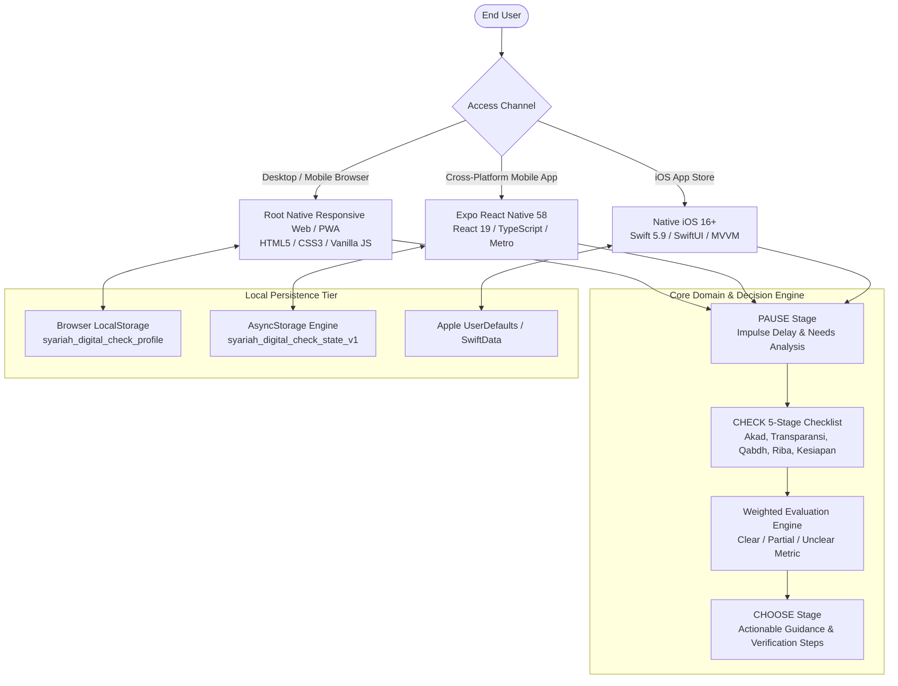
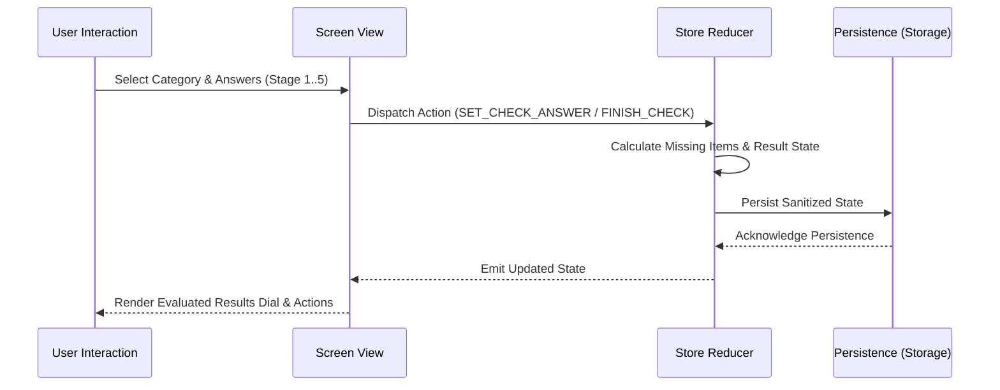

# TECHNICAL ARCHITECTURE: SYARIAH DIGITAL CHECK
**System Architecture Specification**  
**Document Version:** 1.0.0  
**Target:** Multi-Platform Islamic Fintech Literacy Platform (Web PWA, Expo Mobile/Web, Native iOS)  

---

## 1. SYSTEM OVERVIEW

Syariah Digital Check is architected as an offline-first, client-side, privacy-preserving decision-support tool. It empowers users to evaluate financial agreements, digital contracts, and fintech products against classical and contemporary Islamic commercial jurisprudence (Fiqh Muamalah) and DSN-MUI (National Sharia Board – Indonesian Ulema Council) guidelines.



---

## 2. MULTI-TARGET PLATFORM ARCHITECTURES

### A. Root Standalone Web Application (`index.html`)
- **Pattern:** Single-Page Application (SPA) with Hash-based Client-Side Routing.
- **Runtime:** Native browser JS runtime without polyfills or bundlers.
- **Routing Engine:**
  - `navigateTo(screenId)` dynamically toggles active classes on `<section class="screen">` containers.
  - Bidirectional hash routing supports deep linking: `#home`, `#categories`, `#checklist`, `#result`, `#learn`, `#casestudies`, `#quiz`, `#progress`, and `#profile`.
- **Styling Architecture:**
  - Zero CSS framework (no Tailwind, Bootstrap, or styled-components).
  - Modern CSS Custom Properties (CSS variables) driving typography, spacing, elevations, and palette tokens.
  - Pure CSS Grid and Flexbox layouts supporting responsive transitions across 390px, 768px, 1024px, and 1440px.
- **Service Worker (`sw.js`)**:
  - Implements an offline cache-first strategy targeting core assets (`/index.html`, `/manifest.json`, and `/assets/*`).

### B. Expo Cross-Platform Codebase (`Digital_Check/`)
- **Pattern:** File-Based Routing via Expo Router 58.
- **Component Model:** Strongly typed functional React 19 components with React Native primitives (`View`, `Text`, `Pressable`, `ScrollView`).
- **Web Compilation:** Uses `react-native-web` to transpile components into semantic HTML5/CSS elements.
- **Testing Architecture:** Jest-Expo preset with `@testing-library/react-native` executing unit tests for store reducers, scoring algorithms, and checklist validations.

### C. Native iOS Codebase (`SyariahDigitalCheck_iOS/`)
- **Pattern:** Model-View-ViewModel (MVVM) utilizing Swift 5.9 and SwiftUI.
- **State Flow:** `AppState: ObservableObject` acts as the central single source of truth across views.
- **Platforms:** iOS 16.0+, macOS 13.0+.

---

## 3. STATE MANAGEMENT & DATA FLOW

### Data Flow Diagram (Expo & Web)


### Domain Data Schema
```typescript
export interface PersistedState {
  version: 1;
  onboardingDone: boolean;
  displayName: string;
  checks: CheckRecord[];
  draft: ChecklistDraft | null;
  lessonsRead: string[];
  scenariosDone: string[];
  quizAttempts: QuizAttempt[];
  activity: ActivityEntry[];
}

export interface CheckRecord {
  id: string;
  date: string;
  category: TransactionCategory;
  answers: ChecklistAnswers;
  resultState: 'understood' | 'needs_checking' | 'not_understood';
  unresolvedCount: number;
}
```

---

## 4. CORE BUSINESS LOGIC & ALGORITHMS

### 1. Checklist Evaluation Algorithm
The 5-stage checklist inspects five critical vectors: `structure`, `transparency`, `mechanism`, `sharia`, and `readiness`. Each answer yields an `AnswerStatus`:
- `'clear'`: The clause or contract structure is fully transparent and compliant.
- `'partial'`: Information is partially provided or requires confirmation.
- `'unknown'`: Unchecked, unknown, or speculative.

```typescript
export function computeResult(
  answers: ChecklistAnswers,
  category: TransactionCategory,
): CheckResult {
  const missing = unresolvedSteps(answers);
  const readiness = statusOf('readiness', answers.readiness);

  let state: CheckResult['state'];
  if (missing.length === 0) state = 'understood';
  else if (readiness === 'unknown' || missing.length >= 3) state = 'not_understood';
  else state = 'needs_checking';

  return {
    state,
    title: copy[state].title,
    description: copy[state].description,
    missing,
    questions: [...GENERIC_QUESTIONS, ...cat.extraQuestions],
    lessonIds: cat.lessonIds,
    sourceIds: cat.sourceIds,
  };
}
```

### 2. Literacy Progress Formula
The overall literacy index measures learning engagement rather than formal compliance:
$$\text{Literacy Progress} = \min\left(100, \left(C_{\text{check}} + L_{\text{read}} + S_{\text{scenario}} + Q_{\text{quiz}}\right)\right)$$
- $C_{\text{check}}$: Completed checks ($\ge 1 \implies 25\%$).
- $L_{\text{read}}$: Lesson completion ratio ($\frac{\text{completed}}{\text{total}} \times 35\%$).
- $S_{\text{scenario}}$: Case study completion ratio ($\frac{\text{completed}}{\text{total}} \times 15\%$).
- $Q_{\text{quiz}}$: Best quiz score percentage ($Q_{\text{best}} \times 25\%$).

---

## 5. DESIGN SYSTEM & TOKEN MAPPING

```css
:root {
  /* Primary Islamic Fintech Palette */
  --emerald-950: #032115; /* Deep luxury backdrop */
  --emerald-900: #064E3B; /* Primary brand hue (11.2:1 contrast ratio) */
  --emerald-800: #065F46; /* Interactive hover & active links */
  --emerald-700: #047857; /* Focus rings & active tabs */
  --emerald-600: #059669; /* Accent badges */
  --emerald-50:  #ECFDF5; /* Soft tinted surface */

  /* Neutral Warm Canvas */
  --ivory-50:    #FAF8F5; /* Main application background */
  --ivory-100:   #F4EFE6; /* Surface cards & subtle borders */
  --ivory-200:   #E8DFD1; /* Input borders & dividers */

  /* Prestige Gold Accent */
  --gold-500:    #C89D42; /* Primary gold accent */
  --gold-600:    #A8802E; /* Accessible text gold */
  --gold-100:    #FDF6E2; /* Subtle gold badge background */

  /* Typography */
  --font-serif:  'Playfair Display', Georgia, serif;
  --font-sans:   'Plus Jakarta Sans', system-ui, -apple-system, sans-serif;
}
```

### Responsive Layout Grid Architecture
- **Desktop (1024px+):**
  - Sticky Top Navigation Bar with brand mark, tagline, 6 navigation links, and profile badge.
  - Multi-column grids: Home (60/40 split), Checklist (35/65 split with sticky stage sidebar), Results (40/60 split with sticky gauge card).
  - Bottom navigation bar: `display: none !important`.
- **Mobile (<1024px):**
  - Top Navigation condensed to brand logo + profile avatar.
  - Bottom Navigation Bar active with 5 quick-access tabs (`Beranda`, `Cek`, `Belajar`, `Kasus`, `Kuis`).
  - Safe-area bottom padding (`env(safe-area-inset-bottom)`).

---

## 6. SECURITY, ACCESSIBILITY & DATA INTEGRITY

1. **Zero External Data Leakage:** All computations occur strictly in-memory within the client's device. No financial transaction descriptions or answers are sent to remote analytics or third-party servers.
2. **WCAG 2.1 AAA Accessibility Compliance:**
   - Emerald Green `#064E3B` on Warm Ivory `#FAF8F5` achieves an **11.2:1 contrast ratio** (exceeding the 7:1 AAA standard).
   - Touch targets for interactive buttons, checkboxes, and tabs are sized at $\ge 44 \times 44\text{px}$.
3. **PWA Offline Resilience:**
   - The application functions 100% offline once cached by the Service Worker, ensuring users can evaluate agreements even in locations with poor internet connectivity.
